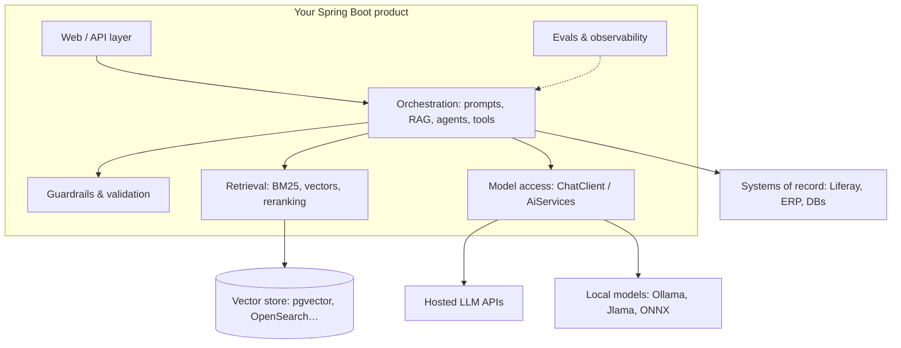

## Why it matters

You already know how to build enterprise software: transactions, security, integration, deployment, delivery. What has changed is that one component of the system — the model — is **probabilistic, expensive per call, and can be wrong with full confidence**. AI engineering is the discipline of building dependable products around that component.

The job is mostly *not* training models. A realistic split of an AI engineer's time on an enterprise product:

| Activity | Share | You already know… |
|---|---|---|
| Integration: data access, APIs, auth, tool calling | 30% | Spring, REST, Liferay headless APIs |
| Retrieval: ingestion, chunking, search, ranking | 20% | Elasticsearch/Solr in Liferay |
| Evaluation and testing | 20% | JUnit, CI quality gates |
| Prompt and context design | 10% | — new |
| Operations: cost, latency, observability, safety | 15% | Micrometer, resilience patterns |
| Model internals and customisation | 5% | — new (but needed to make good decisions) |

This course spends real time on that last 5%: you build gradients, a neural network, a tokenizer and a transformer by hand. Without that understanding you cannot reason about why a model fails, what a context window really costs, or whether fine-tuning will help.

## Concept: the AI engineering stack

Three layers matter:

1. **Models** — what they are (Phases 1–5), how to call them (Phase 6), how to customise them (Phase 13).
2. **Context** — what you put in front of the model: prompts (Phase 7), retrieved knowledge (Phases 8–9), tools and agents (Phases 10–11).
3. **Production** — evals (Phase 12), operations (Phase 14), security and governance (Phase 15), architecture (Phase 16) and delivery (Phase 17).

## The Java AI ecosystem

| Library | What it is | Used in |
|---|---|---|
| **Spring AI** | Spring-native portable API: `ChatClient`, `ChatModel`, `EmbeddingModel`, `VectorStore`, advisors, tool calling, MCP, Boot auto-configuration | Phases 6–14 and this app |
| **LangChain4j** | Framework-agnostic: `AiServices` (declarative interfaces), RAG, agents, many providers | Phase 6, 10 |
| **MCP Java SDK** | Official Model Context Protocol SDK (Spring AI builds on it) | Phase 11 |
| **DJL** (Deep Java Library) | Engine-agnostic deep learning: NDArray, PyTorch/ONNX engines, model zoo, Hugging Face tokenizers | Phases 3, 4 |
| **ONNX Runtime (Java)** | Fast CPU/GPU inference of exported models | Phases 4, 13 |
| **Tribuo** | Oracle's classical ML library with provenance tracking | Phase 2 |
| **Jlama** | Pure-Java LLM inference engine using the Vector API | Phase 13 |
| **Vector API** (`jdk.incubator.vector`) | SIMD in pure Java | Phase 1 |

> **Analogy you already own.** Spring AI is to model providers what Spring Data is to databases: a portable programming model with provider-specific modules and auto-configuration. LangChain4j's `AiServices` is closer to Spring Data repositories or Feign — you declare an interface and get an implementation.

## How your experience transfers

- **Spring internals** — `ChatClient` advisors are an interceptor chain, like `HandlerInterceptor` or AOP advice. Tool registries look like a `BeanFactory`. Auto-configuration selects providers exactly as it selects a `DataSource`.
- **Liferay** — you know portals full of unstructured content, permissions, and search. That is exactly the raw material of enterprise RAG. Phases 9, 11 and 16 build AI search and an MCP server over Liferay's headless APIs, with permission-aware retrieval.
- **PMP / PSM** — AI work has more uncertainty than ordinary feature work. Phase 17 adapts estimation, Scrum and risk management to experiments and eval-driven "done".

## Production notes

- Treat every model call as an **unreliable remote dependency** with variable latency (hundreds of ms to tens of seconds) and cost per token. Timeouts, retries, fallbacks and budgets are not optional.
- **Never let model output reach a system of record unvalidated.** Parse, validate and authorise first — the same way you treat user input.
- **Data governance comes first.** Before sending content to a hosted model, know its data classification, the provider's retention terms and your legal basis. A local model (Ollama) is often the first answer for confidential data.

## Exercises

1. **Easy** — List three features in a system you have built that could benefit from an LLM. For each, write one sentence on what could go wrong if the model is confidently wrong.
2. **Medium** — For one of those features, sketch the stack diagram above with concrete components (which data, which retrieval, which model, which guardrail).
3. **Hard** — Write a one-page "AI readiness" note for that feature: data availability and classification, success metric, failure cost, and a build/buy recommendation. You will revisit it in Phase 17.

## Common mistakes

- Starting with a model choice instead of a **success metric**. Define how you will measure "good" before writing a prompt.
- Assuming "AI" means Python. Integration-heavy products are often better in the language the rest of the system uses.
- Skipping fundamentals. Teams that never learn what a token or an embedding is make expensive architecture mistakes (oversized contexts, wrong chunking, misleading evals).

## Further reading

- Chip Huyen, *AI Engineering* (O'Reilly, 2025) — the best book-length overview of the discipline.
- Spring AI reference: <https://docs.spring.io/spring-ai/reference/>
- LangChain4j documentation: <https://docs.langchain4j.dev/>
- Anthropic, "Building effective agents" (2024): <https://www.anthropic.com/research/building-effective-agents>
