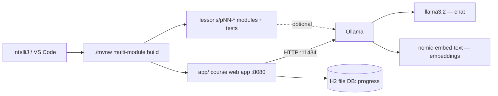

## Why it matters

Every later lesson assumes three things work: a modern JDK, the Maven build of this repository, and a local model server. Set them up once, verify them with code, and you will never lose a study session to environment problems.

## Concept: what runs where



All lesson tests run **without** a model: they use fakes or stubs, so `./mvnw test` is fast and deterministic. A running model is only needed for the interactive parts — the tutor, the playground and the `main()` demos.

## Build it: the setup

### 1. JDK 21 or newer

The course targets Java 21 (LTS) bytecode and uses records, sealed types, pattern matching, virtual threads and `HttpClient`. Any newer JDK works too.

```bash
java -version   # 21 or newer
```

### 2. The repository build

The repository is a Maven multi-module project. You don't need Maven installed — use the wrapper.

```text
pom.xml                 parent: Spring Boot 4.1, Spring AI 2.0, LangChain4j BOMs
app/                    the course web application (this site)
lessons/pNN-*/          one module per phase; every lesson's code + tests
content/pNN-*/          lesson text (Markdown + YAML front matter)
```

```bash
./mvnw test                         # build everything, run every lesson test
./mvnw -pl lessons/p03-neural-networks test    # one phase
./mvnw -pl app spring-boot:run      # start the site on http://localhost:8080
```

### 3. Docker and Ollama

The easiest path is the provided Compose file, which starts Ollama, pulls the two models and starts the app:

```bash
docker compose up -d
```

Or install Ollama natively (better on Apple Silicon / NVIDIA GPUs) and pull the models:

```bash
ollama pull llama3.2           # ~2 GB, 3B parameters, chat
ollama pull nomic-embed-text   # ~270 MB, 768-dim embeddings
ollama pull qwen2.5:3b         # optional second chat model for A/B comparisons
```

### 4. Verify with code

Run the environment check from this phase's module:

<!-- code: lessons/p00-setup/src/main/java/dev/aieng/p00/EnvironmentCheck.java -->

Notice there is no framework here: `java.net.http.HttpClient` (Java 11+) is all you need to talk to a model server. The next lesson builds on that.

## Hardware: what you actually need

| Setup | Good for |
|---|---|
| 16 GB RAM laptop, no GPU | Everything in this course with 1–3B models (slower generation, ~5–20 tokens/s) |
| Apple Silicon 16–32 GB | 7–8B models comfortably via Ollama's Metal backend |
| NVIDIA GPU 8–12 GB VRAM | 7–8B models fast; fine-tuning small models with QLoRA (Phase 13) |
| Hosted API key | Frontier-quality answers; set `AI_CHAT_PROVIDER=openai` (any OpenAI-compatible endpoint) |

Memory rule of thumb for model weights: **parameters × bytes per parameter**. A 3B model at 4-bit quantisation is about 1.5 GB of weights; at FP16 it is about 6 GB.

## Now with the library: switching providers

The app uses Spring AI's provider selection. The defaults live in `app/src/main/resources/application.yml`:

```yaml
spring:
  ai:
    model:
      chat: ${AI_CHAT_PROVIDER:ollama}         # ollama | openai | none
      embedding: ${AI_EMBEDDING_PROVIDER:ollama}
    ollama:
      chat.model: ${OLLAMA_CHAT_MODEL:llama3.2}
      embedding.model: ${OLLAMA_EMBEDDING_MODEL:nomic-embed-text}
```

To use a hosted OpenAI-compatible API instead:

```bash
export AI_CHAT_PROVIDER=openai AI_EMBEDDING_PROVIDER=openai OPENAI_API_KEY=sk-...
./mvnw -pl app spring-boot:run
```

`spring.ai.model.chat` is a Boot condition: only the selected provider's `ChatModel` bean is created, much like choosing one `DataSource` auto-configuration.

## Production notes

- Pin model **versions** (`llama3.2:3b-instruct-q4_K_M`, not `llama3.2`), exactly as you pin library versions. A silently updated model is a silent behaviour change.
- Keep API keys out of `application.yml`; use environment variables or a secret manager.
- In containers, give the model server its own resource limits — a model loading into memory can starve the app.

## Exercises

1. **Easy** — Run `EnvironmentCheck` and get all checks green.
2. **Medium** — Pull a second chat model and compare it with `llama3.2` in the Playground's Prompt lab. Note latency and token counts.
3. **Hard** — Run the app against a hosted provider through the `openai` settings, then switch back. Which settings did you have to change, and why does the embedding provider matter for the semantic index?

## Common mistakes

- Running the app with the embedding model missing: semantic search then shows "failed". Pull `nomic-embed-text` and click *Rebuild semantic index*.
- Changing the embedding model without rebuilding the index. Vectors from different models are not comparable — **never mix embedding models in one index**.
- Giving Docker Desktop too little memory (it defaults to a fraction of system RAM).
- Leaving Ollama's context window (`num_ctx`) at its small default: longer prompts — RAG context included — are **silently truncated**. The course app sets `spring.ai.ollama.chat.num-ctx: 8192`.
- Expecting fast answers on CPU: a 3B model in Docker on a laptop CPU can take one to two minutes for a 400-token answer. Native Ollama with GPU/Metal is many times faster.

## Further reading

- Ollama documentation and model library: <https://ollama.com/library>
- Spring AI Ollama chat: <https://docs.spring.io/spring-ai/reference/api/chat/ollama-chat.html>
- JDK `HttpClient`: <https://docs.oracle.com/en/java/javase/21/docs/api/java.net.http/java/net/http/HttpClient.html>
