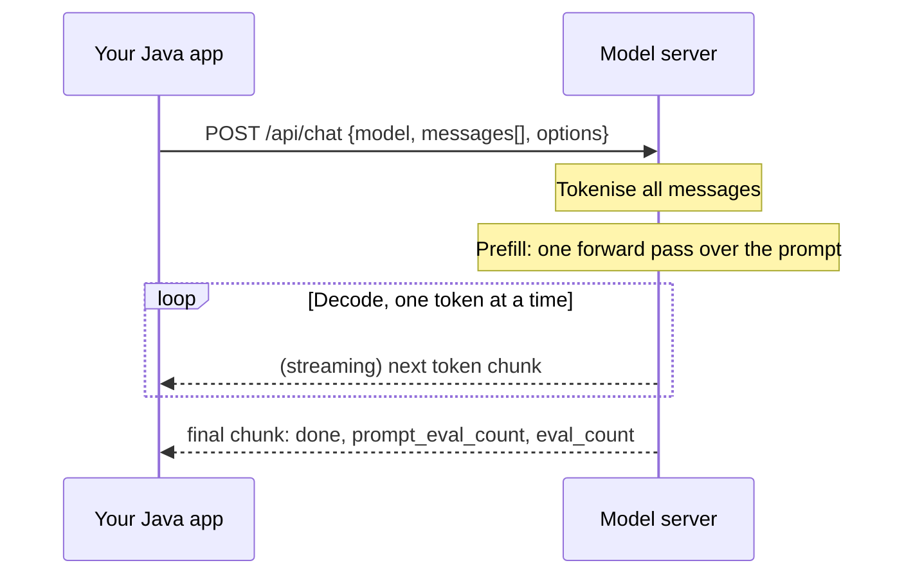

## Why it matters

Before using any framework, see the bare mechanics. A chat model is **a stateless HTTP endpoint**: you send the whole conversation, it returns the next message. Everything else — memory, RAG, tools, agents — is the client deciding what to put in that request.

## Concept: request, prefill, decode



Two numbers drive cost and latency:

- **Input (prompt) tokens** — everything you send, including the system prompt, history and retrieved documents. Processed in parallel during *prefill*.
- **Output (completion) tokens** — generated one at a time during *decode*. Usually several times more expensive per token on hosted APIs, and the main driver of latency.

A useful latency model: `latency ≈ TTFT + output_tokens / tokens_per_second`.

## Build it from scratch

The client below is the whole idea: serialise, POST, parse. Records give you the JSON shape for free with Jackson.

<!-- code: lessons/p00-setup/src/main/java/dev/aieng/p00/RawOllamaClient.java#blocking -->

Streaming uses the same endpoint with `"stream": true`. Ollama answers with newline-delimited JSON; hosted APIs typically use Server-Sent Events. Either way you read chunks as they arrive:

<!-- code: lessons/p00-setup/src/main/java/dev/aieng/p00/RawOllamaClient.java#streaming -->

### Testing without a model

The lesson's test starts a fake Ollama with the JDK's built-in `com.sun.net.httpserver.HttpServer`, so it runs in milliseconds with no network:

<!-- code: lessons/p00-setup/src/test/java/dev/aieng/p00/RawOllamaClientTest.java -->

This pattern — **fake the model at the HTTP boundary** — is how you keep AI code testable. You will use it again with Spring's `MockRestServiceServer` and with stub `ChatModel` beans.

## Now with the library

The same call with Spring AI (Phase 6 goes deep):

```java
String answer = ChatClient.create(chatModel)
        .prompt()
        .system("You are a concise assistant for senior Java engineers.")
        .user("In two sentences: what does an embedding model return?")
        .call()
        .content();
```

What Spring AI adds on top of your raw client: provider portability, retries, observation (Micrometer metrics and traces), advisors (interceptors for memory and RAG), structured output conversion and tool calling.

## Production notes

- **Set timeouts.** A local model on a cold start can take 30+ seconds to load. Use a short connect timeout and a generous but bounded request timeout.
- **Log usage, not content.** Token counts belong in metrics. Prompt content may contain personal data; log it only where policy allows.
- **Stream to users, block for machines.** Stream when a person is waiting; use blocking calls for batch jobs and structured output you must parse whole.

## Exercises

1. **Easy** — Run `RawOllamaClient.main` against your local model. Change `temperature` to 0 and run it twice. Are the answers identical?
2. **Medium** — Add a `maxTokens` option (`num_predict` in Ollama) and observe the `done_reason` field when the limit is hit.
3. **Hard** — Measure TTFT and tokens/second in `stream()` using `System.nanoTime()` and print them. Compare a 1B and a 3B model.

## Common mistakes

- Expecting the model to remember the previous call. It does not; you must send the history.
- Parsing streamed chunks as one JSON document. Each line is its own JSON object.
- Treating `temperature: 0` as fully deterministic. It is much more stable, but batching and floating-point effects on GPUs can still change outputs.

## Further reading

- Ollama API reference: <https://github.com/ollama/ollama/blob/main/docs/api.md>
- OpenAI-compatible Chat Completions format (used by many providers): <https://platform.openai.com/docs/api-reference/chat>
