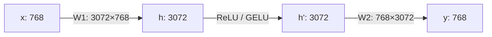

## Why it matters

A neural network layer is $y = Wx + b$: a matrix times a vector, plus a bias. A transformer is mostly large matrix multiplications. A 7-billion-parameter model is a few hundred matrices. When people say "AI needs GPUs", they mean "AI needs fast matrix multiplication".

## Concept

A matrix $W$ with $m$ rows and $n$ columns is a **linear map** from $n$-dimensional vectors to $m$-dimensional vectors. Each output element is the dot product of one row of $W$ with the input:

$$y_i = \sum_{j=1}^{n} W_{ij}\, x_j$$

Multiplying two matrices composes two maps. Shapes must line up: $(n \times k) \cdot (k \times m) = (n \times m)$. Getting shapes right is 80% of debugging neural network code — always write them down.



That diagram is the feed-forward block inside every transformer layer (Phase 5). With a batch of 32 token positions you multiply a $32 \times 768$ matrix instead of one vector — same code, more parallelism.

## Build it from scratch

The data lives in one flat `double[]` in **row-major** order: element $(r, c)$ is at `data[r * cols + c]`.

<!-- code: lessons/p01-math/src/main/java/dev/aieng/p01/Matrix.java#multiply -->

The textbook formula suggests the loop order *i, j, p*. The implementation uses *i, p, j* instead. Both do the same $n \cdot k \cdot m$ multiply-adds, but in *i-p-j* the innermost loop reads `b.data[bRow + j]` and writes `out[outRow + j]` sequentially — perfect for CPU caches. With *i-j-p*, the innermost loop jumps down a column of B, touching a new cache line on every step. On a 1024×1024 multiply the difference is typically 3–10×. The test `cacheFriendlyMultiplyMatchesNaive` proves both orders give the same answer; the exercise asks you to measure the speed.

## Now with the library

You will rarely multiply matrices by hand in production:

| Need | Java option |
|---|---|
| Fast CPU linear algebra | EJML, ND4J, or the Vector API (lesson 7) |
| Deep learning tensors on CPU/GPU | DJL `NDArray` (backed by PyTorch or ONNX Runtime) |
| LLM inference | Ollama / llama.cpp (native), Jlama (pure Java), ONNX Runtime |

```java
// DJL — the same multiply on whatever engine is installed (reference snippet; DJL is not a build dependency)
try (NDManager nd = NDManager.newBaseManager()) {
    NDArray a = nd.randomNormal(new Shape(1024, 1024));
    NDArray b = nd.randomNormal(new Shape(1024, 1024));
    NDArray c = a.matMul(b);   // dispatched to MKL / cuBLAS by the engine
}
```

## Production notes

- **Parameter count = sum of matrix sizes.** A layer with 4,096 inputs and 4,096 outputs has ~16.8M weights. Multiply by bytes per weight to get memory: that is how you size inference hardware.
- **Batching is matrix multiplication.** Model servers batch concurrent requests because a $32 \times d$ multiply costs far less than 32 separate $1 \times d$ ones on a GPU.
- **Memory bandwidth often dominates.** During token generation every weight is read once per token. A 4 GB model on a 100 GB/s machine cannot exceed ~25 tokens/s, whatever the FLOPs say.

## Exercises

1. **Easy** — Compute $\begin{bmatrix}1&2\\3&4\end{bmatrix} \begin{bmatrix}5\\6\end{bmatrix}$ by hand, then with `Matrix.apply`.
2. **Medium** — Write a small benchmark comparing `multiply` and `multiplyNaive` on 512×512 and 1024×1024 matrices. Warm up the JIT first. Explain the ratio.
3. **Hard** — Implement blocked (tiled) multiplication with 64×64 tiles and compare against `multiply`. Then parallelise the outer loop with `IntStream.range(...).parallel()` and measure speed-up vs core count.

## Common mistakes

- Confusing $(m \times n)$ with $(n \times m)$ for weight matrices; frameworks differ (PyTorch's `Linear` stores `out × in`).
- Allocating a new matrix inside a hot training loop — the garbage collector becomes your bottleneck.
- Benchmarking without JIT warm-up. Use JMH for anything you will make decisions on.

## Further reading

- Ulrich Drepper, *What Every Programmer Should Know About Memory* (2007), sections 3 and 6.
- DJL NDArray documentation: <https://docs.djl.ai/>
