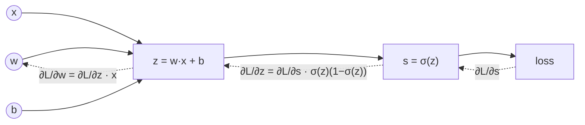

## Why it matters

Training a model means answering one question millions of times: *if I nudge this weight slightly, does the loss go up or down, and by how much?* That answer is a **derivative**. Collected for every weight, it is the **gradient**. The **chain rule** is what makes computing it efficient for deep networks.

## Concept

**Derivative.** For $f(x)$, the derivative $f'(x)$ is the slope: how much $f$ changes per unit change of $x$ near that point.

$$f'(x) = \lim_{h \to 0} \frac{f(x+h) - f(x)}{h}$$

**Partial derivatives and the gradient.** For $f(x_1, \dots, x_n)$, the partial derivative $\partial f / \partial x_i$ is the slope along $x_i$ with everything else held fixed. The gradient stacks them into a vector:

$$\nabla f = \left( \frac{\partial f}{\partial x_1}, \dots, \frac{\partial f}{\partial x_n} \right)$$

It points in the direction of steepest increase. To *decrease* a loss, step the other way.

**Chain rule.** Models are compositions of simple functions. If $y = g(h(x))$:

$$\frac{dy}{dx} = g'(h(x)) \cdot h'(x)$$



Each node only needs to know its own local derivative. Multiplying local derivatives backwards along the graph gives the gradient for every input — that is **backpropagation** (Phase 3).

## Build it from scratch

Numeric derivatives need nothing but function evaluation. The centred difference is far more accurate than the one-sided formula:

<!-- code: lessons/p01-math/src/main/java/dev/aieng/p01/Gradients.java#numeric -->

And the chain rule applied by hand to a single sigmoid neuron:

<!-- code: lessons/p01-math/src/main/java/dev/aieng/p01/Gradients.java#chain -->

The test `chainRuleMatchesNumericGradient` checks the hand-derived formula against the numeric one. That is **gradient checking** — the technique you will use in Phase 3 to prove your autograd engine correct.

## Now with the library

Deep-learning frameworks compute gradients automatically (autograd). In DJL:

```java
// reference snippet (DJL is not a build dependency)
try (NDManager nd = NDManager.newBaseManager(); GradientCollector gc = Engine.getInstance().newGradientCollector()) {
    NDArray w = nd.create(-0.4f);
    w.setRequiresGradient(true);
    NDArray loss = Activation.sigmoid(w.mul(1.7f).add(0.3f));   // σ(w·x + b)
    gc.backward(loss);
    System.out.println(w.getGradient());   // same value as Gradients.sigmoidNeuronGradW
}
```

You build that machinery yourself in Phase 3.

## Production notes

You will rarely write a derivative at work, but gradients explain production behaviour:

- **Fine-tuning instability** (exploding or vanishing gradients) shows up as loss spikes or flat loss curves. Gradient clipping and learning-rate warm-up exist because of this.
- **Adversarial and prompt-injection research** often uses gradients with respect to the *input* to find text that pushes a model towards a target output.
- **LoRA** (Phase 13) works because you only need gradients for a small set of added parameters.

## Exercises

1. **Easy** — Using `Gradients.derivative`, estimate the derivative of $x^3$ at $x = 2$. Compare with $3x^2 = 12$.
2. **Medium** — Derive by hand the gradient of $f(x, y) = x^2 y + \sin(y)$ and check it with `Gradients.gradient`.
3. **Hard** — Derive the gradient of mean squared error $L = \frac{1}{n}\sum (w x_i + b - y_i)^2$ with respect to $w$ and $b$, implement it, and gradient-check it on random data. You will reuse it in Phase 2.

## Common mistakes

- Choosing $h$ too small (1e-12): floating-point cancellation destroys accuracy. 1e-5 to 1e-6 with doubles is the sweet spot.
- Gradient-checking in `float` precision. Always use `double` for checks.
- Forgetting that the gradient points *uphill*.

## Further reading

- 3Blue1Brown, *Essence of Calculus*, chapters 1–4.
- Andrej Karpathy, "Yes you should understand backprop" (2016).
