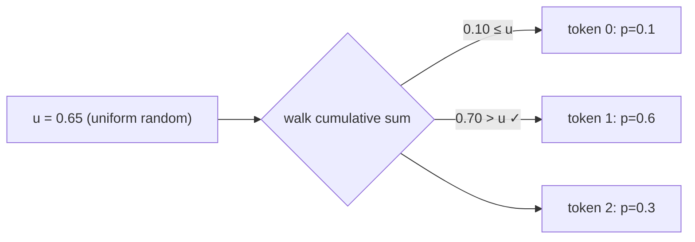

## Why it matters

A language model does not output a word. It outputs a **probability distribution over its whole vocabulary** (often 32,000–200,000 tokens), and then something *samples* from it. Temperature, top-k and top-p — the settings you tune every day — are operations on that distribution. Evaluating classifiers, guardrails and retrieval also comes down to probability, and base rates catch out experienced engineers all the time.

## Concept

- **Random variable and distribution.** A *categorical* distribution assigns a probability $p_i \ge 0$ to each of $n$ outcomes, with $\sum_i p_i = 1$. The next-token distribution is categorical.
- **Expectation.** $\mathbb{E}[X] = \sum_i p_i x_i$ — the probability-weighted average. Training minimises the *expected* loss over the data.
- **Variance.** $\mathrm{Var}(X) = \mathbb{E}[(X - \mu)^2]$ — spread around the mean. Weight initialisation (Phase 3) is chosen to keep activation variance stable through layers.
- **Conditional probability and Bayes' rule.**

$$P(A \mid B) = \frac{P(B \mid A)\, P(A)}{P(B)}$$

- **Gaussian (normal) distribution** — used to initialise weights and to add noise.

### Sampling from a categorical distribution



Lay the probabilities end to end on $[0, 1)$, throw a uniform random dart $u$, and return whichever segment it lands in. More probable tokens own longer segments.

## Build it from scratch

<!-- code: lessons/p01-math/src/main/java/dev/aieng/p01/Probability.java#sample -->

The test `categoricalSamplingMatchesProbabilities` draws 100,000 samples and checks each frequency is within 1% of its probability.

Bayes' rule in code — the fraud example from the quiz:

```java
double pFraudGivenFlag = Probability.bayes(0.99, 0.01, 0.05);  // ≈ 0.167
```

Even with a 99%-sensitive detector, five out of six alerts are false. That is the **base-rate fallacy**, and it applies directly to AI guardrails, toxicity filters and hallucination detectors.

## Now with the library

You never write the sampler yourself in production — the model server does it. You control it with parameters:

```java
ChatOptions options = ChatOptions.builder()
        .temperature(0.2)   // reshapes the distribution (lesson 5)
        .topP(0.9)          // samples only from the smallest set of tokens covering 90% of probability
        .topK(40)           // ... or only from the 40 most likely tokens
        .build();
```

Phase 5 implements temperature, top-k and top-p on top of this lesson's sampler.

## Production notes

- **Low temperature for extraction, classification and code; higher for brainstorming.** Structured-output tasks should be close to deterministic.
- **A seed parameter** (supported by some providers and by Ollama) makes sampling reproducible for tests and evals. Results can still vary across hardware or server versions.
- **Report precision at your real base rate** for any detector you put in front of users.

## Exercises

1. **Easy** — Compute by hand which token is chosen for $p = [0.5, 0.3, 0.2]$ and $u = 0.85$.
2. **Medium** — Sample 10,000 values with `Probability.gaussian` and print a text histogram with 20 buckets.
3. **Hard** — A RAG system answers correctly 92% of the time when retrieval finds the right document and 30% when it does not. Retrieval succeeds 80% of the time. What is the overall accuracy? If a user reports a wrong answer, what is the probability retrieval failed? Code the answer with `Probability.bayes`.

## Common mistakes

- Treating model "confidence" (a token probability) as calibrated correctness probability. LLMs are often poorly calibrated after instruction tuning.
- Ignoring base rates when reading detector metrics.
- Expecting identical outputs at temperature 0.7 between runs.

## Further reading

- Joseph K. Blitzstein & Jessica Hwang, *Introduction to Probability* (free online), chapters 1–3.
- Daniel Kahneman, *Thinking, Fast and Slow*, chapter 16 on base rates.
