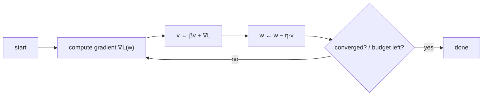

## Why it matters

Every model you will use was produced by an optimiser walking downhill on a loss surface with billions of dimensions. Learning rate, momentum, warm-up and schedules show up as fine-tuning hyperparameters (Phase 13), and "the loss went NaN" is a debugging conversation you will have. This lesson builds the loop on a function you can reason about.

## Concept

**Gradient descent:**

$$w_{t+1} = w_t - \eta \, \nabla L(w_t)$$

where $\eta$ is the **learning rate**.

- Too small: progress is painfully slow.
- Too large: steps overshoot the minimum, the loss oscillates or explodes to infinity.

**Momentum** keeps a running average of gradients (a "velocity") and steps along it:

$$v_{t+1} = \beta v_t + \nabla L(w_t), \qquad w_{t+1} = w_t - \eta\, v_{t+1}$$

In a long narrow valley the gradient points mostly *across* the valley, so plain gradient descent zig-zags. With momentum, the across-valley components alternate in sign and cancel, while the along-valley components add up.



The **Rosenbrock function** $f(x, y) = (1-x)^2 + 100(y - x^2)^2$ has its minimum at $(1, 1)$ at the bottom of a curved, narrow valley — a classic optimiser test.

## Build it from scratch

<!-- code: lessons/p01-math/src/main/java/dev/aieng/p01/GradientDescent.java#minimize -->

Run `GradientDescent.main`. On the reference machine:

```text
momentum=0.0 -> x=(1.0000, 1.0000) f=1.25e-12 after 65395 steps
momentum=0.9 -> x=(1.0000, 1.0000) f=1.24e-12 after 6400 steps
```

Same answer, **ten times fewer steps**. The test `tooHighLearningRateDiverges` shows the other failure: with $\eta = 1.5$ on $f(x) = x^2$, each step multiplies $x$ by $-2$ and the loss explodes. The code detects the non-finite value and throws, the same way a training framework reports NaN loss.

## Now with the library

Real optimisers build on this loop:

| Optimiser | Idea | Where you meet it |
|---|---|---|
| SGD + momentum | This lesson, on mini-batches | Classical deep learning |
| Adam / AdamW | Per-parameter adaptive step sizes from running averages of the gradient and its square | Almost all LLM training and fine-tuning |
| Learning-rate schedules | Warm-up, then cosine or linear decay | Every fine-tuning config |

You implement Adam yourself in Phase 3, lesson 5.

## Production notes

- **Watch loss curves, not just final numbers.** Training loss falling while validation loss rises means overfitting (Phase 2).
- **Warm-up prevents early divergence** when weights and optimiser statistics are still poorly scaled.
- **Gradient clipping** (cap the gradient norm) is a standard safety net for fine-tuning runs.

## Exercises

1. **Easy** — Minimise $f(x) = (x - 3)^2$ with learning rates 0.01, 0.1, 0.9 and 1.1. Record steps to converge or divergence.
2. **Medium** — Add learning-rate decay $\eta_t = \eta_0 / (1 + kt)$ to `minimize` and compare on Rosenbrock.
3. **Hard** — Implement Nesterov momentum (evaluate the gradient at the look-ahead point $w - \eta \beta v$) and compare step counts with classical momentum.

## Common mistakes

- Tuning the number of steps before the learning rate.
- Using the same learning rate for full fine-tuning and LoRA (they differ by roughly 10×).
- Declaring convergence from training loss alone.

## Further reading

- Sebastian Ruder, "An overview of gradient descent optimization algorithms" (2016), arXiv:1609.04747.
- Gabriel Goh, "Why Momentum Really Works", *Distill* (2017).
