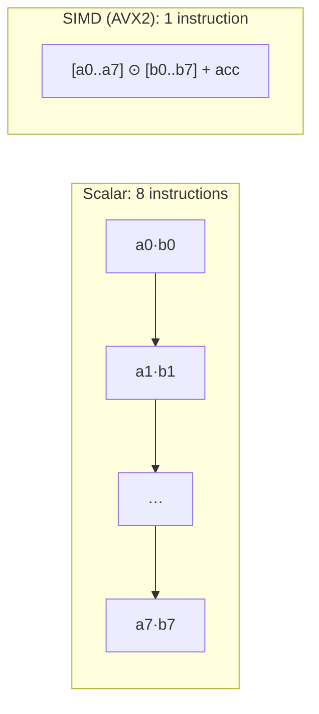

## Why it matters

The previous lessons used plain loops. That is fine for learning, but real inference needs hardware-level parallelism. Modern CPUs can multiply 8 (AVX2), 16 (AVX-512) or 4 (ARM NEON) floats in **one instruction**. The JDK's **Vector API** (Project Panama) exposes that from pure Java — it is how Jlama runs LLMs on the JVM with no native code.

## Concept

- A **species** describes the vector shape: element type and lane count (e.g. 8 floats in 256 bits). `SPECIES_PREFERRED` picks the best for the running CPU.
- **FMA** (fused multiply-add) computes `acc + a * b` in one instruction with one rounding.
- **Reduction** (`reduceLanes(ADD)`) sums the lanes at the end.

The Vector API is still an **incubator module** — you must pass `--add-modules jdk.incubator.vector` to `javac` and `java`. This phase's `pom.xml` shows how to do that in Maven.

## Build it from scratch

<!-- code: lessons/p01-math/src/main/java/dev/aieng/p01/SimdDot.java#simd -->

The test `simdMatchesScalar` uses a length of 1,003 — deliberately not a multiple of any lane count — to exercise the tail loop. The results differ in the last decimals because the SIMD version adds in a different order; floating-point addition is not associative. Run `SimdDot.main` to see your CPU's lane count and a rough speed comparison (use JMH for real measurements).

## Now with the library

| Library | How it uses the hardware |
|---|---|
| **Jlama** | Pure-Java LLM inference; Vector API for matrix-vector products, FFM API for memory-mapped weights |
| **ONNX Runtime Java** | Native C++ kernels (MLAS, oneDNN, CUDA) via JNI |
| **DJL** | Delegates to PyTorch, ONNX Runtime or other native engines |
| **Lucene** | Uses the Vector API for vector-search distance functions (since Lucene 9.7) |

The last row matters for enterprise search: Elasticsearch and OpenSearch run on Lucene, so their vector search already uses this technique.

## Production notes

- **Inference is usually memory-bound, not compute-bound.** Generating one token reads every weight once. Halving bytes per weight (FP16 → INT8 → 4-bit) speeds generation up nearly proportionally — more than any SIMD trick.
- **Incubator APIs change between JDK releases.** Isolate Vector API code behind your own small interface so upgrades are local.
- **Measure on the target hardware.** Containers on cloud VMs may not expose AVX-512; `SPECIES_PREFERRED` adapts at run time, but your throughput estimates must too.

## Exercises

1. **Easy** — Run `SimdDot.main` and record the lane count and the speed ratio.
2. **Medium** — Write a JMH benchmark (`org.openjdk.jmh`) comparing `scalar` and `simd` for lengths 64, 1,024 and 1,048,576. Explain why small sizes gain little.
3. **Hard** — Implement a SIMD matrix-vector product (`float[] rows × float[] x`) and compare it with `Matrix.apply`. Then make it multi-threaded with a parallel stream over rows.

## Common mistakes

- Forgetting `--add-modules jdk.incubator.vector` at **run** time (the compile succeeds, the run fails).
- Expecting bit-identical results between scalar and SIMD code.
- Benchmarking with `System.nanoTime` loops and drawing conclusions — the JIT may eliminate or reorder your code.

## Further reading

- JEP 508: Vector API (Tenth Incubator) and its predecessors: <https://openjdk.org/jeps/508>
- Jlama: <https://github.com/tjake/Jlama>
- Aleksey Shipilëv, JMH samples: <https://github.com/openjdk/jmh/tree/master/jmh-samples>
