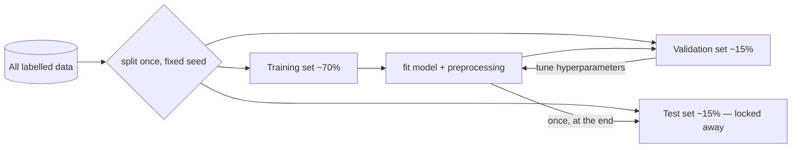

## Why it matters

LLMs are machine-learning models, and every lesson after this one inherits ML's discipline: train on one set, evaluate on another, never let the evaluation data leak into decisions. Even if you never train a classical model in production, you will build **evaluation sets** for RAG and agents (Phase 12), and the same mistakes ruin them.

## Concept

**Supervised learning** finds a function $f$ such that $f(x) \approx y$ for examples you have, and — the hard part — for examples you have not seen.

| Term | Meaning | Example (support tickets) |
|---|---|---|
| Example / row | One observation | One ticket |
| Features $x$ | Inputs | Length, product, words used, customer tier |
| Label $y$ | Known answer | "billing" / "technical" / "account" |
| Model | Function family with parameters | Logistic regression, tree, neural net |
| Loss | How wrong a prediction is | Cross-entropy |
| Training | Choosing parameters that minimise loss on training data | Gradient descent |
| Generalisation | Performance on unseen data | Accuracy on next month's tickets |



**Regression** predicts a number; **classification** predicts a category. **Unsupervised** learning finds structure without labels (clustering, embeddings). **Self-supervised** learning creates labels from the data itself — "predict the next word" is how LLMs are pre-trained.

## Build it from scratch

A dataset is a feature matrix and a target vector. The split shuffles once with a seed — reproducibility is the only way to compare two models fairly:

<!-- code: lessons/p02-classical-ml/src/main/java/dev/aieng/p02/Dataset.java#split -->

Feature scaling is learned from training data, then applied unchanged everywhere else:

<!-- code: lessons/p02-classical-ml/src/main/java/dev/aieng/p02/Dataset.java#standardize -->

The test `scalerUsesTrainingStatisticsOnly` pins that behaviour: a test value of 4 is scaled with the *training* mean and standard deviation.

## Now with the library

Tribuo (Oracle's Java ML library) makes the same steps explicit and records **provenance** — which data, transformations and hyperparameters produced a model — which is valuable for audits:

```java
// reference snippet (Tribuo is not a build dependency of this course)
var splitter = new TrainTestSplitter<>(dataSource, 0.7, 1L);
var train = new MutableDataset<>(splitter.getTrain());
var test  = new MutableDataset<>(splitter.getTest());
Model<Label> model = new LogisticRegressionTrainer().train(train);
LabelEvaluation eval = new LabelEvaluator().evaluate(model, test);
System.out.println(eval.accuracy());
```

## Production notes

- **Split by time or by entity** when examples are correlated. Random splits on time-ordered data let the model "see the future".
- **Version your evaluation data** like code. A changed test set makes historical comparisons meaningless.
- **Label quality caps model quality.** For enterprise classifiers, a few hundred carefully labelled examples often beat thousands of noisy ones — and today an LLM can draft labels for human review.

## Exercises

1. **Easy** — For a problem you know (e.g. routing Liferay form submissions), list five features, the label, and whether it is regression or classification.
2. **Medium** — Modify `split` to produce train/validation/test in one call with fractions 70/15/15.
3. **Hard** — Write a *time-based* split for a dataset with timestamps, and a test proving no training example is later than any test example.

## Common mistakes

- Fitting scalers, vocabularies or imputers on the full dataset.
- Repeatedly checking the test set while tuning.
- Reporting a single split's score without variance (use cross-validation, lesson 5).

## Further reading

- Andrew Ng, *Machine Learning Yearning* (free), chapters 5–12 on dev/test sets.
- Tribuo documentation: <https://tribuo.org/>
