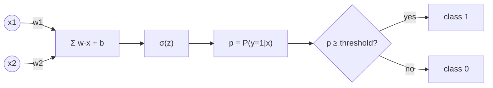

## Why it matters

Logistic regression is a single artificial neuron: weighted sum, then a non-linear "squash". Stack many and you have a neural network (Phase 3). It is also a genuinely useful production tool — logistic regression on top of embeddings is one of the best cost/quality trade-offs for text classification.

## Concept

$$p = \sigma(w \cdot x + b), \qquad \sigma(z) = \frac{1}{1 + e^{-z}}$$

The sigmoid maps any real number to $(0, 1)$, so $p$ can be read as $P(y = 1 \mid x)$.

**Binary cross-entropy loss:**

$$L = -\big[\, y \log p + (1 - y) \log (1 - p) \,\big]$$

This is the two-class version of the cross-entropy you met in Phase 1. Confident wrong answers are punished hard: predicting $p = 0.01$ for a positive example costs $-\log 0.01 = 4.6$.

**The gradient is beautifully simple:** $\partial L / \partial w_j = (p - y)\, x_j$.



**Decision boundary.** The model predicts class 1 when $w \cdot x + b > 0$ — a straight line (a hyperplane in more dimensions). That is its strength (simple, robust) and its limit: it cannot draw a circle. Lesson 6 shows a dataset where it fails.

**L2 regularisation** adds $\lambda \lVert w \rVert^2$ to the loss, which pulls weights towards zero and makes the model less confident and more robust.

## Build it from scratch

<!-- code: lessons/p02-classical-ml/src/main/java/dev/aieng/p02/LogisticRegression.java#fit -->

The test `logisticRegressionSeparatesBlobs` trains on two Gaussian blobs and asserts accuracy above 95% and ROC AUC above 0.98 on the held-out set. `l2ShrinksWeights` proves the regulariser does what it says.

## Now with the library

**Multi-class** classification replaces the sigmoid with softmax over $K$ classes and uses categorical cross-entropy — exactly Phase 1's `Information.crossEntropy`. In LangChain4j and Spring AI, an LLM can also act as a zero-shot classifier:

```java
enum Route { BILLING, TECHNICAL, ACCOUNT }

Route route = chatClient.prompt()
        .user("Classify this support ticket: " + ticket)
        .call()
        .entity(Route.class);   // structured output (Phase 6)
```

That is flexible and needs no training data — but each call costs hundreds of milliseconds and real money. A common production pattern is a **cascade**: an embedding + logistic regression classifier handles confident cases, and only uncertain ones go to the LLM.

## Production notes

- **Pick thresholds from costs, not from 0.5.** Compute expected cost per threshold on validation data.
- **Check calibration.** If the model says 0.8, is it right ~80% of the time? Plot predicted vs observed frequency in bins.
- **Class imbalance:** use class weights or resampling, and evaluate with precision/recall, not accuracy (next lesson).

## Exercises

1. **Easy** — Print the learned weights for the blobs dataset. Why are both weights positive and similar?
2. **Medium** — Implement softmax regression for 3 classes (three weight vectors, categorical cross-entropy) and test it on three blobs.
3. **Hard** — Implement a threshold sweep: for thresholds 0.05…0.95 print precision, recall and expected cost when a false negative costs 10× a false positive. Pick the best threshold.

## Common mistakes

- Treating the output as calibrated probability without checking.
- Forgetting to scale features (gradient descent struggles; L2 penalises features unevenly).
- Using accuracy on imbalanced data.

## Further reading

- Jurafsky & Martin, *Speech and Language Processing* (3rd ed. draft), chapter 5 "Logistic Regression".
