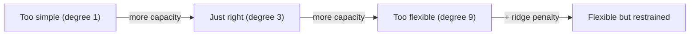

## Why it matters

The single most common way to fool yourself in machine learning is to fit the training data too well. The same failure appears in prompt engineering (a prompt tuned to ten examples), fine-tuning (memorising a small dataset) and RAG tuning (a chunking strategy that only works on the questions you tried).

## Concept

- **Underfitting (high bias):** the model is too simple to capture the pattern. Training and test error are both high.
- **Overfitting (high variance):** the model is flexible enough to fit the noise. Training error is low, test error is high.
- **Regularisation** limits effective flexibility: penalise large weights (L2/ridge), stop early, add data, or simplify the model.



**Ridge loss:** $L = \mathrm{MSE} + \lambda \lVert w \rVert^2$.

**k-fold cross-validation:** split the training data into $k$ folds; train on $k-1$, validate on the remaining one, rotate, and average.

## Build it from scratch

Ridge regression is linear regression with one extra gradient term, $2\lambda w$:

<!-- code: lessons/p02-classical-ml/src/main/java/dev/aieng/p02/Regularization.java#ridge -->

k-fold cross-validation takes a "train and score" function, which keeps it model-agnostic:

<!-- code: lessons/p02-classical-ml/src/main/java/dev/aieng/p02/Regularization.java#kfold -->

### The experiment

`Regularization.main` fits polynomials of degree 1, 3 and 9 to 20 noisy points from $\sin(2\pi x)$ and evaluates on 20 held-out points:

```text
degree  lambda   train MSE   test MSE
     1    0.00      0.1255     0.4175    <- underfits: a line cannot follow a sine
     3    0.00      0.0779     0.1473    <- best generalisation
     3    0.10      0.1292     0.4081    <- too much penalty: back to underfitting
     9    0.00      0.0563     0.2569    <- overfits: lowest train error, worse test error
     9    0.10      0.0866     0.2071    <- ridge pulls the wiggly model back
```

Read the table row by row. Training error falls monotonically with capacity. Test error does not. The right amount of regularisation depends on the model — which is exactly what cross-validation is for.

## Now with the library

Every training framework exposes these knobs:

| Knob | Classical ML | Deep learning / fine-tuning |
|---|---|---|
| Penalty on weights | `lambda`, `alpha`, `C` (inverse) | `weight_decay` (AdamW) |
| Capacity | polynomial degree, tree depth | number of layers, LoRA rank |
| Early stopping | iterations | epochs, eval-loss patience |
| More data | — | data augmentation, synthetic data |

## Production notes

- **Keep a frozen test set** and a separate validation set for tuning. Reusing the test set during tuning turns it into a validation set and inflates your scores.
- **Prompt overfitting is real.** Maintain an eval set of real user questions that the prompt author has *not* looked at while iterating.
- **More data beats clever regularisation** when you can get it — for enterprise problems, collecting real failures from production is the highest-value data you have.

## Exercises

1. **Easy** — Run `Regularization.main` and add degree 15. What happens to train and test MSE?
2. **Medium** — Use `kFold` to pick lambda from {0, 0.001, 0.01, 0.1, 1} for degree 9, then report test MSE once for the chosen value.
3. **Hard** — Implement L1 (lasso) regularisation with the subgradient $\lambda \cdot \mathrm{sign}(w)$. Show that it drives some weights to exactly (or nearly) zero, unlike L2.

## Common mistakes

- Choosing lambda by looking at test error.
- Fitting the scaler on all folds together inside cross-validation.
- Assuming a bigger model is always better without regularisation or more data.

## Further reading

- *An Introduction to Statistical Learning*, chapters 5 (resampling) and 6 (regularisation).
- Belkin et al., "Reconciling modern machine-learning practice and the bias–variance trade-off" (2019) — the "double descent" phenomenon in large models.
