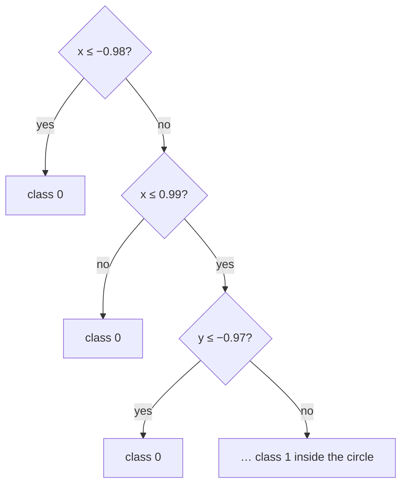

## Why it matters

Not every model is trained by gradient descent. **kNN** is the conceptual basis of vector search and RAG retrieval. **Decision trees** — and their ensembles, random forests and gradient boosting — still win most competitions on *tabular* enterprise data, and they are explainable rule by rule.

## Concept

### k-nearest neighbours

To classify a new point, find the $k$ closest training points and take a majority vote. No training, no parameters except $k$ and the distance function.

- Small $k$ → very flexible (overfits noise). Large $k$ → smooth (underfits).
- Prediction cost is $O(n \cdot d)$ per query — fine for thousands of points, impossible for millions without an index.

### Decision trees

Recursively split the data on the single (feature, threshold) test that makes the children "purest".

$$\text{Gini}(p) = 1 - \sum_k p_k^2$$



A tree approximates the circle with axis-aligned boxes. Depth controls capacity: deeper trees fit more detail and overfit sooner.

## Build it from scratch

kNN in a dozen lines:

<!-- code: lessons/p02-classical-ml/src/main/java/dev/aieng/p02/KNearest.java#predict -->

The tree builder tries every feature and every observed value as a threshold, keeping the split with the lowest weighted child impurity. Sealed interfaces and records make the tree structure explicit:

<!-- code: lessons/p02-classical-ml/src/main/java/dev/aieng/p02/DecisionTree.java#build -->

The test `knnAndTreeLearnANonLinearBoundary` trains kNN, a depth-6 tree and logistic regression on the circle dataset. kNN (>90%) and the tree (>85%) succeed; the linear model cannot.

## Now with the library

| Model | Java library |
|---|---|
| kNN, trees, random forests, gradient boosting | Tribuo, Smile |
| XGBoost / LightGBM models | XGBoost4J; LightGBM via ONNX export |
| Approximate kNN at scale | Lucene HNSW (Elasticsearch/OpenSearch), pgvector, dedicated vector DBs — Phase 8 |

```java
// reference snippet — Tribuo CART tree
var trainer = new CARTClassificationTrainer(6);   // max depth 6
Model<Label> tree = trainer.train(trainingData);
```

## Production notes

- **Tabular data → try gradient-boosted trees before neural networks.** They are fast, strong and need little tuning.
- **Trees are explainable** — the path to a leaf is a human-readable rule, which helps with regulatory requirements such as the EU AI Act's transparency obligations for high-risk systems.
- **kNN-style retrieval needs an index** above a few hundred thousand vectors. Exact search is still the right *evaluation baseline* for measuring an index's recall.

## Exercises

1. **Easy** — Run the circle test with kNN for k = 1, 5, 25 and 101. Explain the accuracy trend.
2. **Medium** — Add a `maxFeatures` option that considers a random subset of features at each split, then build a random forest of 25 trees with bootstrap samples and majority voting.
3. **Hard** — Make the tree builder O(n log n) per feature by sorting each feature once and sweeping thresholds with running counts.

## Common mistakes

- Using kNN without feature scaling (large-range features dominate the distance).
- Growing trees without a depth or sample limit.
- Forgetting that kNN prediction cost grows with the data.

## Further reading

- Breiman et al., *Classification and Regression Trees* (1984) — the original CART.
- Chen & Guestrin, "XGBoost: A Scalable Tree Boosting System", KDD 2016.
