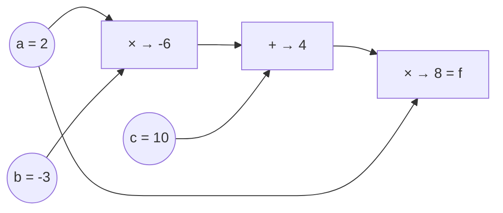

## Why it matters

Every model you will use was trained by backpropagation, and every framework — PyTorch, JAX, DJL — is built around an automatic differentiation engine. Building one yourself turns "the framework computes gradients" from magic into a data structure you understand. It also makes later topics concrete: why memory grows with sequence length during training, why LoRA saves memory, why `zero_grad()` exists.

## Concept

Each `Value` stores:

- `data` — the number,
- `grad` — $\partial L / \partial \text{this}$, filled in by backward,
- its **parents** (the inputs it was computed from),
- a small `backward` closure that applies the chain rule for *this one operation*.



For $f = (a \cdot b + c) \cdot a$ the backward pass walks right to left:

| Node | Local rule | Gradient |
|---|---|---|
| $f$ | seed | 1 |
| $p = ab + c$ | $\partial f / \partial p = a$ | 2 |
| $c$ | $\partial p / \partial c = 1$ | 2 |
| $m = ab$ | $\partial p / \partial m = 1$ | 2 |
| $b$ | $\partial m / \partial b = a$ | $2 \cdot 2 = 4$ |
| $a$ | via $m$: $b \cdot 2 = -6$; via $f$: $p = 4$ | $-6 + 4 = -2$ |

Note $a$: it is used twice, so its gradient is the **sum** of both paths — the reason every backward step uses `+=`.

## Build it from scratch

Each operation creates the output node and attaches its local derivative:

<!-- code: lessons/p03-neural-networks/src/main/java/dev/aieng/p03/Value.java#ops -->

Backward sorts the graph topologically and runs the closures in reverse:

<!-- code: lessons/p03-neural-networks/src/main/java/dev/aieng/p03/Value.java#backward -->

Three tests prove it:

- `valueGradientsMatchHandDerivation` — the table above.
- `reusedNodesAccumulateGradients` — $f = a + a$ gives $\partial f / \partial a = 2$.
- `valueGradientsPassNumericCheck` — a composite of `tanh`, `pow`, `exp`, `log` and `relu` checked against finite differences, the gradient-checking technique from Phase 1.

A fourth test builds a 50,000-node chain. A recursive topological sort would throw `StackOverflowError` — the reason the implementation uses an explicit stack. Real frameworks hit the same issue with very deep unrolled graphs.

## Now with the library

Every deep-learning library exposes the same three ideas — record, backward, read gradients:

```java
// DJL (reference snippet; DJL is not a build dependency)
try (NDManager nd = NDManager.newBaseManager();
     GradientCollector gc = Engine.getInstance().newGradientCollector()) {
    NDArray a = nd.create(2f); a.setRequiresGradient(true);
    NDArray b = nd.create(-3f); b.setRequiresGradient(true);
    NDArray c = nd.create(10f);
    NDArray f = a.mul(b).add(c).mul(a);
    gc.backward(f);
    System.out.println(a.getGradient());   // -2.0, same as our table
}
```

PyTorch: `a.requires_grad_()`, `f.backward()`, `a.grad`. Identical model.

## Production notes

- **Training memory ≈ weights + gradients + optimiser state + saved activations.** Backward needs the forward values (our closures capture `data`), so activation memory grows with batch size and sequence length. Gradient checkpointing trades compute for memory by recomputing them.
- **Inference needs no graph.** Frameworks offer "no-grad" modes because recording the graph costs memory and time — always disable it when serving.
- **LoRA's memory savings** come from only needing gradients and optimiser state for small adapter matrices (Phase 13).

## Exercises

1. **Easy** — Draw the graph for $f = \tanh(w x + b)$ and compute all gradients by hand for $w = 0.5$, $x = 2$, $b = -1$. Check with `Value`.
2. **Medium** — Add `sigmoid()` and `sub(double)` operations with correct backward closures, plus numeric gradient tests.
3. **Hard** — Add a `toDot()` method that outputs the graph in Graphviz DOT format with data and grad in each node, and render the graph of a 2-2-1 MLP.

## Common mistakes

- Using `=` instead of `+=` in backward closures.
- Calling `backward()` twice without resetting gradients (the code resets graph gradients, but parameters in a training loop need explicit zeroing — next lessons).
- Forgetting that `relu`'s derivative at exactly 0 is a convention (0 here).

## Further reading

- Andrej Karpathy, "The spelled-out intro to neural networks and backpropagation: building micrograd" (video, 2022) and <https://github.com/karpathy/micrograd>.
- Baydin et al., "Automatic Differentiation in Machine Learning: a Survey", JMLR 18 (2018).
