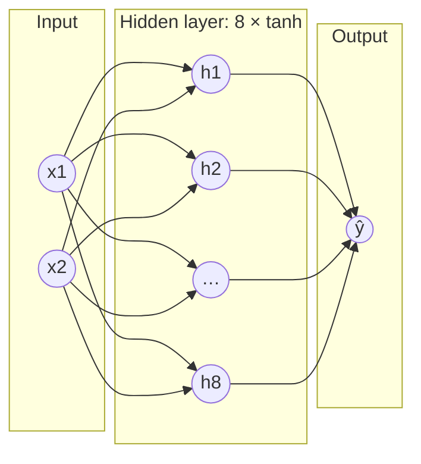

## Why it matters

A neural network is just logistic regression stacked: weighted sums followed by non-linear functions, many times over. A transformer's feed-forward block (Phase 5) is exactly the two-layer MLP you build here, applied to every token.

## Concept

**A neuron:** $\text{out} = \phi(w \cdot x + b)$, where $\phi$ is a non-linear activation such as $\tanh$ or ReLU.

**A layer:** many neurons reading the same input — mathematically $\phi(Wx + b)$.

**An MLP:** layers composed, $f(x) = W_3\, \phi(W_2\, \phi(W_1 x + b_1) + b_2) + b_3$.



**Why non-linearity matters.** Without $\phi$, stacking layers collapses to a single linear map. With it, the hidden layer can bend the input space so the output layer *can* separate it with a line. XOR — output 1 when exactly one input is 1 — is the classic problem a linear model cannot solve.

## Build it from scratch

A neuron, a layer and the network, all on `Value`:

<!-- code: lessons/p03-neural-networks/src/main/java/dev/aieng/p03/Mlp.java#model -->

Weights are initialised with standard deviation $1/\sqrt{\text{fan-in}}$ — lesson 3 explains why. The training loop is the four-step cycle:

<!-- code: lessons/p03-neural-networks/src/main/java/dev/aieng/p03/Mlp.java#train -->

Run `Mlp.main`:

```text
loss after 100 epochs: 0.01247
loss after 200 epochs: 0.00000
[0.0, 0.0] -> -1.000
[0.0, 1.0] -> 1.000
[1.0, 0.0] -> 1.000
[1.0, 1.0] -> -1.000
```

A 2-8-1 network (33 parameters) solves XOR. The test `mlpLearnsXor` asserts it and checks the parameter count: $2 \cdot 8 + 8$ for the hidden layer plus $8 + 1$ for the output.

## Now with the library

```java
// DJL — the same 2-8-1 network (reference snippet)
SequentialBlock net = new SequentialBlock()
        .add(Linear.builder().setUnits(8).build())
        .add(Activation::tanh)
        .add(Linear.builder().setUnits(1).build());
```

Spring AI and LangChain4j never expose layers — they call models over APIs. But when you run a local embedding model through ONNX Runtime or DJL, this is what is inside: stacks of linear layers and activations, just much wider (768–4,096 units) and deeper.

## Production notes

- **Scalar autograd is millions of times too slow** for real networks — each multiply is an object with a closure. Lesson 4 moves to tensors, where one graph node is a whole matrix multiply.
- **Parameter count drives cost.** Learn to compute it quickly: a Linear layer has `in × out + out` parameters.
- **Model size on disk = parameters × bytes per parameter.** That number determines download times, memory and cold-start latency in containers.

## Exercises

1. **Easy** — Train XOR with hidden sizes 2, 4 and 8. Which sizes fail sometimes? Try several seeds.
2. **Medium** — Replace `tanh` with `relu` in hidden layers. What changes in training speed and reliability?
3. **Hard** — Train a 2-16-16-1 network on the circle dataset from Phase 2 (labels −1/+1) and compare its accuracy with kNN.

## Common mistakes

- Forgetting the non-linearity (silently gives you a linear model).
- Using a tanh output when targets are outside $(-1, 1)$.
- Initialising all weights to the same value — every neuron then learns the same thing ("symmetry").

## Further reading

- Michael Nielsen, *Neural Networks and Deep Learning* (free online), chapters 1–2.
- Cybenko, "Approximation by superpositions of a sigmoidal function" (1989).
