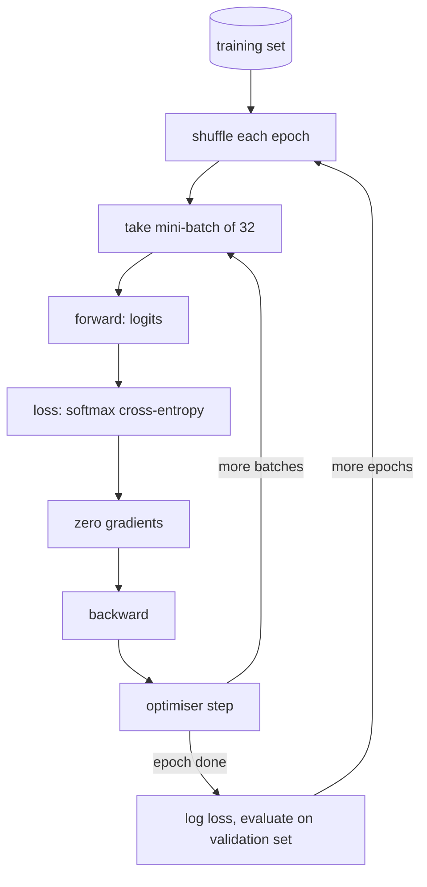

## Why it matters

This is the loop that trains and fine-tunes every model. When you run a fine-tuning job (Phase 13) you configure exactly these pieces — batch size, epochs, learning rate, evaluation strategy — and read exactly these curves.

## Concept



- **Mini-batch gradient descent:** each step uses a small random subset. Cheaper than the full dataset per step, less noisy than one example.
- **Epoch:** one pass over the training data.
- **Validation:** measured on held-out data after each epoch to detect overfitting.

The **spiral dataset** has three interleaved arms — impossible for a linear model, straightforward for a small MLP.

## Build it from scratch

The model is the transformer feed-forward shape at toy scale: Linear → ReLU → Linear.

<!-- code: lessons/p03-neural-networks/src/main/java/dev/aieng/p03/Trainer.java#model -->

The loop:

<!-- code: lessons/p03-neural-networks/src/main/java/dev/aieng/p03/Trainer.java#loop -->

`Trainer.main` trains the same architecture with two optimisers:

```text
SGD+momentum  loss 0.0311  train acc 0.988  validation acc 0.975  (epoch 10 loss 0.183)
Adam          loss 0.0151  train acc 0.996  validation acc 0.983  (epoch 10 loss 0.236)
```

Both reach high validation accuracy; Adam ends with lower loss. Note Adam's higher loss at epoch 10 — early progress is not the whole story.

## Debugging a training run

| Symptom | Likely cause | First action |
|---|---|---|
| Loss stays at $\ln(\text{classes})$ | Gradients not flowing, LR too low, labels shuffled separately from inputs | Overfit a tiny batch |
| Loss → NaN | LR too high, numerical instability | Lower LR, check fused loss, clip gradients |
| Train ≫ validation accuracy | Overfitting | More data, regularisation, early stopping |
| Both accuracies low | Underfitting or bug | Bigger model, more epochs, check preprocessing |
| Loss jumps periodically | Bad batches, data errors | Log per-batch loss, inspect outliers |

## Now with the library

A DJL training setup maps one-to-one onto this loop:

```java
// reference snippet (DJL is not a build dependency)
DefaultTrainingConfig config = new DefaultTrainingConfig(Loss.softmaxCrossEntropyLoss())
        .optOptimizer(Optimizer.adam().optLearningRateTracker(Tracker.fixed(0.01f)).build())
        .addEvaluator(new Accuracy())
        .addTrainingListeners(TrainingListener.Defaults.logging());
try (Trainer trainer = model.newTrainer(config)) {
    EasyTrain.fit(trainer, 300, trainingSet, validationSet);
}
```

And a Hugging Face fine-tuning config names the same knobs: `per_device_train_batch_size`, `num_train_epochs`, `learning_rate`, `eval_strategy="epoch"`.

## Production notes

- **Log everything** — loss per step, learning rate, gradient norm, validation metrics — to a tracking tool (MLflow, Weights & Biases). Training runs are experiments; treat them like auditable records.
- **Fix seeds** and record data versions for reproducibility, but expect small run-to-run variance on GPUs.
- **Checkpoint regularly** and keep the best checkpoint by validation metric, not the last one.

## Exercises

1. **Easy** — Train with batch sizes 8, 32 and 240 (full batch). Compare final validation accuracy and wall-clock time.
2. **Medium** — Add early stopping: stop when validation accuracy has not improved for 20 epochs and restore the best weights.
3. **Hard** — Run the "overfit one batch" sanity check: train on 10 examples until loss < 0.01. Then introduce a bug (shuffle labels independently of inputs) and observe which symptom from the table appears.

## Common mistakes

- Evaluating with the same data you trained on.
- Not zeroing gradients between batches.
- Comparing optimisers at a single learning rate — tune each one.

## Further reading

- Andrej Karpathy, "A Recipe for Training Neural Networks" (2019 blog post).
- Stanford CS231n notes, "Neural Networks Part 3: Learning and Evaluation".
