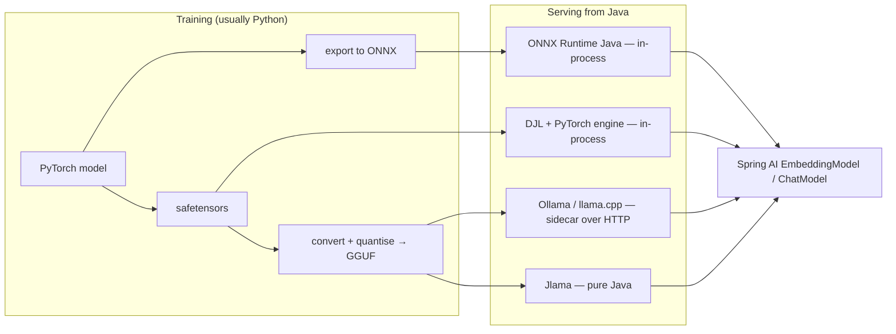

## Why it matters

You will rarely train a large model, but you will often **run** models inside Java services — embedding models, rerankers, classifiers, small LLMs — for latency, cost or data-residency reasons. This lesson connects what you built to the tools you will deploy.

## Concept



| Format | Contains | Typical use |
|---|---|---|
| PyTorch `.pt` / `.bin` | Pickled tensors (can run code on load!) | Legacy checkpoints |
| `safetensors` | Raw tensors + header, safe to load | Hugging Face standard |
| ONNX | Computation graph + weights | Portable inference, ONNX Runtime |
| GGUF | Quantised weights + tokenizer + metadata | llama.cpp, Ollama, Jlama |

## Map: your engine vs the libraries

| You built | DJL | ONNX Runtime |
|---|---|---|
| `Tensor` | `NDArray` | `OnnxTensor` |
| `Trainer.Model` | `Block` / `SequentialBlock` | (inference only) |
| `Optimizers.adam` | `Optimizer.adam()` | — |
| Forward pass | `Predictor.predict` | `OrtSession.run` |

## Now with the library

Running an exported embedding model with ONNX Runtime (reference snippet — `com.microsoft.onnxruntime:onnxruntime` and `ai.djl.huggingface:tokenizers` are not build dependencies of this course because they pull in large native binaries):

```java
try (OrtEnvironment env = OrtEnvironment.getEnvironment();
     OrtSession session = env.createSession("all-MiniLM-L6-v2.onnx", new OrtSession.SessionOptions());
     HuggingFaceTokenizer tokenizer = HuggingFaceTokenizer.newInstance("sentence-transformers/all-MiniLM-L6-v2")) {

    Encoding enc = tokenizer.encode("Spring Boot auto-configuration");
    long[][] ids = {enc.getIds()};
    long[][] mask = {enc.getAttentionMask()};
    long[][] types = {enc.getTypeIds()};
    Map<String, OnnxTensor> inputs = Map.of(
            "input_ids", OnnxTensor.createTensor(env, ids),
            "attention_mask", OnnxTensor.createTensor(env, mask),
            "token_type_ids", OnnxTensor.createTensor(env, types));
    try (OrtSession.Result out = session.run(inputs)) {
        float[][][] tokenVectors = (float[][][]) out.get(0).getValue();  // [batch][tokens][384]
        // mean-pool over tokens (respecting the mask) and L2-normalise -> sentence embedding (Phase 4)
    }
}
```

Spring AI also ships a `TransformersEmbeddingModel` (module `spring-ai-transformers`) that wraps exactly this ONNX + tokenizer pipeline behind the `EmbeddingModel` interface.

## Production notes

- **Never load untrusted pickle checkpoints.** Prefer safetensors, ONNX or GGUF; verify checksums of model files like any other artefact.
- **Warm up** ONNX/DJL sessions at startup — the first inference compiles kernels and allocates memory.
- **Native memory is outside the Java heap.** Size containers for heap + native model memory, and close tensors/sessions (they are `AutoCloseable`) to avoid leaks.
- **Sidecar vs in-process:** in-process is fastest and simplest to secure; a sidecar (Ollama, Text Embeddings Inference) isolates crashes, scales independently and can use a GPU node.

## Exercises

1. **Easy** — For a model you might deploy, list its format, size in GB, and whether it would run in-process or as a sidecar in your environment.
2. **Medium** — Add DJL and ONNX Runtime to a scratch project, run the snippet above with an exported MiniLM model, and implement mean pooling.
3. **Hard** — Wrap the ONNX pipeline as a Spring AI `EmbeddingModel` bean and swap it into the course app in place of Ollama embeddings. Compare semantic-search quality and latency.

## Common mistakes

- Forgetting the tokenizer must match the model exactly.
- Mixing up pooling strategies (CLS vs mean) — the model card tells you which one the model was trained with.
- Not closing native resources.

## Further reading

- DJL: <https://djl.ai/>
- ONNX Runtime Java API: <https://onnxruntime.ai/docs/get-started/with-java.html>
- Hugging Face safetensors: <https://huggingface.co/docs/safetensors>
- GGUF specification: <https://github.com/ggml-org/ggml/blob/master/docs/gguf.md>
