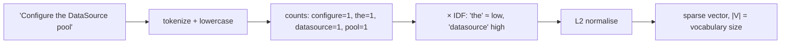

## Why it matters

Models only process numbers. How you turn text into numbers decides what "similar" means. TF-IDF is the representation behind decades of search engines — including the Lucene/Elasticsearch/Solr search inside Liferay — and its successor, BM25, is still half of every good RAG retriever (Phase 8).

## Concept

**One-hot:** each word is a vector with a single 1 in its vocabulary position. Every pair of different words is equally dissimilar — "car" is as far from "automobile" as from "banana".

**Bag of words:** add the one-hot vectors of a document. Word order is lost; counts remain.

**TF-IDF** reweights each count:

$$\text{tfidf}(t, d) = \text{tf}(t, d) \cdot \text{idf}(t), \qquad \text{idf}(t) = \log \frac{1 + N}{1 + \text{df}(t)} + 1$$

- $\text{tf}(t, d)$: how often term $t$ occurs in document $d$.
- $\text{df}(t)$: how many of the $N$ documents contain $t$.

Then L2-normalise each vector and compare with cosine similarity (Phase 1).

**The fundamental limitation:** only identical tokens match. "Oven temperature" and "bake at 220 degrees" share nothing.

## Build it from scratch

<!-- code: lessons/p04-nlp-embeddings/src/main/java/dev/aieng/p04/TfIdf.java#fit -->

The test `tfIdfRanksExactWordMatchesButMissesSynonyms` shows both sides: "datasource pool" finds the right document; "oven temperature" produces an all-zero query vector, so the ranking is meaningless.

## Now with the library

| Need | Java option |
|---|---|
| Full-text search with BM25 | Lucene, Elasticsearch, OpenSearch, Solr |
| Postgres keyword search | `tsvector` / `ts_rank` (built in) |
| Hybrid lexical + vector | Elasticsearch/OpenSearch, pgvector + `tsvector`, Weaviate, Qdrant |

Liferay DXP's search is built on Elasticsearch (or OpenSearch in recent versions), so every Liferay installation already has a BM25 engine — useful for the hybrid retrieval you build in Phase 9.

## Production notes

- **Tokenisation is a product decision.** Lowercasing, stemming, stop words, and how you split `spring-boot-starter-web` or `NullPointerException` all change recall. Test with real queries.
- **Sparse vectors are huge but cheap.** A 100,000-word vocabulary gives 100,000 dimensions, but each document has only a few hundred non-zeros; inverted indexes exploit that.
- **Keep lexical search for identifiers.** Error codes, ticket numbers, class names and part numbers are where embeddings fail most often.

## Exercises

1. **Easy** — Compute by hand the IDF of a word that appears in 1 of 10 documents and of one that appears in all 10.
2. **Medium** — Add bigrams ("data source") as extra vocabulary terms. How does the ranking change for multi-word queries?
3. **Hard** — Write a `SparseVector` (sorted int indices + float values) and reimplement `vector` and the dot product on it. Measure memory for a 10,000-document corpus versus dense arrays.

## Common mistakes

- Fitting the vocabulary on queries or test data.
- Expecting synonyms or paraphrases to match.
- Forgetting to normalise vectors before cosine comparison.

## Further reading

- Manning, Raghavan & Schütze, *Introduction to Information Retrieval* (free online), chapter 6.
- Robertson & Zaragoza, "The Probabilistic Relevance Framework: BM25 and Beyond" (2009).
