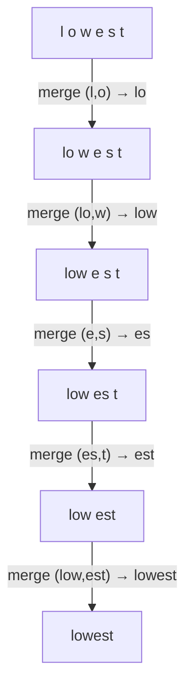

## Why it matters

Every price, limit and latency figure in LLM work is measured in **tokens**. Chunk sizes for RAG are measured in tokens. Many odd model behaviours — trouble spelling, counting characters, or handling long numbers — come from the tokenizer. Building one takes an afternoon and removes the mystery.

## Concept

Word-level vocabularies explode in size and cannot handle unseen words. Character-level sequences are very long. **Byte-Pair Encoding** sits in between:

1. Start with every word split into characters.
2. Count every adjacent pair of symbols across the corpus.
3. Merge the most frequent pair into a new symbol; record the merge.
4. Repeat until the vocabulary reaches the target size (32k–200k for real LLMs).

To **encode** new text, apply the learned merges in the order they were learned.



Frequent words become one token; rare words fall back to several subword pieces; nothing is ever "unknown". Production tokenizers (GPT's `tiktoken`, Llama's SentencePiece) work on **bytes** rather than characters, so any input — emoji, binary, any script — can be encoded.

## Build it from scratch

Training: count pairs, merge the best one, repeat. Ties are broken alphabetically so training is deterministic.

<!-- code: lessons/p04-nlp-embeddings/src/main/java/dev/aieng/p04/Bpe.java#train -->

Encoding applies the earliest-learned applicable merge first, exactly like GPT-2's tokenizer:

<!-- code: lessons/p04-nlp-embeddings/src/main/java/dev/aieng/p04/Bpe.java#encode -->

The tests show the key properties: frequent training words become single tokens (`▁lowest`), an unseen word (`lowness`) is split into known pieces that keep the frequent stem (`▁low…`), and decoding is lossless.

## Now with the library

```java
// Hugging Face tokenizers from Java via DJL (reference snippet; ai.djl.huggingface:tokenizers is not a build dependency)
try (HuggingFaceTokenizer tok = HuggingFaceTokenizer.newInstance("meta-llama/Llama-3.2-1B")) {
    Encoding e = tok.encode("Spring Boot auto-configuration");
    System.out.println(Arrays.toString(e.getTokens()));
    System.out.println(e.getIds().length + " tokens");
}
```

For OpenAI-family models, the pure-Java library **JTokkit** implements `tiktoken`:

```java
Encoding enc = Encodings.newDefaultEncodingRegistry().getEncoding(EncodingType.O200K_BASE);
int tokens = enc.countTokens(prompt);
```

Spring AI uses JTokkit internally for token estimation (`JTokkitTokenCountEstimator`), for example when splitting documents with `TokenTextSplitter` (Phase 9).

## Production notes

- **Count tokens with the target model's tokenizer** when budgeting cost and context. A rule of thumb for English is ~4 characters or ~0.75 words per token; code, JSON and non-English text are often much worse.
- **Chunk by tokens,** not characters, for RAG — otherwise chunks overflow embedding-model limits unpredictably.
- **Identifiers and numbers tokenize strangely.** `getCustomerAccountBalance` may be five tokens; long numbers are split into pieces. This affects both cost and model accuracy on exact-match tasks.

## Exercises

1. **Easy** — Train on a paragraph of your own text with 50 merges and print the merges in order. Which ones appear first?
2. **Medium** — Measure "compression": characters per token on a held-out paragraph, for 10, 50, 200 and 1,000 merges.
3. **Hard** — Make the tokenizer byte-level: operate on UTF-8 bytes (mapped to printable characters as GPT-2 does) so any input — including emoji and Hindi — encodes without unknown symbols. Compare tokens per character for English and another language.

## Common mistakes

- Estimating tokens with `text.length() / 4` for non-English text or code.
- Assuming tokenizers are interchangeable between model families.
- Forgetting that special tokens (system/user markers, BOS/EOS) also consume context.

## Further reading

- Sennrich, Haddow & Birch, "Neural Machine Translation of Rare Words with Subword Units", ACL 2016.
- Andrej Karpathy, "Let's build the GPT Tokenizer" (video, 2024).
- JTokkit: <https://github.com/knuddelsgmbh/jtokkit>
