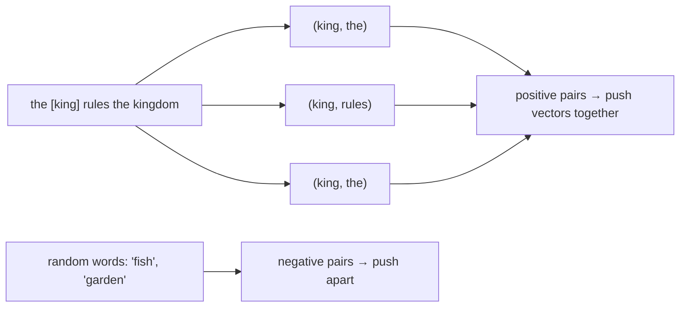

## Why it matters

Word2vec (2013) was the moment NLP discovered that **meaning can be learned as geometry** from raw text. Every embedding model you use for semantic search descends from this idea: train vectors so that things used in similar contexts end up close together.

## Concept

**Distributional hypothesis:** "You shall know a word by the company it keeps" (J.R. Firth, 1957).

**Skip-gram:** for each word in the text (the *centre*), predict the words within a window around it (the *context*).



Each word gets two vectors, *input* (centre) and *output* (context). For a pair, the model predicts $\sigma(v_{\text{centre}} \cdot u_{\text{context}})$: 1 for real pairs, 0 for random negatives. That is **logistic regression on a dot product** — the gradient is the familiar $(p - y)$ times the other vector.

After training, words that appear in similar contexts have similar input vectors. Famous analogies such as $v_{\text{king}} - v_{\text{man}} + v_{\text{woman}} \approx v_{\text{queen}}$ emerge on large corpora.

## Build it from scratch

<!-- code: lessons/p04-nlp-embeddings/src/main/java/dev/aieng/p04/Word2Vec.java#train -->

On a toy corpus about royalty and pets (`Word2Vec.main`):

```text
sim(king, queen) = 0.766
sim(dog, cat) = 0.700
sim(king, dog) = 0.330
sim(crown, fish) = 0.370
```

Nobody told the model that kings and queens are related — they appear in the same contexts ("rules the kingdom", "wears a crown"), so their vectors converge. The test `word2vecGroupsWordsByContext` asserts the ordering.

## Now with the library

You will not train word2vec in production; modern embedding models replace it. But the idea maps directly:

| word2vec | Modern sentence embedding model |
|---|---|
| One vector per word | One vector per text (sentence, paragraph, chunk) |
| Static (no context) | Contextual (transformer encoder, Phase 5) |
| Skip-gram objective | Contrastive objective on (query, relevant passage) pairs |
| Logistic regression with negatives | InfoNCE loss with in-batch negatives |

## Production notes

- **Static embeddings still have uses:** they are tiny and fast for features in classical models, and for keyword expansion ("synonyms" for BM25 queries).
- **Embeddings encode bias in the training text.** Analogy tests famously surface gender and other stereotypes; downstream systems (ranking candidates, routing tickets) can inherit them. Evaluate for it.
- **Domain matters.** Generic embeddings may not know that "DXP", "portlet" and "site" are related in a Liferay context. Domain fine-tuning of embedding models is cheap compared with LLM fine-tuning (Phase 13).

## Exercises

1. **Easy** — Add a sentence about "the prince rules the kingdom" to the corpus and check `sim(prince, king)`.
2. **Medium** — Implement `nearest(word, k)` returning the k most similar words, and print neighbours of "cat" and "crown".
3. **Hard** — Implement subsampling of frequent words (drop "the" and "a" with probability $1 - \sqrt{t/f(w)}$) and show that it improves the king/queen vs king/dog separation.

## Common mistakes

- Evaluating embeddings only on analogies; use downstream task metrics.
- Treating cosine similarity of 0.7 as universally "high" — scales differ per model and corpus.
- Forgetting that out-of-vocabulary words have no vector at all in word-level models (subword models like fastText fix this).

## Further reading

- Mikolov et al., "Distributed Representations of Words and Phrases and their Compositionality", NeurIPS 2013.
- Jay Alammar, "The Illustrated Word2vec" (2019).
- Bolukbasi et al., "Man is to Computer Programmer as Woman is to Homemaker?", NeurIPS 2016.
