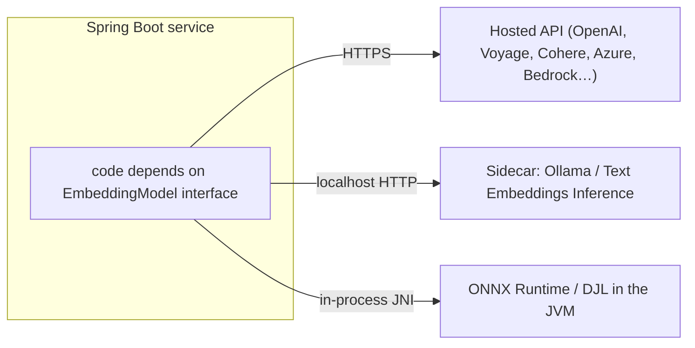

## Why it matters

Embeddings are infrastructure. Once millions of vectors depend on one model, changing it is a migration; running it badly costs money and latency on every query. This lesson turns the previous four into deployment decisions.

## Concept: three deployment shapes



| Shape | Latency | Ops effort | Data leaves your network? | Best for |
|---|---|---|---|---|
| Hosted API | 50–300 ms + network | Lowest | Yes | Prototypes, non-sensitive data, top quality |
| Sidecar (Ollama, TEI) | 5–50 ms | Medium | No | Shared GPU, polyglot clients |
| In-process ONNX | 2–20 ms (CPU, small models) | Medium | No | Low latency, simple deployment, small models |

Because Spring AI abstracts all three behind `EmbeddingModel`, the choice is a configuration and bean decision — not a code rewrite.

## Choosing a model

| Criterion | Question |
|---|---|
| Retrieval quality | MTEB retrieval score in your language(s) — then **your own eval set** |
| Max input tokens | Does your chunk size fit (512? 8,192?) |
| Dimensions | Storage = vectors × dims × bytes; Matryoshka support? |
| Licence | Commercial use allowed? |
| Data residency | Can text leave your network? |
| Cost | Price per million tokens × corpus size × re-embedding frequency |

## Build it: the cost and storage calculator

Back-of-envelope numbers you should be able to produce in a meeting:

```java
long docs = 5_000_000, chunksPerDoc = 6, tokensPerChunk = 400, dims = 1024;
long chunks = docs * chunksPerDoc;                       // 30 M chunks
double storageGb = chunks * dims * 4 / 1e9;              // ≈ 123 GB float32 (≈ 31 GB as int8)
double tokens = chunks * (double) tokensPerChunk;        // 12 B tokens for a full embed
double costUsd = tokens / 1e6 * 0.02;                    // ≈ $240 at $0.02 per M tokens (hosted, illustrative price)
```

Embedding the corpus once is usually cheap; **re-embedding frequently and storing many dimensions** is what gets expensive.

## Now with the library

Switching providers in Spring Boot:

```yaml
# Local (default in this course)
spring.ai.model.embedding: ollama
spring.ai.ollama.embedding.model: nomic-embed-text

# Hosted OpenAI-compatible
spring.ai.model.embedding: openai
spring.ai.openai.embedding.options.model: text-embedding-3-small
spring.ai.openai.embedding.options.dimensions: 512      # Matryoshka truncation server-side
```

For in-process ONNX, Spring AI's `spring-ai-transformers` module provides `TransformersEmbeddingModel`, configured with a model and tokenizer URI.

## Production notes

- **Version everything.** Store `embedding_model` and `embedding_version` on every vector row; refuse queries that would mix versions.
- **Blue/green re-indexing.** Build the new index alongside the old, evaluate recall on a labelled set, switch an alias, then delete.
- **Batch, rate-limit and retry** embedding calls in ingestion jobs (Spring Batch or a Kafka consumer with back-pressure).
- **Monitor drift.** If the average query–top-hit similarity drops over weeks, the content or the users' language changed.

## Exercises

1. **Easy** — Compute storage for your largest content repository at 384, 768 and 1,536 dimensions, float32 and int8.
2. **Medium** — Write a `CachingEmbeddingModel` decorator implementing Spring AI's `EmbeddingModel` that caches by SHA-256 of text + model id in a `ConcurrentHashMap`, with a unit test proving the delegate is called once per unique text.
3. **Hard** — Design (diagram + one page) a blue/green re-embedding process for a 30-million-chunk index with zero downtime, including how you validate the new index before switching.

## Common mistakes

- Hard-coding one provider's client into business code instead of depending on `EmbeddingModel`.
- Re-embedding everything on every deployment.
- Silent truncation of long chunks by the model's token limit.

## Further reading

- Spring AI embedding models overview: <https://docs.spring.io/spring-ai/reference/api/embeddings.html>
- Hugging Face Text Embeddings Inference: <https://github.com/huggingface/text-embeddings-inference>
