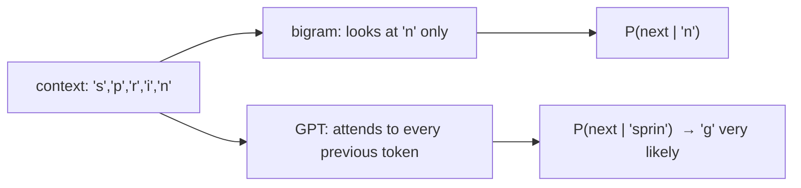

## Why it matters

Every LLM is trained to do one thing: **predict the next token**. Instruction following, coding, reasoning, refusals — all are learned behaviours of a next-token predictor conditioned on the right context. Understanding this objective explains why prompts work, why models hallucinate fluent text, and why context engineering (Phase 7) matters so much.

## Concept

A language model assigns a probability to a sequence by the chain rule of probability:

$$P(t_1, \dots, t_n) = \prod_{i=1}^{n} P(t_i \mid t_1, \dots, t_{i-1})$$

Training minimises the **cross-entropy** of the actual next token (Phase 1) averaged over every position of the training text. **Perplexity** $= e^{\text{loss}}$.

The simplest model ignores everything but the previous token — a **bigram** model.



## Build it from scratch

**By counting** — the maximum-likelihood solution, with optional add-α smoothing:

<!-- code: lessons/p05-transformers/src/main/java/dev/aieng/p05/BigramLm.java#counts -->

**As a neural network** — one weight matrix, trained with softmax cross-entropy and Adam using the autograd engine you built in Phase 3:

<!-- code: lessons/p05-transformers/src/main/java/dev/aieng/p05/BigramLm.java#neural -->

`BigramLm.main` output:

```text
vocab 28 | uniform 3.332 | counts (MLE) 1.873 | counts (add-one) 2.204 | neural 1.875
sample: stendioranddions bended a besprs moddintatatens previnst terentenelombenthevataleng ...
```

Three lessons in one table:

1. **Gradient descent recovers the counting solution** (1.875 vs 1.873). Neural networks are a general way of finding maximum-likelihood parameters when counting is impossible — and with real context lengths it is impossible: there are more possible 1,000-token contexts than atoms in the universe.
2. **Smoothing costs training loss** (2.204) but gives unseen pairs non-zero probability — regularisation again.
3. **One character of context is not enough.** The sample has plausible letter pairs and no meaning. The rest of this phase is about using *all* previous tokens.

## Now with the library

Hosted APIs expose the next-token distribution indirectly:

- `temperature`, `top_p`, `top_k` reshape it (lesson 6).
- `logprobs` return $\log P(t_i \mid \text{context})$ for generated tokens (supported by OpenAI-compatible APIs and Ollama).
- `max_tokens` caps how many times the model is called in the decode loop.

## Production notes

- **Fluency is not truth.** The objective rewards plausible continuations; factual accuracy is a side effect of training data, not guaranteed. Ground answers in retrieved sources (Phase 9).
- **Context is conditioning.** Everything in the prompt — instructions, examples, documents — changes the distribution of what comes next.
- **Perplexity on your domain** is a useful quick check when comparing base models for fine-tuning.

## Exercises

1. **Easy** — Generate text at temperatures 0.2, 0.8 and 1.5 with `generate`. Describe the difference.
2. **Medium** — Build a **trigram** count model (context of two characters). How much does the training loss drop? What happens to the number of parameters?
3. **Hard** — Split the corpus into train and validation text and compare validation loss for α = 0, 0.1 and 1. Explain why α = 0 can give infinite validation loss.

## Common mistakes

- Thinking LLMs "look up" answers; they generate likely continuations.
- Comparing perplexities across different tokenizers.
- Expecting a pre-trained (base) model to follow instructions like a chat model.

## Further reading

- Andrej Karpathy, "The spelled-out intro to language modeling: building makemore" (video, 2022).
- Jurafsky & Martin, *Speech and Language Processing*, chapter 3 "N-gram Language Models".
