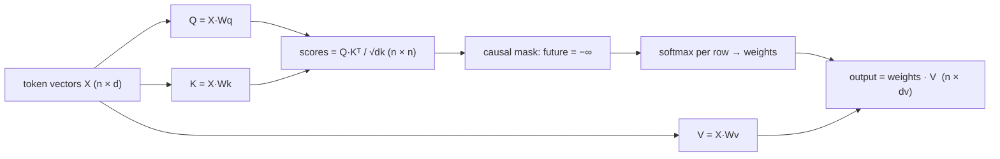

## Why it matters

Attention is the mechanism that replaced recurrent networks and made LLMs possible. It is also the source of the context-window limits, the quadratic cost of long prompts and the KV cache that dominates inference memory. Every architecture discussion about LLMs eventually comes back to it.

## Concept

From each token's vector $x_i$, three learned projections produce:

- a **query** $q_i = x_i W_Q$ — what this token is looking for,
- a **key** $k_i = x_i W_K$ — what this token offers,
- a **value** $v_i = x_i W_V$ — what this token passes on if attended to.

$$\mathrm{Attention}(Q, K, V) = \mathrm{softmax}\!\left(\frac{QK^\top}{\sqrt{d_k}} + \text{mask}\right) V$$

- **Why $\sqrt{d_k}$:** the dot product of two random vectors with unit-variance components has variance $d_k$. Dividing keeps scores near unit variance, so softmax does not saturate (Phase 3's vanishing-gradient lesson again).
- **Causal mask:** in a decoder, position $i$ may only see positions $\le i$. Setting future scores to $-\infty$ makes their softmax weight exactly 0. This lets training compute the loss for *every* position in parallel without cheating.
- **Cost:** the score matrix is $n \times n$. Doubling the context quadruples attention compute and memory.

## Build it from scratch

<!-- code: lessons/p05-transformers/src/main/java/dev/aieng/p05/Attention.java#attention -->

The `offset` handles the KV-cache case (lesson 5), where a few new queries attend to many cached keys.

Tests pin the key properties:

- every row of weights sums to 1 and future weights are exactly 0;
- the first token can only attend to itself, so its output equals its own value vector;
- **without positional information, attention is permutation-equivariant** — shuffle the input and the outputs shuffle the same way. Attention alone cannot tell "dog bites man" from "man bites dog". Lesson 3 fixes that.

## Now with the library

Production implementations compute the same function with very different engineering:

| Technique | What it changes |
|---|---|
| FlashAttention | Never materialises the n × n matrix; tiles the computation in fast on-chip memory. Same result, far less memory traffic |
| Multi-query / grouped-query attention | Shares keys/values across heads to shrink the KV cache (lesson 7) |
| Sliding-window attention | Each token attends only to the last w tokens (Mistral), making cost linear in n |

You never call attention directly from Spring AI, but its cost model explains API pricing and latency: input tokens are processed in parallel (prefill), and longer prompts make every generated token slightly slower.

## Production notes

- **Long prompts are not free.** Prefill cost grows with prompt length, and attention over a long context makes each decode step slower too.
- **"Lost in the middle":** models use information at the start and end of long contexts more reliably than in the middle. Put the most important instructions and evidence first or last (Phase 7).
- **Attention weights are not explanations.** They show where information was mixed, not why a decision was made — be careful presenting them as interpretability.

## Exercises

1. **Easy** — For $q = [1, 0]$ and keys $k_1 = [1, 0]$, $k_2 = [0, 1]$, compute the attention weights by hand (with $d_k = 2$).
2. **Medium** — Remove the $\sqrt{d_k}$ scaling and measure the entropy of the attention rows for $d_k = 4$ and $d_k = 256$ with random inputs. Explain the result.
3. **Hard** — Implement attention's backward pass (gradients for Q, K and V) and gradient-check it.

## Common mistakes

- Forgetting the causal mask in a decoder (the model "sees the answer" during training).
- Masking with a large negative number instead of $-\infty$ in low precision, which can leak probability.
- Confusing self-attention (Q, K, V from the same sequence) with cross-attention (Q from one sequence, K and V from another, as in encoder–decoder models).

## Further reading

- Vaswani et al., "Attention Is All You Need", NeurIPS 2017.
- Jay Alammar, "The Illustrated Transformer" (2018).
- Dao et al., "FlashAttention", NeurIPS 2022.
