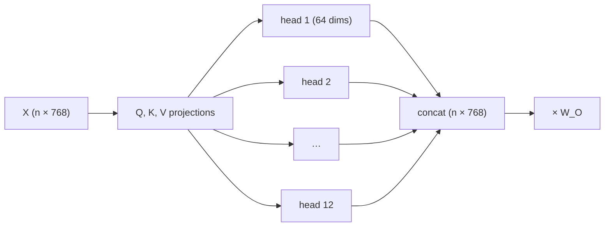

## Why it matters

Real models never use a single attention operation. They run many **heads** in parallel, each free to learn a different kind of relationship. And because attention ignores order, every model needs a **positional scheme** — the choice of which (RoPE, in most modern LLMs) determines how well context windows can be extended.

## Concept

### Multi-head attention

Split $d_{\text{model}}$ into $h$ heads of size $d_k = d_{\text{model}} / h$. Each head runs attention on its own slice of Q, K and V; outputs are concatenated and mixed by $W_O$:

$$\mathrm{MHA}(X) = \mathrm{Concat}(\text{head}_1, \dots, \text{head}_h)\, W_O$$

Empirically, different heads specialise: some track the previous token, some attend to matching brackets, some link pronouns to nouns.



### Positional encodings

**Sinusoidal (original transformer):** add a fixed pattern to each token embedding:

$$PE_{(pos, 2i)} = \sin\!\left(\frac{pos}{10000^{2i/d}}\right), \qquad PE_{(pos, 2i+1)} = \cos\!\left(\frac{pos}{10000^{2i/d}}\right)$$

**Learned absolute positions (GPT-2):** a trainable vector per position — simple, but cannot go beyond the trained length. Our `TinyGpt` uses this.

**RoPE (rotary, Llama/Mistral/Qwen):** rotate each 2-D pair of query and key components by an angle proportional to position. The dot product of a rotated query at position $m$ and a rotated key at position $n$ depends only on $m - n$ — relative position, for free.

## Build it from scratch

<!-- code: lessons/p05-transformers/src/main/java/dev/aieng/p05/Positional.java#sinusoidal -->

<!-- code: lessons/p05-transformers/src/main/java/dev/aieng/p05/Positional.java#rope -->

The test `ropeEncodesRelativePositionAndPreservesLength` checks the defining property: the score for positions (5, 3) equals the score for (105, 103) — same offset, same score — and rotation never changes a vector's length.

Multi-head attention lives inside the transformer block (next lesson): Q, K and V are computed once, then each head attends over its own column slice.

## Now with the library

Model cards and configs expose exactly these choices:

```json
{ "hidden_size": 2048, "num_attention_heads": 32, "num_key_value_heads": 8,
  "max_position_embeddings": 131072, "rope_theta": 500000.0,
  "rope_scaling": { "rope_type": "llama3", "factor": 32.0 } }
```

(Llama 3.2 1B style.) You can now read every field: 32 query heads of 64 dimensions, 8 key/value heads (grouped-query attention, lesson 7), RoPE with a large base and scaling for a 128k context.

## Production notes

- **Advertised context ≠ effective context.** Test recall at the lengths you will actually use.
- **Context length drives KV-cache memory,** which limits concurrent requests on a GPU (lesson 5).
- **Position bias:** instructions buried in the middle of a long prompt are followed less reliably.

## Exercises

1. **Easy** — Print `Positional.sinusoidal(50, 16)` as a heat-map of characters (e.g. `" .:-=+*#"`). Which dimensions change fastest?
2. **Medium** — Show numerically that sinusoidal encodings of positions 10 and 11 are closer (by cosine) than 10 and 40.
3. **Hard** — Implement multi-head attention as a standalone class with RoPE applied to Q and K, and test that it is still causal.

## Common mistakes

- Applying RoPE to values (it applies to queries and keys only).
- Assuming more heads is always better — at fixed $d_{\text{model}}$ each head gets fewer dimensions.
- Using positions beyond the trained range without scaling.

## Further reading

- Su et al., "RoFormer: Enhanced Transformer with Rotary Position Embedding" (2021), arXiv:2104.09864.
- Peng et al., "YaRN: Efficient Context Window Extension of Large Language Models" (2023).
- Liu et al., "Lost in the Middle: How Language Models Use Long Contexts", TACL 2024.
