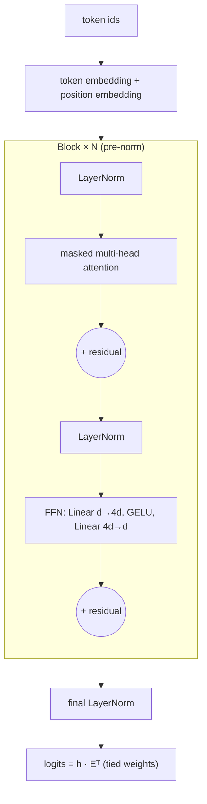

## Why it matters

This is the architecture behind GPT, Llama, Mistral, Qwen, Gemma and Claude-class models. After this lesson you can read a model's config, estimate its parameter count, and know what each part of the computation does — and you have Java code that executes it.

## Concept

- **Residual stream.** Each sub-layer *adds* to $x$ rather than replacing it. Gradients flow straight through the additions (Phase 3, lesson 3), so dozens of blocks train.
- **LayerNorm** re-standardises each token's vector; modern models use the cheaper **RMSNorm**.
- **Feed-forward network (FFN)** — the MLP from Phase 3 applied to every position independently. It holds about two thirds of the block's parameters and is where much of the model's "knowledge" is stored.
- **Weight tying** — the output head reuses the embedding matrix.

**Parameter count per block** (no attention biases): attention $4d^2$, FFN $8d^2 + 5d$, two norms $4d$ — about $12d^2$. GPT-2 small ($d = 768$, 12 layers) has $12 \times 12 \times 768^2 \approx 85\text{M}$ in its blocks, plus 38M in embeddings: the famous 124M.

## Build it from scratch

The block — attention sub-layer, then FFN sub-layer, each with a residual:

<!-- code: lessons/p05-transformers/src/main/java/dev/aieng/p05/TinyGpt.java#block -->

The model — embeddings, blocks, final norm, tied output head:

<!-- code: lessons/p05-transformers/src/main/java/dev/aieng/p05/TinyGpt.java#forward -->

Tests verify the properties that matter: output shape is `(tokens × vocab)`; **changing a later token never changes earlier logits** (the causal mask works end to end); exceeding the context window throws; and `parameterCount` matches the $12d^2 + 9d$ formula.

### About training

The weights here are random, so generated tokens are noise. Training requires gradients for every operation — attention, LayerNorm, GELU — which means extending the Phase 3 `Tensor` engine with those backward passes. That is the hard exercise below. Andrej Karpathy's *nanoGPT* (Python) and *llm.c* (C) are the reference implementations to compare against. At this point you understand every line in them.

## Now with the library

You will meet this architecture in three places as a Java engineer:

- **Model configs** (`config.json`): `hidden_size`, `num_hidden_layers`, `num_attention_heads`, `intermediate_size`, `vocab_size`, `tie_word_embeddings`.
- **Inference engines:** Jlama implements these blocks in pure Java; llama.cpp (inside Ollama) in C++; ONNX graphs contain them as operator nodes.
- **Capacity planning:** parameters × bytes per parameter = memory for weights.

## Production notes

- **Parameter count → memory → hardware.** A 7B model ≈ 14 GB at FP16, ≈ 4 GB at 4-bit.
- **Depth vs width** affects latency: layers run sequentially per token, so deeper models have higher per-token latency at the same parameter count.
- **Decoder-only vs encoder models:** embedding models and rerankers are usually encoder-only (bidirectional attention, no causal mask) — the same blocks without the mask.

## Exercises

1. **Easy** — Compute the parameter count of a model with $d = 4096$, 32 layers, vocabulary 128,000 and tied embeddings. Compare with "8B".
2. **Medium** — Replace LayerNorm with RMSNorm ($x / \sqrt{\text{mean}(x^2) + \epsilon} \cdot g$) and GELU with SwiGLU in `Block`, as in Llama. Update `parameterCount`.
3. **Hard** — Add backward passes for LayerNorm, GELU and attention to the Phase 3 `Tensor` engine, gradient-check them, and train a 2-layer `TinyGpt` on `BigramLm.CORPUS`. Its loss should drop well below the bigram's 1.87.

## Common mistakes

- Post-norm vs pre-norm confusion when reading papers (the original transformer was post-norm).
- Forgetting the final LayerNorm before the output head.
- Counting the tied output head twice in parameter counts.

## Further reading

- Radford et al., "Language Models are Unsupervised Multitask Learners" (GPT-2, 2019).
- Andrej Karpathy, "Let's build GPT: from scratch, in code, spelled out" (video, 2023) and nanoGPT.
- Anthropic, "A Mathematical Framework for Transformer Circuits" (2021) — the residual-stream view.
