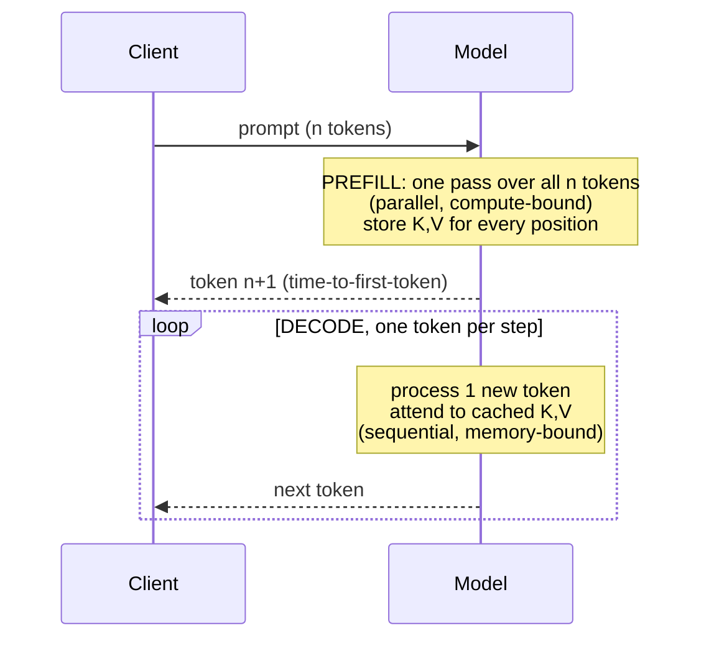

## Why it matters

Every latency and throughput number for LLMs — time-to-first-token, tokens per second, max concurrency — follows from how generation works. Knowing it lets you reason about cost, choose serving infrastructure, and design prompts that are cheaper and faster.

## Concept

Generation is a loop: run the model, sample one token, append it, repeat.

**Without a cache**, generating token $t$ recomputes all $t$ positions — $O(t^2)$ attention work per token. **With a KV cache**, each step computes Q, K, V for the new token only, appends K and V to the cache, and attends over the cache — $O(t)$ per token.

**KV-cache size** per sequence:

$$2 \times \text{layers} \times \text{kv\_heads} \times \text{head\_dim} \times \text{bytes} \times \text{tokens}$$

For a Llama-3-8B-class model (32 layers, 8 KV heads, head dim 128, FP16): $2 \cdot 32 \cdot 8 \cdot 128 \cdot 2 = 131\,072$ bytes ≈ 128 KB **per token**. An 8,000-token conversation needs ~1 GB of cache; 50 of them need 50 GB.

## Build it from scratch

`TinyGpt.generate` supports both modes. With the cache, the prompt is processed once (prefill) and then one token at a time (decode):

<!-- code: lessons/p05-transformers/src/main/java/dev/aieng/p05/TinyGpt.java#generate -->

Inside each block, the new keys and values are appended to the layer's cache before attention runs, and `Attention.scaledDotProduct` uses the `offset` so the new queries see every cached position but nothing in the future.

The test `kvCacheGivesIdenticalResultsToFullRecomputation` is the contract every inference engine must satisfy: greedy generation with and without the cache produces **identical tokens**, and feeding the prompt token by token through `next()` produces the same final logits as one full forward pass.

## Now with the library

| Engine | KV-cache features |
|---|---|
| Ollama / llama.cpp | Cache per session slot; `num_ctx` sets the maximum; optional cache quantisation |
| vLLM | PagedAttention (cache in fixed-size pages, like virtual memory), continuous batching, prefix caching |
| Hosted APIs | **Prompt caching** — reuse prefill for identical prompt prefixes at a discount (Phase 7) |

From Spring AI you control the cache indirectly: `num_ctx` / max context options, max output tokens, and keeping shared content (system prompts, tool definitions, documents) at the **start** of the prompt so provider-side prefix caching can reuse it.

## Production notes

- **Measure TTFT and inter-token latency separately.** Long prompts hurt TTFT; long outputs hurt total latency.
- **Cap `max_tokens`** for every call. An unbounded generation holds cache memory and costs money until it stops.
- **Stable prefixes save money.** Put the system prompt, tool schemas and static context first; put the user-specific part last.
- **Concurrency is a memory problem.** Size GPU serving by KV-cache budget, not just weights.

## Exercises

1. **Easy** — Compute the KV-cache size for a 32k-token context on the model above. How many such sessions fit in 40 GB?
2. **Medium** — Time `generate(..., useCache = true)` against `false` for 50 and 200 new tokens with `System.nanoTime()`. Plot (as a table) how the ratio grows.
3. **Hard** — Implement prefix sharing: two prompts with the same first 20 tokens should reuse one prefill. Prove with a test that results are unchanged.

## Common mistakes

- Benchmarking only short prompts and short outputs.
- Assuming GPU memory beyond the weights is "free" headroom.
- Placing per-request content before static content, defeating prefix caching.

## Further reading

- Kwon et al., "Efficient Memory Management for Large Language Model Serving with PagedAttention" (vLLM), SOSP 2023.
- Pope et al., "Efficiently Scaling Transformer Inference" (2022).
