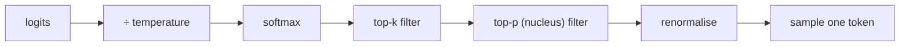

## Why it matters

Every chat call you make sets these knobs, explicitly or by default. They decide whether the same question gives the same answer twice, whether structured output parses, and how often the model drifts into creative-but-wrong territory.

## Concept

Starting from logits $z$ over the vocabulary:

1. **Temperature** $T$: $p = \mathrm{softmax}(z / T)$. $T \to 0$ is greedy; $T > 1$ flattens.
2. **Top-k**: keep only the $k$ most likely tokens.
3. **Top-p (nucleus)**: keep the smallest set of most likely tokens whose cumulative probability $\ge p$.
4. Renormalise the survivors and sample.



Top-p adapts to the shape of the distribution: when the model is confident, the nucleus is one or two tokens; when it is uncertain, many tokens survive. Top-k uses a fixed count regardless.

Other knobs you will meet: **repetition / frequency / presence penalties** (lower the logits of tokens already used), **min-p** (keep tokens with probability ≥ min-p × max probability), **stop sequences**, **max tokens**, **seed**.

## Build it from scratch

<!-- code: lessons/p05-transformers/src/main/java/dev/aieng/p05/Sampling.java#sample -->

The test `samplingStrategies` checks each rule on logits $[1, 3, 2, -1]$ (probabilities ≈ $[0.09, 0.67, 0.24, 0.01]$):

- temperature 0 and top-k 1 are both greedy;
- top-k 2 only ever returns tokens 1 or 2;
- top-p 0.5 always returns token 1 (it alone holds 67%);
- unfiltered sampling over 20,000 draws matches the softmax probabilities within 1.5 percentage points.

## Now with the library

```java
// Spring AI 2.x: options are passed as a builder
String answer = chatClient.prompt()
        .user(question)
        .options(ChatOptions.builder()
                .temperature(0.2)
                .topP(0.9)
                .maxTokens(500)
                .stopSequences(List.of("</answer>")))
        .call()
        .content();
```

```java
// LangChain4j
ChatModel model = OllamaChatModel.builder()
        .baseUrl("http://localhost:11434").modelName("llama3.2")
        .temperature(0.2).topP(0.9).numPredict(500).seed(42)
        .build();
```

The course app's **Playground → Prompt lab** lets you run the same prompt at different temperatures side by side.

| Task | Temperature | Notes |
|---|---|---|
| Extraction, classification, JSON, tool arguments | 0 – 0.2 | Validate against a schema |
| RAG answers, support replies | 0.2 – 0.5 | Faithfulness matters more than variety |
| General chat | 0.5 – 0.8 | Provider defaults are often ~0.7–1.0 |
| Brainstorming, copywriting | 0.8 – 1.0, top-p 0.9–0.95 | Review output |

## Production notes

- **Defaults differ between providers.** Set parameters explicitly in code so a provider switch does not change behaviour.
- **Reasoning models** may ignore or restrict temperature; check the model documentation.
- **Determinism is best-effort.** Even temperature 0 can vary across hardware, batch composition and server versions — design tests around evals, not exact strings.

## Exercises

1. **Easy** — With the bigram model from lesson 1, generate 100 characters at temperature 0 (greedy). What pattern appears?
2. **Medium** — Implement min-p sampling and compare its behaviour with top-p on a confident and an uncertain distribution.
3. **Hard** — Implement a frequency penalty: subtract $\alpha \cdot \text{count}(token)$ from logits of tokens already generated. Show that it reduces repetition in greedy bigram generation.

## Common mistakes

- Tuning temperature and top-p aggressively at the same time.
- Using high temperature for structured output.
- Relying on exact-string tests for LLM output.

## Further reading

- Holtzman et al., "The Curious Case of Neural Text Degeneration" (top-p), ICLR 2020.
- Nguyen et al., "Turning Up the Heat: Min-p Sampling for Creative and Coherent LLM Outputs" (2024).
