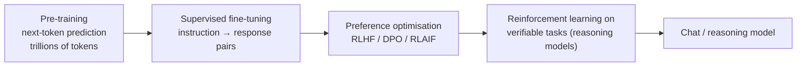

## Why it matters

The `TinyGpt` you built has the same skeleton as current frontier models. What differs is scale, training stages and a handful of efficiency tricks. Knowing them lets you read model announcements critically and make sound model-selection decisions (Phase 6).

## Concept

### 1. Scale and scaling laws

Loss falls predictably as a power law in parameters, data and compute (Kaplan et al., 2020). Chinchilla (2022) showed many models were under-trained: compute-optimal training uses roughly **20 tokens per parameter**. Modern small models are deliberately "over-trained" far beyond that, because a smaller model trained longer is cheaper to *serve*.

### 2. Training stages



- **Base model:** a document completer.
- **Instruct/chat model:** follows instructions using a chat template with special role tokens.
- **Reasoning models:** trained with RL to produce long internal reasoning before answering; better at maths, code and multi-step problems, at the cost of many more output tokens and latency.

### 3. Efficiency tricks inside the architecture

| Technique | Idea | Effect |
|---|---|---|
| RMSNorm, SwiGLU, RoPE | Cheaper norm, gated FFN, rotary positions | Standard in Llama-family models |
| Grouped-query attention | Query heads share K/V heads | Smaller KV cache, faster decode |
| Mixture of experts | Router sends each token to k of N expert FFNs | More parameters at similar compute per token |
| Sliding-window attention | Attend to last w tokens only | Linear cost in sequence length |
| Quantisation | 8/4-bit weights (and KV cache) | 2–4× less memory, faster memory-bound decode |
| Speculative decoding | Small draft model proposes tokens, big model verifies in one pass | 2–3× faster decode, identical output distribution |

### 4. Multimodality

Images and audio are converted to token-like vectors by an encoder (e.g. a vision transformer) and fed into the same decoder alongside text tokens.

## Build it: read a model card

Take this (illustrative) config and answer the questions:

```json
{ "hidden_size": 4096, "num_hidden_layers": 32, "num_attention_heads": 32,
  "num_key_value_heads": 8, "intermediate_size": 14336, "vocab_size": 128256,
  "max_position_embeddings": 131072, "torch_dtype": "bfloat16" }
```

- Head dimension: $4096 / 32 = 128$.
- GQA ratio: 32 query heads share 8 KV heads → **4× smaller KV cache** than standard multi-head attention.
- Weights: ≈ 8B parameters × 2 bytes ≈ **16 GB** in BF16, ≈ 4.5 GB at 4-bit.
- KV cache per token: $2 \cdot 32 \cdot 8 \cdot 128 \cdot 2$ bytes = **128 KB** (lesson 5).

## Now with the library

From Spring AI and LangChain4j, these choices appear as **model names and options**, not code. What changes in your code:

- Reasoning models: longer latency and more output tokens — stream, raise timeouts, budget tokens; some ignore temperature.
- Multimodal models: pass images as `Media` on the user message (Phase 6).
- Different chat templates are handled by the provider or Ollama — never hand-build `<|im_start|>`-style prompts when an API is available.

## Production notes

- **Benchmarks are not your use case.** Public leaderboards are contaminated and generic; build your own eval set (Phase 12).
- **Model churn is constant.** Keep model choice in configuration behind an interface, with evals to re-validate on every switch.
- **Total cost includes output tokens.** Reasoning models can produce 5–20× more tokens than a direct answer.

## Exercises

1. **Easy** — For a model you use, find its config and compute head dimension, GQA ratio and FP16 weight size.
2. **Medium** — Estimate the monthly cost of 100,000 requests/day with 2,000 input and 400 output tokens for two hosted models of your choice, using their current price pages.
3. **Hard** — Write a one-page model-selection ADR for a Liferay knowledge-assistant feature, comparing one hosted and one self-hosted option on quality (how you would measure it), latency, cost, data residency and operations.

## Common mistakes

- Equating parameter count with quality across model generations.
- Ignoring output-token costs of reasoning models.
- Assuming an MoE model needs less memory because it uses less compute per token.

## Further reading

- Hoffmann et al., "Training Compute-Optimal Large Language Models" (Chinchilla), 2022.
- Ainslie et al., "GQA: Training Generalized Multi-Query Transformer Models", 2023.
- Fedus et al., "Switch Transformers", JMLR 2022.
- Ouyang et al., "Training language models to follow instructions with human feedback" (InstructGPT), 2022.
