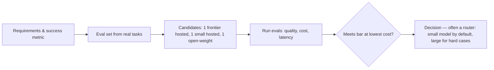

## Why it matters

Model choice is the biggest single lever on quality, cost, latency and data risk — and it changes every few months. You need a repeatable way to evaluate it and an architecture that lets you switch.

## Concept: the four axes

| Axis | Questions |
|---|---|
| **Capability** | Does it pass *your* eval set? Tool-use reliability? Languages? Context length that actually works? |
| **Cost** | Price per million input / output / cached tokens × your token volumes |
| **Latency** | Time-to-first-token and tokens per second at your prompt sizes |
| **Risk** | Data residency, retention, licence, vendor lock-in, availability SLA |



**Cost per request:**

$$\text{cost} = \frac{T_{in}^{fresh} \cdot P_{in} + T_{in}^{cached} \cdot P_{in}(1 - d) + T_{out} \cdot P_{out}}{10^6}$$

**Latency:** $\text{TTFT} + T_{out} / \text{tokens per second}$ (Phase 5).

## Build it from scratch

<!-- code: lessons/p06-llms-in-practice/src/main/java/dev/aieng/p06/TokenCostEstimator.java#estimate -->

`TokenCostEstimator.main` compares three **illustrative** price points for a support workload of 20,000 requests/day, 3,000 input tokens (60% cacheable) and 350 output tokens:

```text
llama3.2-3b (self-hosted, amortised GPU)   $0.00009/request  $     51.90/month  ~8.9s latency
efficient-small (hosted)                   $0.00042/request  $    250.20/month  ~3.2s latency
frontier-large (hosted)                    $0.00939/request  $  5,634.00/month  ~6.4s latency
```

A 100× cost spread is normal. Notice the self-hosted row's latency: a small model on modest hardware is cheap but slow, and the GPU cost is hidden in the "amortised" price — model it explicitly before claiming savings.

## Now with the library

Keep the choice in **configuration**, behind Spring AI's `ChatModel`/`ChatClient` abstraction:

```yaml
spring.ai.model.chat: ${AI_CHAT_PROVIDER:ollama}
spring.ai.ollama.chat.model: llama3.2
spring.ai.openai.chat.options.model: ${OPENAI_CHAT_MODEL:gpt-4o-mini}
```

For routing between several models, define multiple `ChatClient` beans (one per model or provider) and choose per request — Phase 14 builds a router with fallbacks.

## Production notes

- **Re-run evals on every model change**, including silent provider updates of the same model name. Pin model versions where the provider allows.
- **Track cost per feature and per tenant** with metrics on token usage (Phase 14).
- **Have an exit plan.** Abstractions, eval sets and prompt versioning make a provider switch a configuration change instead of a rewrite.

## Exercises

1. **Easy** — Update `main` with current real prices for two models you could use, and recompute.
2. **Medium** — Add a `rateLimitTokensPerMinute` field and compute how many replicas or API tiers your peak traffic needs.
3. **Hard** — Add a "router" scenario: 70% of requests go to the small model, 30% escalate to the large one. Compare monthly cost and expected quality (use your own estimate of each model's eval pass rate).

## Common mistakes

- Ignoring input tokens because "the answers are short".
- Comparing models on a handful of hand-picked prompts.
- Forgetting the cost of retries, tool-call round trips and reasoning tokens.

## Further reading

- Provider pricing pages (OpenAI, Anthropic, Google, Mistral, AWS Bedrock, Azure OpenAI) — check them, they change often.
- Artificial Analysis, independent latency and price benchmarks: <https://artificialanalysis.ai/>
