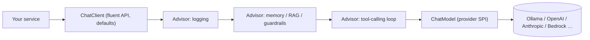

## Why it matters

Spring AI is the Spring-native way to call models. Its design reuses patterns you know — templates, builders, interceptor chains, auto-configuration — so you can apply your Spring architecture instincts directly.

## Concept



| Spring AI | Familiar Spring analogue |
|---|---|
| `ChatModel` | `DataSource` / `ConnectionFactory` — provider SPI |
| `ChatClient` | `JdbcClient` / `RestClient` — fluent client with defaults |
| `Advisor` chain | Servlet filters, `HandlerInterceptor`, AOP `@Around` |
| `PromptTemplate` | `MessageFormat` / template engines |
| Provider starters + `spring.ai.model.chat` | DataSource auto-configuration |
| `ChatOptions` | Per-call `RestClient` request options |

A **`Prompt`** is a list of **messages** (system, user, assistant, tool) plus **options**. `ChatClient` assembles it from your defaults and the per-request parts.

## Build it

A purpose-named service: one `ChatClient` built once with a templated system prompt, default options and an advisor:

<!-- code: lessons/p06-llms-in-practice/src/main/java/dev/aieng/p06/SupportAssistant.java#client -->

`{product}` and `{maxSentences}` are template placeholders (StringTemplate under the hood). Standalone templates work the same way:

<!-- code: lessons/p06-llms-in-practice/src/main/java/dev/aieng/p06/SupportAssistant.java#template -->

### Testing without a model

The test uses `ScriptedChatModel` — a fake `ChatModel` that returns scripted replies and records every `Prompt`:

```java
ScriptedChatModel model = new ScriptedChatModel().reply("Restart the portal node.");
String answer = new SupportAssistant(model, "Liferay DXP").answer("Cache is stale, what do I do?");

List<Message> sent = model.last().getInstructions();
assertTrue(sent.getFirst().getText().contains("support assistant for Liferay DXP"));
assertEquals(0.2, model.last().getOptions().getTemperature());
```

You assert on **what your code sends** — the system prompt, the template rendering, the options — deterministically and for free. Model *quality* is tested separately with evals (Phase 12).

## Now in a Boot application

```java
@Configuration
class AiConfig {
    @Bean
    SupportAssistant supportAssistant(ChatModel chatModel) {        // provided by the starter
        return new SupportAssistant(chatModel, "Liferay DXP");
    }
}

@RestController
class SupportController {
    private final SupportAssistant assistant;
    SupportController(SupportAssistant assistant) { this.assistant = assistant; }

    @PostMapping("/api/support/answer")
    String answer(@RequestBody String question) { return assistant.answer(question); }
}
```

Boot also auto-configures a prototype `ChatClient.Builder` bean you can inject instead of the `ChatModel`; it comes pre-wired with observation (metrics and traces).

## Production notes

- **System prompts are code.** Store them as versioned classpath resources (`.st` files), review them in pull requests and test them (Phase 7).
- **Set options explicitly** — temperature, max tokens — so a provider switch doesn't silently change behaviour.
- **`SimpleLoggerAdvisor` logs full prompts at DEBUG.** Fine locally; in production, logging prompt content may violate data policies. Log metadata (token counts, latency, model) instead.

## Exercises

1. **Easy** — Add a `defaultUser` template to `SupportAssistant` that wraps every question in `<question>` tags, and extend the test.
2. **Medium** — Write a custom `CallAdvisor` that measures latency and records prompt/completion token counts from `ChatResponse.getMetadata().getUsage()` into a Micrometer `SimpleMeterRegistry`.
3. **Hard** — Create two `ChatClient` beans (a cheap and a strong model) with `@Qualifier`s, and a `ModelRouter` service that chooses one by question length. Test the routing with two fakes.

## Common mistakes

- Building a new `ChatClient` with all defaults on every request.
- Concatenating user input into the system prompt (prompt-injection surface — Phase 15).
- Asserting on exact model output strings in unit tests.

## Further reading

- Spring AI ChatClient reference: <https://docs.spring.io/spring-ai/reference/api/chatclient.html>
- Spring AI Advisors: <https://docs.spring.io/spring-ai/reference/api/advisors.html>
