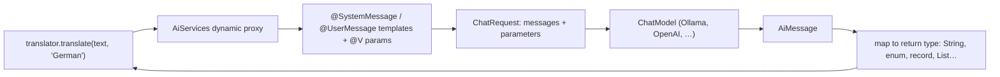

## Why it matters

LangChain4j is the other major Java LLM framework. Its **AiServices** style — declare an interface, get an implementation — is very productive, and it runs anywhere: plain Java, Quarkus, Micronaut, Spring, or inside Liferay's OSGi container where a full Spring Boot stack is not available.

## Concept



| LangChain4j | Spring AI equivalent |
|---|---|
| `ChatModel` | `ChatModel` |
| `AiServices` interface | A service class using `ChatClient` |
| `@SystemMessage`, `@UserMessage`, `@V` | `.system(...)`, `.user(u -> u.text(...).param(...))` |
| Typed return (enum, POJO) | `.call().entity(Type.class)` |
| `@Tool` (dev.langchain4j.agent.tool) | `@Tool` (org.springframework.ai.tool.annotation) |
| `ChatMemory` | `ChatMemory` + `MessageChatMemoryAdvisor` |

## Build it

<!-- code: lessons/p06-llms-in-practice/src/main/java/dev/aieng/p06/LangChainAssistant.java#service -->

Two details:

- Template variables use `{{name}}`, bound by `@V("name")`. A single unannotated parameter is `{{it}}`.
- The **return type drives parsing.** For an enum, LangChain4j instructs the model to answer with one of the constants and maps the reply.

The tests use a tiny LangChain4j `ChatModel` double that records the messages it receives:

```java
static final class RecordingLc4jModel implements ChatModel {
    @Override
    public ChatResponse doChat(ChatRequest request) {
        last = request.messages();
        return ChatResponse.builder().aiMessage(AiMessage.from(answer)).build();
    }
}
```

and assert that the system message and the rendered user message (`"Translate to German:\nHello world"`) are exactly what the annotations promise.

## Now with a real model

```java
ChatModel model = OllamaChatModel.builder()            // langchain4j-ollama
        .baseUrl("http://localhost:11434")
        .modelName("llama3.2")
        .temperature(0.0)
        .build();
Translator translator = AiServices.create(Translator.class, model);
```

With `langchain4j-spring-boot-starter`, an interface annotated `@AiService` becomes a Spring bean automatically.

## Production notes

- **Isolate framework types.** Your domain code should call `Translator`, not `ChatModel`. That keeps a framework switch local.
- **Enum and record returns still need validation** — the model can answer outside the expected set; decide whether to retry, default or escalate.
- **Liferay:** LangChain4j's core has no Spring dependency, so it can be embedded in an OSGi module (with its dependencies bundled or wrapped) to add AI features inside the portal itself; alternatively call a separate Spring Boot AI service over REST — usually easier to operate and scale.

## Exercises

1. **Easy** — Add a `summarize(String text, int maxWords)` method to a new interface and test the rendered prompt.
2. **Medium** — Add a method that returns a record `Summary(String title, List<String> bullets)` and test parsing with a JSON reply from the fake.
3. **Hard** — Implement the same `FeedbackAnalyzer` with Spring AI's `ChatClient` and compare: lines of code, testability, and how each framework phrases the enum instructions (inspect the recorded prompts).

## Common mistakes

- Mixing `{name}` (Spring AI) and `{{name}}` (LangChain4j) template syntax.
- Letting framework-specific types leak into domain APIs.
- Assuming typed returns cannot fail.

## Further reading

- LangChain4j AI Services: <https://docs.langchain4j.dev/tutorials/ai-services>
- LangChain4j Spring Boot integration: <https://docs.langchain4j.dev/tutorials/spring-boot-integration>
