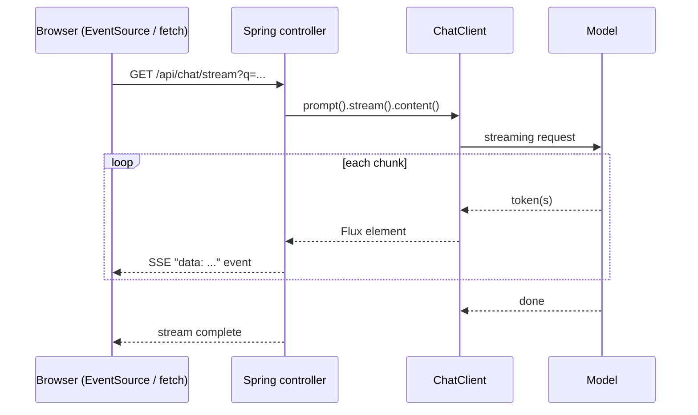

## Why it matters

A 400-token answer at 30 tokens/second takes 13 seconds. Streamed, the user sees the first words after the time-to-first-token — often under a second. Streaming is the single biggest perceived-latency improvement for chat UIs.

## Concept



- **Server-Sent Events (SSE):** one-way, text-based, auto-reconnecting HTTP stream — perfect for token streaming.
- **Back-pressure and cancellation:** if the browser disconnects, the subscription is cancelled and the upstream model call should stop (saving tokens).

## Build it

<!-- code: lessons/p06-llms-in-practice/src/main/java/dev/aieng/p06/StreamingAssistant.java#stream -->

The test drives it with `StepVerifier` (reactor-test) against a fake that emits three chunks:

```java
StepVerifier.create(new StreamingAssistant(model).stream("hi"))
        .expectNext("Spring ", "AI ", "streams.")
        .verifyComplete();
```

## Now in a controller

```java
@RestController
class ChatStreamController {
    private final StreamingAssistant assistant;
    ChatStreamController(StreamingAssistant assistant) { this.assistant = assistant; }

    // Works in Spring MVC (virtual threads recommended) and in WebFlux.
    @GetMapping(value = "/api/chat/stream", produces = MediaType.TEXT_EVENT_STREAM_VALUE)
    Flux<String> stream(@RequestParam String q) {
        return assistant.stream(q);
    }
}
```

```javascript
// Browser
const es = new EventSource('/api/chat/stream?q=' + encodeURIComponent(q));
es.onmessage = e => output.textContent += e.data;
```

Enable virtual threads in Spring Boot with `spring.threads.virtual.enabled=true` — the course app does.

## Production notes

- **Timeouts at every layer:** model call, Flux, reverse proxy (nginx/ingress buffering must be disabled for SSE: `X-Accel-Buffering: no`).
- **Validate after streaming completes.** You cannot validate JSON or run output guardrails on half an answer; for structured output, don't stream — or stream to the user and validate the aggregated text before acting on it.
- **Token usage arrives at the end** (or not at all for some providers in streaming mode). Aggregate it for metering.
- **Accessibility:** announce streamed content politely (`aria-live="polite"`), and don't move focus on every chunk.

## Exercises

1. **Easy** — Add `.doOnComplete(...)` logging to `stream` and print the total characters received.
2. **Medium** — Return `Flux<ServerSentEvent<String>>` with an event id per chunk and a final `event: done` message.
3. **Hard** — Implement cancellation propagation: when the client disconnects, assert in a test (with a fake model emitting slowly via `Flux.interval`) that the upstream subscription is cancelled.

## Common mistakes

- Buffering proxies that hold the whole response, making streaming pointless.
- Streaming structured output and parsing partial JSON.
- Forgetting that each open stream is an open connection — set limits.

## Further reading

- Spring AI streaming: <https://docs.spring.io/spring-ai/reference/api/chatclient.html#_streaming_responses>
- Spring Framework, "Server-Sent Events" in Spring MVC: <https://docs.spring.io/spring-framework/reference/web/webmvc/mvc-ann-async.html>
- JEP 444: Virtual Threads.
