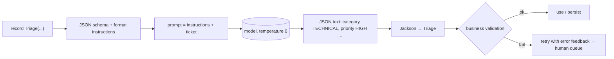

## Why it matters

Most enterprise AI features are not chat — they are **extraction and classification**: triage a ticket, pull fields from an invoice, map an email to a CRM update. Code needs objects, not prose. Structured output is the bridge, and validation is what makes it safe.

## Concept



Three levels of enforcement, weakest to strongest:

1. **Format instructions in the prompt** (portable, works with any model).
2. **JSON mode** — the provider guarantees syntactically valid JSON.
3. **Schema-constrained decoding** — the provider restricts sampling to tokens that keep the output valid against your schema (OpenAI structured outputs, Ollama `format` with a schema, and others).

Even level 3 only guarantees *shape*, never *truth*.

## Build it

The target types — enums for closed sets, a record for the result:

<!-- code: lessons/p06-llms-in-practice/src/main/java/dev/aieng/p06/TicketTriage.java#types -->

Extraction plus the validation the schema cannot express:

<!-- code: lessons/p06-llms-in-practice/src/main/java/dev/aieng/p06/TicketTriage.java#triage -->

The ticket is passed as a template **parameter** inside `<ticket>` tags — not concatenated into instructions — which keeps data and instructions separate (Phase 15).

The test feeds a JSON reply through the fake model and checks: the record is populated (including the enum and list); the user message contains the ticket **and** the appended JSON format instructions; temperature is 0; and a reply with `"priority": null` is rejected.

## Now with the library

```java
// Collections and generics
List<Triage> all = chatClient.prompt().user(batch).call()
        .entity(new ParameterizedTypeReference<List<Triage>>() {});

// Response plus parsed entity (keep token usage for metering)
ResponseEntity<ChatResponse, Triage> both = chatClient.prompt().user(ticket).call()
        .responseEntity(Triage.class);

// LangChain4j: the return type of an AiServices method
interface Triager { Triage triage(@UserMessage String ticket); }
```

Spring AI also ships a `StructuredOutputValidationAdvisor` that validates the output against the schema and re-prompts on failure — a ready-made version of the retry loop in the diagram.

## Production notes

- **Use enums for closed vocabularies** and map "unknown" explicitly (`OTHER`) rather than letting the model invent categories.
- **Keep schemas small.** Deeply nested, many-field schemas raise error rates; split into several focused calls if needed.
- **Never stream structured output into business logic** — validate the complete object.
- **Measure per field.** "93% of triages correct" hides that `priority` is right only 70% of the time.

## Exercises

1. **Easy** — Add a `confidence` field (0–1) to `Triage` and reject results below 0.5 in `validate`.
2. **Medium** — Implement a retry: on `IllegalStateException`, call the model once more with the validation error appended ("Your previous answer was invalid because …"). Test with a fake that fails first and succeeds second.
3. **Hard** — Extract line items from a pasted invoice into `List<LineItem>` and add a validator checking that line totals sum to the invoice total. Build five test invoices.

## Common mistakes

- Trusting output because it parsed.
- Asking for structured output and prose in the same reply.
- Using free-text fields where an enum would do.

## Further reading

- Spring AI structured output: <https://docs.spring.io/spring-ai/reference/api/structured-output-converter.html>
- OpenAI, "Structured Outputs" guide; Ollama structured outputs (`format` parameter).
