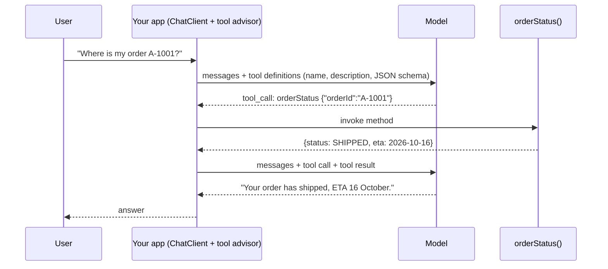

## Why it matters

Tool calling is how an LLM moves from *talking about* your systems to *using* them: looking up an order, querying Liferay content, creating a ticket. It is the foundation of agents (Phase 10) and MCP (Phase 11) — and the largest security surface in AI applications.

## Concept



1. Your app sends **tool definitions** — name, description and a JSON schema of parameters — along with the messages.
2. The model may answer with a **tool call** instead of text.
3. Your app executes it and appends the **tool result** to the conversation.
4. Repeat until the model answers in text.

The model never touches your system. It only *requests*; your code decides whether and how to run it.

## Build it

A tool is an annotated method. The description is part of the prompt — write it like API documentation for a junior developer:

<!-- code: lessons/p06-llms-in-practice/src/main/java/dev/aieng/p06/OrderTools.java#tools -->

Using it — the tool loop is an advisor around the model call:

<!-- code: lessons/p06-llms-in-practice/src/main/java/dev/aieng/p06/OrderTools.java#usage -->

### Testing the loop end to end

The test scripts a two-turn conversation with the fake model:

```java
ScriptedChatModel model = new ScriptedChatModel()
    .reply(p -> AssistantMessage.builder().content("")
        .toolCalls(List.of(new AssistantMessage.ToolCall("call-1", "function", "orderStatus",
                "{\"orderId\":\"A-1001\"}")))
        .build())
    .reply(p -> {   // second turn: the tool result is now the last message
        ToolResponseMessage tr = (ToolResponseMessage) p.getInstructions().getLast();
        return new AssistantMessage(tr.getResponses().getFirst().responseData().contains("SHIPPED")
                ? "Your order has shipped, ETA 2026-10-16." : "?");
    });
```

It proves that Spring AI generated the tool definition, parsed the arguments, invoked `orderStatus("A-1001")`, sent the JSON result back, and that exactly **two** model calls happened. One subtlety the test surfaced: a fake `ChatModel` must return tool-capable default options (`ToolCallingChatOptions`), just as real provider models do — otherwise there is nowhere to attach the tool definitions.

## Now with the library

```java
// LangChain4j
class OrderToolsLc4j {
    @dev.langchain4j.agent.tool.Tool("Look up an order's status by id")
    Order orderStatus(@P("Order id, format A-1234") String orderId) { ... }
}
Assistant a = AiServices.builder(Assistant.class).chatModel(model).tools(new OrderToolsLc4j()).build();
```

Tool calling needs a model that supports it (Llama 3.1+, Qwen 2.5+, Mistral, and all major hosted models). Small local models are noticeably less reliable at choosing tools and producing valid arguments — evaluate.

## Designing good tools

| Principle | Example |
|---|---|
| Narrow and task-specific | `orderStatus(orderId)`, not `runSql(query)` |
| Clear names and descriptions | Describe when to use it and the argument format |
| Return structured data | Records, not formatted prose |
| Errors as data | `NOT_FOUND` result, not an exception |
| Read and write separated | Writes require confirmation (Phase 10) |
| Run as the user | Pass the user's identity via tool context; enforce permissions inside the tool |

## Production notes

- **Authorisation lives in the tool**, using the caller's identity. Never trust the model to respect permissions.
- **Limit loops:** cap tool calls per request; Spring AI provides tool-call limits for this.
- **Every tool call is an audit event** — who, which tool, which arguments, which result.
- **Tool definitions cost tokens on every request.** Dozens of tools bloat prompts and confuse models; group or select tools dynamically.

## Exercises

1. **Easy** — Add a `cancelOrder(orderId)` tool and make it return `REQUIRES_CONFIRMATION` instead of acting.
2. **Medium** — Pass the current user id via `ToolContext` (`.toolContext(Map.of("userId", ...))`) and make `orderStatus` return `FORBIDDEN` for orders that belong to someone else. Test it.
3. **Hard** — With Ollama running a tool-capable model (e.g. `qwen2.5:3b` or `llama3.2`), run `OrderTools.ask` for 20 phrasings of order questions and measure how often the right tool is called with valid arguments.

## Common mistakes

- Generic, powerful tools (`executeQuery`, `httpGet(url)`).
- Trusting tool arguments.
- No limit on the number of tool calls.

## Further reading

- Spring AI tool calling: <https://docs.spring.io/spring-ai/reference/api/tools.html>
- LangChain4j tools: <https://docs.langchain4j.dev/tutorials/tools>
- OWASP Top 10 for LLM Applications — "Excessive Agency".
