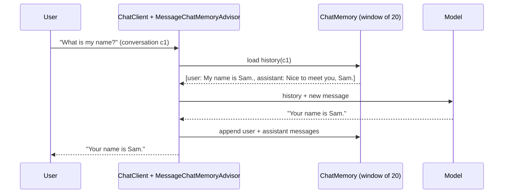

## Why it matters

Users expect follow-up questions to work ("and what about the second one?"). Because models are stateless (Phase 0), *you* decide what history to send — which drives cost, latency, quality and privacy.

## Concept



Strategies, from simplest to most capable:

| Strategy | Idea | Trade-off |
|---|---|---|
| Message window | Last N messages | Simple; forgets older facts abruptly |
| Token budget | As many recent messages as fit in K tokens | Predictable cost |
| Summary memory | Summarise older turns into one message | Extra model call; may lose detail |
| Retrieval memory | Embed past turns, retrieve relevant ones | Best recall for long relationships; more infrastructure |

## Build it

<!-- code: lessons/p06-llms-in-practice/src/main/java/dev/aieng/p06/ConversationService.java#memory -->

The test sends two messages in conversation `c1` and asserts that the second prompt contains the first exchange; then a message in conversation `c2` is sent with **no** history — the isolation property you must guarantee.

## Persisting memory

`MessageWindowChatMemory` stores messages in a `ChatMemoryRepository`. The default is in-memory; Spring AI provides JDBC, Cassandra, Neo4j and other repositories:

```java
// spring-ai-starter-model-chat-memory-repository-jdbc auto-configures a JdbcChatMemoryRepository
@Bean
ChatMemory chatMemory(ChatMemoryRepository repository) {
    return MessageWindowChatMemory.builder().chatMemoryRepository(repository).maxMessages(20).build();
}
```

## Multimodal input

Vision-capable models (e.g. `llama3.2-vision`, `qwen2.5vl` locally, most frontier hosted models) accept images in the user message:

```java
String description = chatClient.prompt()
        .user(u -> u.text("List the error messages visible in this screenshot.")
                    .media(MimeTypeUtils.IMAGE_PNG, new ClassPathResource("/screenshot.png")))
        .call()
        .content();
```

Use cases in enterprise portals: describing screenshots in support tickets, extracting data from scanned forms, generating alt text for Liferay Documents and Media images (with human review).

## Production notes

- **Bind conversation ids to identity.** Derive them server-side from the authenticated user; never accept arbitrary ids from the client without an ownership check.
- **Retention and deletion.** Chat histories are personal data: define retention, support deletion requests, and avoid storing secrets.
- **Watch history cost.** Log how many tokens each turn spends on history; switch to summary or retrieval memory when it dominates.
- **Images are expensive** in tokens and latency; downscale before sending.

## Exercises

1. **Easy** — Lower `maxMessages` to 2 and show in a test that the first message is forgotten after two exchanges.
2. **Medium** — Implement a summary-memory advisor: when history exceeds 10 messages, replace the oldest 8 with one system message summarising them (use the fake model to produce the summary in tests).
3. **Hard** — With a local vision model, write a service that generates alt text for images and returns it with a confidence flag for human review. Add a validation rule rejecting alt text longer than 125 characters.

## Common mistakes

- Using a static conversation id (every user sees everyone's history).
- Unbounded histories.
- Assuming the model "remembers" between separate API calls.

## Further reading

- Spring AI chat memory: <https://docs.spring.io/spring-ai/reference/api/chat-memory.html>
- Spring AI multimodality: <https://docs.spring.io/spring-ai/reference/api/multimodality.html>
