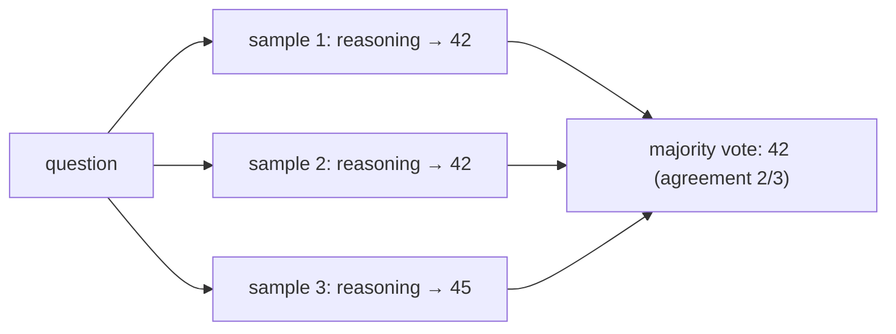

## Why it matters

A handful of patterns account for most of the improvement you can get from prompting. Each has a cost — tokens, latency, complexity — so choose them deliberately, and verify each with an eval.

## Concept

| Pattern | What it does | Cost | Use for |
|---|---|---|---|
| **Zero-shot instructions** | Clear task + format | Lowest | Start here |
| **Few-shot** | 2–8 worked examples as conversation turns | + example tokens on every call | Format, tone, edge cases, classification |
| **Chain-of-thought (CoT)** | Ask for reasoning before the answer | + output tokens, latency | Multi-step reasoning on non-reasoning models |
| **Self-consistency** | Sample N CoT answers, majority vote | × N calls | High-value reasoning; gives a confidence signal |
| **Decomposition / prompt chaining** | Split into steps, each its own call | More calls, but each is simpler and testable | Complex workflows (extract → reason → format) |
| **Reflection / critique** | Second call reviews and fixes the first | + 1 call | Writing quality, code review |



## Build it from scratch

**Few-shot** as real turns — see the `FewShot.build` method from the previous lesson: each example becomes a `UserMessage` followed by an `AssistantMessage`.

**Self-consistency** with a machine-readable final line:

<!-- code: lessons/p07-prompt-context/src/main/java/dev/aieng/p07/SelfConsistency.java#vote -->

A matching CoT prompt ends with an explicit format contract:

```text
Solve the problem. Think step by step.
On the last line write exactly: Final answer: <answer>
```

The test feeds four samples (two say 42, one says 45, one is unparseable) and gets `42` with agreement 0.5 — use agreement as a confidence signal: below a threshold, escalate to a human or a stronger model.

## Now with the library

```java
// Few-shot with ChatClient: pass prior turns as messages
chatClient.prompt()
        .messages(List.of(new UserMessage("Great release!"), new AssistantMessage("POSITIVE")))
        .user(feedback)
        .call().content();

// Self-consistency: N parallel calls on virtual threads
try (var executor = Executors.newVirtualThreadPerTaskExecutor()) {
    List<Future<String>> futures = IntStream.range(0, 5)
            .mapToObj(i -> executor.submit(() -> cotClient.prompt().user(problem).call().content()))
            .toList();
    ...
}
```

## Production notes

- **Pick examples from real failures**, keep them balanced across classes, and rotate them through evals to avoid overfitting.
- **Reasoning tokens cost money** — use CoT/self-consistency where the eval shows a benefit, not everywhere.
- **Hide reasoning from end users** when it may contain unverified intermediate claims; show the answer and sources.
- **Chains are easier to test than mega-prompts.** Each step gets its own eval and its own failure handling.

## Exercises

1. **Easy** — Write a 3-shot prompt for classifying Liferay support tickets into BILLING, TECHNICAL and ACCOUNT, choosing deliberately ambiguous examples.
2. **Medium** — Implement a two-step chain: (1) extract facts from a ticket as JSON, (2) classify using only the extracted facts. Test both steps with a fake model.
3. **Hard** — With a local model, compare accuracy of zero-shot, 3-shot and self-consistency (N = 5) on 30 arithmetic word problems. Report accuracy and cost (tokens) per method.

## Common mistakes

- Examples that all share one surface pattern (the model copies the pattern, not the logic).
- Using CoT for extraction.
- Parsing the final answer from free text without a format contract.

## Further reading

- Brown et al., "Language Models are Few-Shot Learners" (GPT-3), 2020.
- Wei et al., "Chain-of-Thought Prompting Elicits Reasoning in Large Language Models", 2022.
- Wang et al., "Self-Consistency Improves Chain of Thought Reasoning in Language Models", 2022.
