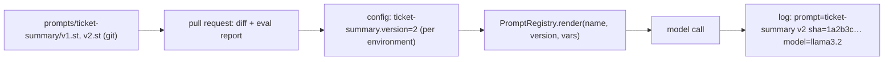

## Why it matters

In AI features, prompts change more often than code — and a one-word change can shift behaviour across thousands of requests. Without versioning and traceability you cannot answer the first question of every incident review: *what exactly did we send?*

## Concept



Principles:

1. **Prompts are files**, not string literals scattered in code.
2. **Versions are immutable.** Changing behaviour means a new version.
3. **The active version is configuration**, enabling canaries and rollback.
4. **Every call logs name, version, hash and model.**
5. **Every change ships with an eval comparison.**

## Build it from scratch

Two versions of the same prompt on the classpath:

```text
# prompts/ticket-summary/v1.st
Summarise the support ticket below for an engineer.
Ticket:
{ticket}
```

```text
# prompts/ticket-summary/v2.st
You summarise support tickets for {audience}.

Rules:
- One sentence, at most 25 words.
- Name the affected product and the observable symptom.
- If the ticket does not describe a problem, answer exactly: NO_PROBLEM

<ticket>
{ticket}
</ticket>
```

The registry renders a pinned version and returns its hash:

<!-- code: lessons/p07-prompt-context/src/main/java/dev/aieng/p07/PromptRegistry.java#render -->

The tests check that versions render differently, that the **hash identifies the template** (not the rendered text, so it is stable across requests), and that unknown versions fail fast.

## Now with the library

Spring AI reads templates directly from resources:

```java
@Value("classpath:/prompts/ticket-summary/v2.st")
Resource ticketSummary;

chatClient.prompt().user(u -> u.text(ticketSummary).param("ticket", t).param("audience", "on-call engineers"))
        .call().content();
```

Wire the version through `@ConfigurationProperties`:

```java
@ConfigurationProperties("ai.prompts")
record PromptVersions(int ticketSummary, int intranetQa) { }
```

## Production notes

- **Observability:** add prompt name, version and hash as span attributes or log fields on every call (Phase 14).
- **A/B testing:** route a percentage of traffic to the new version and compare online metrics before full rollout.
- **Prompt management platforms** exist (Langfuse, PromptLayer, provider consoles). Use one if non-developers edit prompts — but keep the same principles: versions, review, eval, traceability.

## Exercises

1. **Easy** — Add a `v3.st` that asks for the product name as a separate first line, and a test for it.
2. **Medium** — Implement `PromptVersions` as a `@ConfigurationProperties` record and a Spring `@Bean` that resolves the active version per environment.
3. **Hard** — Build a tiny eval runner (preview of Phase 12): for 10 tickets with expected keywords, render v1 and v2, call a fake (or local) model, and print a pass-rate comparison table.

## Common mistakes

- Editing a prompt version in place.
- Prompts embedded in Java string literals in many classes.
- No record of which prompt produced which output.

## Further reading

- Spring AI prompt templates: <https://docs.spring.io/spring-ai/reference/api/prompt.html>
- Langfuse prompt management: <https://langfuse.com/docs/prompts>
