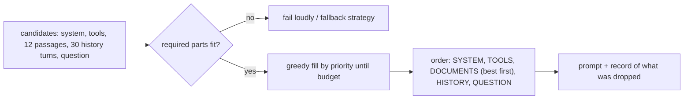

## Why it matters

As AI systems grow — RAG, memory, tools, multi-step agents — the hard question is no longer "how do I phrase this?" but "**what exactly should the model see right now?**" That is context engineering, and it determines quality, cost and latency together.

## Concept

The context window is a budget shared by:

| Part | Typical size | Changes per request? |
|---|---|---|
| System prompt | 200–1,500 tokens | No |
| Tool definitions | 100–300 tokens per tool | Rarely |
| Retrieved documents | 500–8,000 tokens | Yes |
| Conversation history | grows each turn | Yes |
| The question | 10–200 tokens | Yes |
| **Reserved for the answer** | max_tokens | — |

Strategies when content exceeds the budget:

- **Select:** better retrieval and reranking so fewer, better passages are needed (Phases 8–9).
- **Prioritise:** keep the highest-value parts; drop the rest explicitly.
- **Compress:** summarise history or long documents (costs a model call).
- **Order:** stable content first for caching; most important evidence near the start or end; question last.
- **Isolate:** in agents, give sub-tasks their own clean context instead of one ever-growing transcript.

## Build it from scratch

<!-- code: lessons/p07-prompt-context/src/main/java/dev/aieng/p07/ContextBudget.java#pack -->

The test packs a system prompt, a question, three ~100-token documents of different priority and a history snippet into a 230-token budget. It asserts that the system prompt comes first, the question last, the two best documents survive in priority order, the lowest-priority document is reported as **dropped**, and that an impossible budget throws instead of silently truncating.

Greedy packing by priority is a heuristic (the exact version is the knapsack problem). In practice priorities come from retrieval scores, recency and business rules — and greedy is good enough.

## Now with the library

- Spring AI's `TokenTextSplitter` and `JTokkitTokenCountEstimator` give real token counts for budgeting.
- `MessageWindowChatMemory` bounds history by message count; write an advisor for token-based budgets.
- The retrieval advisors in Phase 9 let you set `topK` and a similarity threshold — your first and cheapest context-control knobs.

## Production notes

- **Log the context composition** (token counts per part, dropped parts) for every call. When an answer is wrong, the first question is "was the evidence in the context?"
- **Reserve output tokens.** Budget = context window − max_tokens − safety margin.
- **Lost in the middle:** place the strongest evidence first; consider repeating the key instruction after long documents.
- **Smaller contexts are faster and cheaper.** Measure quality vs context size; the curve usually flattens early.

## Exercises

1. **Easy** — Change the test budget to 130 tokens and predict which parts survive before running it.
2. **Medium** — Replace `estimateTokens` with JTokkit (`com.knuddels:jtokkit`) and compare the estimates on English prose, Java code and German text.
3. **Hard** — Add a compression step: when history is dropped, replace it with a one-line summary produced by a (fake) model, and prove in a test that the summary fits the remaining budget.

## Common mistakes

- Treating the context window as free storage.
- Silent truncation by string length.
- Ordering that defeats prompt caching (timestamps or user ids at the top of the prompt).

## Further reading

- Liu et al., "Lost in the Middle: How Language Models Use Long Contexts", TACL 2024.
- Anthropic, "Effective context engineering for AI agents" (2025).
