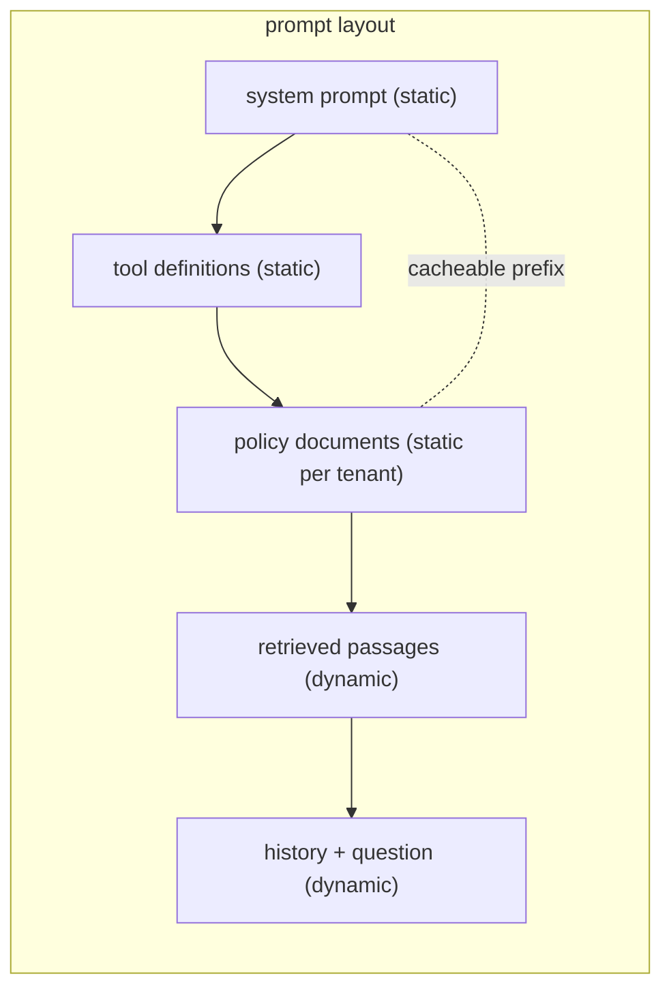

## Why it matters

Input tokens often dominate LLM bills (Phase 6, lesson 1), and many requests share large identical parts — system prompts, tool definitions, policy documents. Caching that shared work is the cheapest performance and cost win available.

## Concept

Three different caches:

| Cache | Where | Reuses | Typical saving |
|---|---|---|---|
| **Prompt (prefix) cache** | Provider / model server | KV cache of an identical prompt prefix | Large discount on cached input tokens; lower TTFT |
| **Exact response cache** | Your app (Redis, Caffeine) | Whole answer for an identical request | 100% of the call, for repeated questions |
| **Semantic response cache** | Your app + embeddings | Answer for a *similar* question | High on FAQ traffic; risk of wrong reuse |



**Layout rule:** stable → less stable → per-request. Anything dynamic placed early (timestamps, user names, request ids) destroys the prefix for everything after it.

## Build it

`ContextBudget.pack` from the previous lesson already orders `SYSTEM → TOOLS → DOCUMENTS → HISTORY → QUESTION`. An exact response cache is a few lines with Spring's cache abstraction:

```java
@Service
class FaqAnswers {
    private final ChatClient chat;
    FaqAnswers(ChatClient.Builder builder) { this.chat = builder.build(); }

    // Key on the normalised question + prompt version + model: any change must miss.
    @Cacheable(cacheNames = "faq", key = "#promptVersion + ':' + #question.strip().toLowerCase()")
    public String answer(String question, String promptVersion) {
        return chat.prompt().user(question).call().content();
    }
}
```

The course app's `SearchService` combines BM25 and embeddings; a semantic cache is the same idea applied to *questions*: embed the question, look for a cached question with cosine similarity above a strict threshold, and only reuse its answer if the permission scope matches.

## Now with the library

- **Provider prompt caching** is automatic on some APIs for long prefixes and explicit on others (cache-control markers on specific messages). Spring AI exposes provider-specific options for explicit cache control on providers that need it, and usage metadata reports cached tokens (`Usage.getCacheReadInputTokens()`).
- **Ollama** keeps the KV cache of the previous request in a session slot, so repeated prefixes are faster locally too.
- **Batch APIs** (offered by several providers) process non-urgent jobs at a discount — good for nightly re-summarisation or enrichment.

## Production notes

- **Measure cache hit rates** (cached input tokens / input tokens) per feature; alert on drops after prompt changes.
- **Scope response caches by permission and tenant.** Never serve one user's personalised or permission-filtered answer to another.
- **Invalidate on content change.** When source documents change, cached answers built from them are stale; include a content version in the key or expire aggressively.
- **Don't cache errors or refusals** by accident.

## Exercises

1. **Easy** — Audit one of your prompts: list every dynamic element and move them after the static ones.
2. **Medium** — Implement an exact response cache with Caffeine keyed on (prompt hash, model, normalised question) and a test proving the fake model is called once for two identical questions.
3. **Hard** — Implement a semantic cache with the `SemanticSearch` class from Phase 4: reuse an answer only above cosine 0.95 *and* when the cached entry's permission scope equals the caller's. Write tests for a near-duplicate that should hit and a "my vs a user's password" pair that must miss.

## Common mistakes

- Dynamic data at the top of the system prompt.
- Semantic caching with loose thresholds and no permission scoping.
- Forgetting to include the prompt version in cache keys.

## Further reading

- Anthropic, "Prompt caching" documentation; OpenAI, "Prompt caching" guide.
- Bang, "GPTCache: An Open-Source Semantic Cache for LLM Applications", 2023.
