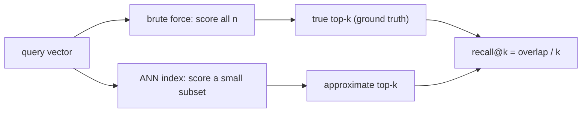

## Why it matters

RAG retrieval, semantic search, recommendations and deduplication are all **nearest-neighbour search**: given a query vector, find the $k$ most similar stored vectors. Before reaching for a vector database, know exactly what it computes and how to tell whether its approximations are acceptable.

## Concept

- **Similarity:** with L2-normalised vectors, dot product = cosine similarity (Phase 1).
- **Exact k-NN:** score all $n$ vectors, keep the best $k$. Cost $O(n \cdot d)$ per query.
- **Approximate nearest neighbour (ANN):** skip most of the vectors using an index (clusters or a graph). Much faster, occasionally misses true neighbours.
- **Recall@k:** the fraction of the true top-$k$ that the ANN index returns, averaged over queries. You **must** measure it — indexes fail silently.

Rough numbers: $10^6$ vectors × 768 dims × 4 bytes ≈ 3 GB scanned per brute-force query — tens to hundreds of milliseconds on a CPU. ANN indexes answer in about a millisecond.

## Build it from scratch

The interface shared by all indexes in this phase:

<!-- code: lessons/p08-vector-search/src/main/java/dev/aieng/p08/VectorIndex.java -->

Exact search with a size-$k$ min-heap:

<!-- code: lessons/p08-vector-search/src/main/java/dev/aieng/p08/BruteForceIndex.java#search -->

And the recall metric used throughout this phase:

<!-- code: lessons/p08-vector-search/src/main/java/dev/aieng/p08/Benchmark.java#recall -->

## Now with the library

Every vector store offers an exact mode for small collections or evaluation: pgvector without an index (sequential scan), Elasticsearch/OpenSearch `script_score` queries, Qdrant's `exact: true` search parameter. Use it to build your recall baseline.

The course app's own semantic search (`app/.../search/SemanticIndex.java`) is brute force over ~1,000 lesson sections — the right choice at that size.

## Production notes

- **Benchmark on your data and filters.** Recall depends heavily on data distribution; synthetic benchmarks are only a start.
- **Filters change everything.** A highly selective filter can make ANN graphs perform badly; some engines switch to exact search for small filtered sets.
- **Track recall over time** by periodically comparing a sample of production queries against exact search.

## Exercises

1. **Easy** — Time `BruteForceIndex.search` at 1k, 10k and 100k vectors of 384 dimensions. Is it linear?
2. **Medium** — Replace `float[]` dot products with the SIMD version from Phase 1, lesson 7 (requires `--add-modules jdk.incubator.vector`) and measure the speed-up.
3. **Hard** — Store vectors in one contiguous `float[]` (row-major) instead of a `List<float[]>` and measure the effect on cache behaviour.

## Common mistakes

- Comparing un-normalised vectors with dot product while assuming cosine.
- Trusting ANN results without measuring recall.
- Filtering results *after* ANN search (returns fewer than $k$ hits and can leak — lesson 5).

## Further reading

- ANN-Benchmarks: <https://ann-benchmarks.com/>
- Johnson, Douze & Jégou, "Billion-scale similarity search with GPUs" (FAISS), 2017.
