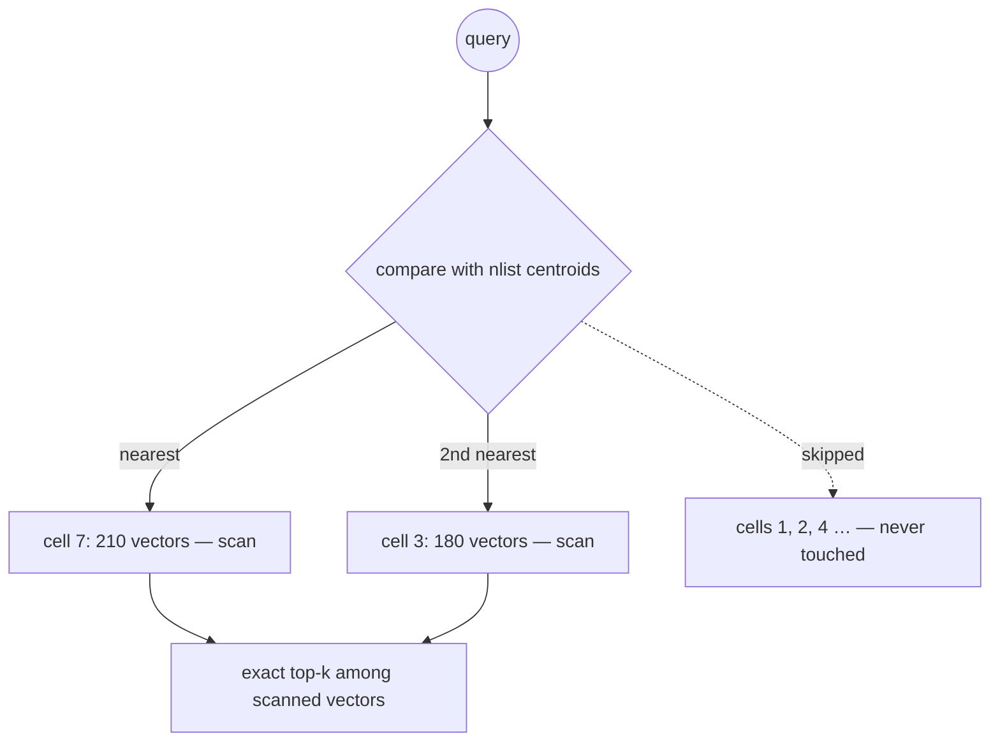

## Why it matters

IVF is the simplest serious ANN index and the basis of large-scale systems (FAISS, Milvus, pgvector's `ivfflat`). It shows the core trade-off of every approximate index: **less work for slightly worse recall**, controlled by a knob you must tune.

## Concept

1. **Train:** cluster the vectors into `nlist` cells with k-means. Each cell has a centroid.
2. **Assign:** store each vector in the list (the "inverted file") of its nearest centroid.
3. **Search:** compare the query with all centroids, pick the `nprobe` nearest cells, scan only those vectors exactly.



Work per query ≈ `nlist` centroid comparisons + `nprobe × n / nlist` vector comparisons. A common starting point is `nlist ≈ √n` and `nprobe` a few percent of `nlist`, then tune by measuring recall.

**k-means** (Lloyd's algorithm): pick initial centroids, assign every point to its nearest centroid, move each centroid to the mean of its points, repeat. On normalised vectors we re-normalise the means ("spherical k-means").

## Build it from scratch

Training:

<!-- code: lessons/p08-vector-search/src/main/java/dev/aieng/p08/IvfIndex.java#build -->

Searching only the nearest `nprobe` cells:

<!-- code: lessons/p08-vector-search/src/main/java/dev/aieng/p08/IvfIndex.java#search -->

The test `ivfTradesRecallForWorkViaNprobe` shows both ends: probing every cell gives recall exactly 1.0; probing 2 of 30 cells scans less than a third of the data while still returning most true neighbours.

## Now with the library

```sql
-- pgvector: IVF index; lists ≈ rows/1000 for up to 1M rows is the documented starting point
CREATE INDEX ON chunks USING ivfflat (embedding vector_cosine_ops) WITH (lists = 1000);
SET ivfflat.probes = 10;   -- per session/transaction: the nprobe knob
SELECT id, content FROM chunks ORDER BY embedding <=> $1 LIMIT 10;
```

Build `ivfflat` indexes **after** loading representative data — the centroids are trained from the rows present at creation time.

## Production notes

- **Rebuild after big data changes** — new content types, a new embedding model, or 10× growth.
- **Product quantisation (PQ)** compresses vectors inside cells (e.g. 768 floats → 64 bytes), enabling billions of vectors in memory at some recall cost.
- **Tune nprobe per use case:** interactive search may accept 0.95 recall; compliance retrieval may need exact search.

## Exercises

1. **Easy** — With the benchmark data, print recall@10 for nprobe = 1, 2, 4, 8, 16 and the number of vectors scanned.
2. **Medium** — Add k-means++ initialisation (choose initial centroids far apart) and compare cell balance (min/max cell sizes).
3. **Hard** — Implement incremental `add` that assigns new vectors to the existing nearest centroid instead of rebuilding, and measure how recall degrades as you add data from a shifted distribution.

## Common mistakes

- Building the index on an empty or tiny table.
- Leaving `probes`/`nprobe` at 1 and blaming the embeddings for poor results.
- Never re-training after the embedding model changes.

## Further reading

- Jégou, Douze & Schmid, "Product Quantization for Nearest Neighbor Search", IEEE TPAMI 2011.
- pgvector documentation, IVFFlat section: <https://github.com/pgvector/pgvector>
