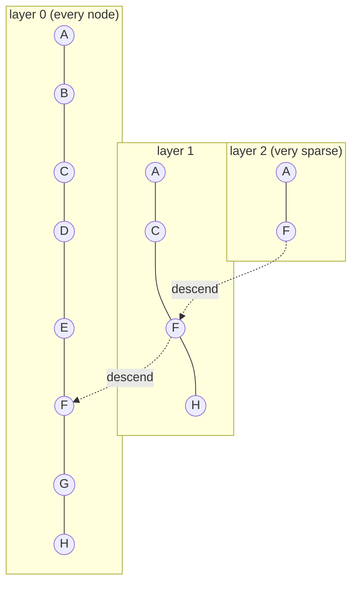

## Why it matters

HNSW is the default ANN index almost everywhere you will deploy: Elasticsearch/OpenSearch (via Lucene), pgvector, Qdrant, Weaviate, Redis, Milvus. Its three knobs — `M`, `efConstruction`, `efSearch` — appear in all of their configs.

## Concept

**Navigable small world graph:** each vector is a node linked to similar nodes. Greedy search — jump to whichever neighbour is closest to the query until no neighbour is closer — finds near neighbours quickly when the graph has both short and long links.

**Hierarchy:** each node gets a random top layer (exponentially fewer nodes per layer). Search starts at the top layer's entry point, descends greedily layer by layer, then runs a wider best-first search (candidate list of size `ef`) on layer 0.



| Parameter | Effect |
|---|---|
| `M` | Links per node (2M on layer 0). More → better recall, more memory |
| `efConstruction` | Candidate list size while inserting. More → better graph, slower build |
| `efSearch` | Candidate list size while querying. More → better recall, slower queries |

## Build it from scratch

Insertion: pick a random level, descend greedily to that level, then on each layer search for candidates and link to selected neighbours (bidirectionally, pruning over-full neighbour lists):

<!-- code: lessons/p08-vector-search/src/main/java/dev/aieng/p08/Hnsw.java#insert -->

Search: greedy descent through upper layers, then best-first search with two heaps on layer 0:

<!-- code: lessons/p08-vector-search/src/main/java/dev/aieng/p08/Hnsw.java#search -->

### The bug the test caught

The first version of this class linked each node to its **M closest** candidates. On clustered data the test `hnswReachesHighRecallAndEfSearchControlsIt` failed with recall@10 = **0.59**: links stayed inside clusters, so greedy search could not travel between them. Adding the paper's **neighbour-selection heuristic** (`selectNeighbours`: keep a candidate only if it is closer to the new node than to every neighbour already kept) restored recall above 0.95. This is precisely why you measure recall against brute force — the broken index returned plausible-looking results.

### Benchmark

`Benchmark.main` on 20,000 vectors of 64 dimensions with 200 queries (reference machine):

```text
HNSW build 9.6s (4 layers); brute/IVF insert 0.01s
BruteForceIndex  recall@10 1.000   0.485 ms/query
IvfIndex         recall@10 1.000   0.400 ms/query
Hnsw             recall@10 1.000   0.083 ms/query
HNSW efSearch=10   recall@10 0.967
HNSW efSearch=32   recall@10 1.000
```

HNSW queries are ~6× faster than brute force at only 20k vectors, and the gap grows with $n$ (HNSW is roughly logarithmic). The price is the build time — production implementations are far faster than this teaching version, but the asymmetry remains.

## Now with the library

```sql
-- pgvector
CREATE INDEX ON chunks USING hnsw (embedding vector_cosine_ops) WITH (m = 16, ef_construction = 64);
SET hnsw.ef_search = 100;
```

```json
// Elasticsearch / OpenSearch mapping (Lucene HNSW)
"embedding": { "type": "dense_vector", "dims": 768, "similarity": "cosine",
               "index_options": { "type": "hnsw", "m": 16, "ef_construction": 100 } }
```

Spring AI's `PgVectorStore`, `ElasticsearchVectorStore`, `OpenSearchVectorStore`, `QdrantVectorStore` and `RedisVectorStore` expose these as configuration properties.

## Production notes

- **Memory:** vectors + about $2M \times 4$ bytes per node for layer-0 links. For 10M × 768-dim floats: ~31 GB of vectors plus ~1.3 GB of links at $M = 16$.
- **Bulk loads:** build the index after loading (or load in parallel), not row by row in a transaction.
- **Deletes are tombstones** in most engines; schedule rebuilds/merges for high-churn data.
- **Selective filters** can hurt recall; test recall with your real filter combinations.

## Exercises

1. **Easy** — Run `Benchmark.main` with `M` = 4, 16 and 32. Record build time, query time and recall.
2. **Medium** — Replace `HashSet<Integer>` visited sets with a reusable `BitSet` or generation-stamped `int[]` and measure the speed-up.
3. **Hard** — Implement filtered search: accept a `Predicate<Integer>` and only *return* matching nodes while still *traversing* non-matching ones. Measure recall when the filter matches 50%, 10% and 1% of nodes.

## Common mistakes

- Using default `efSearch` without measuring recall.
- Assuming deletes immediately free memory.
- Building HNSW on a few thousand vectors where brute force would be simpler and exact.

## Further reading

- Malkov & Yashunin, "Efficient and robust approximate nearest neighbor search using Hierarchical Navigable Small World graphs", IEEE TPAMI 2018 (arXiv:1603.09320).
- Lucene HNSW implementation: `org.apache.lucene.util.hnsw`.
