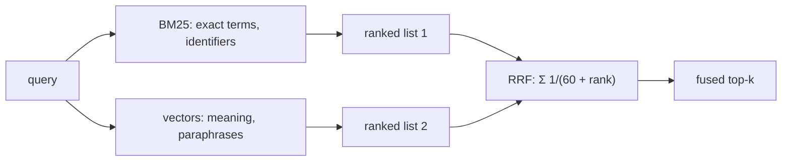

## Why it matters

Neither lexical nor semantic search wins everywhere. Hybrid retrieval — run both, fuse the rankings — is the most reliable default for RAG and enterprise search, and it is what this course's own search page and AI tutor use.

## Concept

**BM25** (the TF-IDF successor) scores a document $d$ for query $q$:

$$\text{score}(q,d) = \sum_{t \in q} \text{IDF}(t)\cdot \frac{f(t,d)\,(k_1+1)}{f(t,d) + k_1\left(1 - b + b\,\frac{|d|}{\text{avgdl}}\right)}$$

- $k_1 \approx 1.2$: term frequency saturates — the 10th occurrence adds little.
- $b \approx 0.75$: long documents are normalised so they don't win just by being long.

**Reciprocal Rank Fusion:**

$$\text{RRF}(d) = \sum_{\text{rankings } r} \frac{1}{k + \text{rank}_r(d)}, \qquad k = 60$$

A document ranked moderately well by **both** retrievers beats one ranked first by only one of them — exactly the behaviour you want when either retriever can be fooled.

## Build it from scratch

The course app's BM25 implementation — an inverted index with the formula above:

<!-- code: app/src/main/java/dev/aieng/course/search/Bm25Index.java -->

RRF in a few lines:

<!-- code: lessons/p08-vector-search/src/main/java/dev/aieng/p08/Ranking.java#rrf -->

The test `rrfRewardsDocumentsRankedHighInBothLists` fuses `[1, 2, 3, 4]` (BM25) with `[3, 5, 1, 6]` (vectors): documents 1 and 3 — high in both — come first.

The app's `SearchService.hybrid` method does the same with real lesson sections. Try it: search for `HNSW` in **Keyword**, **Semantic** and **Hybrid** modes and compare.

## Now with the library

| Engine | Hybrid support |
|---|---|
| Elasticsearch | `rrf` retriever combining `standard` (BM25) and `knn` retrievers |
| OpenSearch | `hybrid` query + search pipeline with normalisation/combination |
| PostgreSQL | `tsvector` full-text + pgvector, fused in SQL or in Java |
| Qdrant / Weaviate | Sparse + dense vectors with built-in fusion |

Spring AI's `VectorStore` API covers the vector half; for the lexical half you call the engine's own client (e.g. Spring Data Elasticsearch) and fuse in Java with the `rrf` method above.

## Production notes

- **Retrieve deep, fuse, then cut.** Take e.g. the top 50 from each retriever, fuse, keep the top 10 (or rerank first — lesson 6).
- **Apply the same filters to both retrievers** — permission, tenant, language, freshness.
- **Measure per query type.** Identifier-heavy queries may need a higher weight on BM25 (weighted RRF).

## Exercises

1. **Easy** — Search the course for an exact class name like `ToolCallingAdvisor` in all three modes. Which mode wins and why?
2. **Medium** — Implement weighted RRF (`w_r / (k + rank)`) and test that a weight of 0 removes a retriever's influence.
3. **Hard** — Build a 20-query evaluation set for this course (question → expected lesson) and compute recall@5 for keyword, semantic and hybrid modes using the app's `SearchService`.

## Common mistakes

- Linear score mixing without normalisation.
- Different filters on the two retrievers.
- Fusing only the top 5 of each list — too shallow to benefit.

## Further reading

- Cormack, Clarke & Büttcher, "Reciprocal Rank Fusion outperforms Condorcet and individual Rank Learning Methods", SIGIR 2009.
- Elasticsearch RRF documentation; OpenSearch hybrid search documentation.
