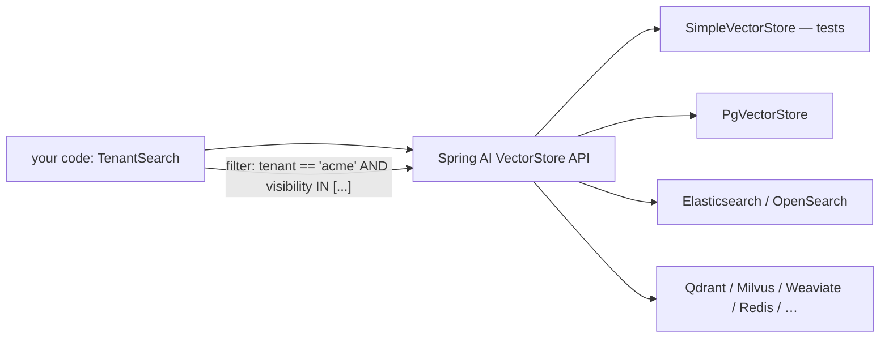

## Why it matters

You will not run your own HNSW in production — you will use a vector store. The two decisions that matter are **which store** and **how you enforce permissions**. Getting the second wrong turns a helpful assistant into a data leak.

## Concept



The API is small:

| Method | Purpose |
|---|---|
| `add(List<Document>)` | Embed (via the configured `EmbeddingModel`) and store, with metadata |
| `similaritySearch(SearchRequest)` | `query`, `topK`, `similarityThreshold`, `filterExpression` |
| `delete(List<String> ids)` / `delete(filter)` | Remove documents |

**Filter expressions** are portable: `tenant == 'acme' && visibility in ['public','internal']`, translated by each store into its native query (SQL `WHERE` on JSONB, Elasticsearch filters, Qdrant payload filters…).

## Build it

A search service whose permission filter cannot be forgotten by callers:

<!-- code: lessons/p08-vector-search/src/main/java/dev/aieng/p08/TenantSearch.java#usage -->

The test runs it on `SimpleVectorStore` with a deterministic fake embedding model, indexing documents for two tenants with two visibility levels, and asserts that a public `acme` search never returns the internal runbook or the other tenant's document — while an admin scope sees both `acme` documents.

## Choosing a store

| Store | Strengths | Watch out for |
|---|---|---|
| **pgvector** | Uses existing Postgres; SQL joins and transactions; HNSW and IVFFlat | Very large scale needs partitioning; tuning `ef_search` with filters |
| **Elasticsearch / OpenSearch** | Hybrid BM25 + kNN in one engine; already behind Liferay search | Memory for HNSW graphs; licence/version differences |
| **Qdrant** | Fast filtered search, quantisation, simple ops | Another system to run |
| **Milvus** | Billion scale, GPU and disk indexes | Operational complexity |
| **Redis** | Low latency, already common as cache | Memory cost |
| **Weaviate, Pinecone, Azure AI Search, …** | Managed options, built-in hybrid | Vendor lock-in, data residency |

Running pgvector locally for the exercises (this repository's `docker-compose.yml` includes it):

```yaml
# application.yml with spring-ai-starter-vector-store-pgvector
spring:
  datasource.url: jdbc:postgresql://localhost:5432/course
  ai.vectorstore.pgvector:
    index-type: HNSW
    distance-type: COSINE_DISTANCE
    dimensions: 768
    initialize-schema: true
```

## Production notes

- **Store permissions as metadata at ingestion** (site/group ids, roles, tenant, visibility) and update them when permissions change — or re-check permissions against the source system for the final top-k.
- **Document ids should be deterministic** (source id + chunk number) so re-ingestion upserts instead of duplicating.
- **Keep the source of truth elsewhere.** The vector store is an index; you must be able to rebuild it from source content.

## Exercises

1. **Easy** — Add a `language` metadata field and filter by it in `TenantSearch`.
2. **Medium** — Start pgvector with `docker compose up postgres`, switch `TenantSearch` to `PgVectorStore` with an Ollama embedding model, and rerun the same scenario as an integration test.
3. **Hard** — Implement "permission drift" handling: when a document's visibility changes in the source system, update its metadata without re-embedding (delete + add with the stored vector, or a store-specific metadata update), and test it.

## Common mistakes

- Post-filtering by permission in Java.
- Random UUIDs for chunks, causing duplicates on every re-ingest.
- Choosing a new database before checking whether the existing one is enough.

## Further reading

- Spring AI vector databases: <https://docs.spring.io/spring-ai/reference/api/vectordbs.html>
- pgvector: <https://github.com/pgvector/pgvector>
