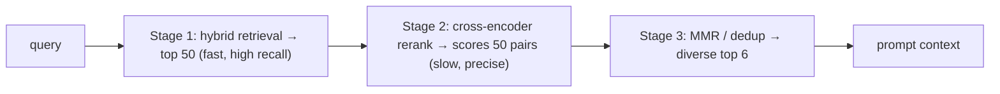

## Why it matters

First-stage retrieval optimises for **recall** cheaply over millions of chunks. What reaches the prompt should be optimised for **precision and diversity**. A reranker and a diversity step are the highest-leverage additions to most RAG pipelines.

## Concept

**Bi-encoder vs cross-encoder:**

| | Bi-encoder (embedding model) | Cross-encoder (reranker) |
|---|---|---|
| Input | Query and document **separately** | Query **and** document together |
| Output | Two vectors, compared by cosine | One relevance score |
| Precomputable | Yes — index documents once | No — runs per (query, document) pair |
| Use | Retrieval over the whole corpus | Reordering the top 20–100 |

**Maximal Marginal Relevance:**

$$\text{MMR} = \arg\max_{d \in R \setminus S} \Big[\lambda \cdot \text{sim}(q, d) - (1-\lambda) \max_{s \in S} \text{sim}(d, s)\Big]$$

Pick documents one by one, rewarding relevance and penalising similarity to what is already selected.

## Build it from scratch

<!-- code: lessons/p08-vector-search/src/main/java/dev/aieng/p08/Ranking.java#mmr -->

The test `mmrAvoidsNearDuplicates` uses three vectors where two are nearly identical: pure relevance ($\lambda = 1$) picks the duplicate pair; $\lambda = 0.5$ picks one of them plus the different document.

## Now with the library

- **Hosted rerankers:** Cohere Rerank, Voyage, Jina and others expose `rerank(query, documents)` APIs.
- **Local rerankers:** BGE-reranker or ms-marco MiniLM cross-encoders exported to ONNX, run with ONNX Runtime (Phase 3, lesson 7).
- **Spring AI:** the modular RAG API (Phase 9) has a `DocumentPostProcessor` stage where rerankers and MMR plug in.
- **Engines:** Elasticsearch and OpenSearch support rerank steps in their retriever/search pipelines; some vector stores implement MMR natively.

## Production notes

- **Rerankers add latency** (tens to hundreds of ms for 50 pairs). Cap candidates and set timeouts with a fallback to the un-reranked order.
- **Rerank scores are better calibrated than cosine** — a threshold on them is a good "no relevant document found" signal for refusing to answer.
- **Deduplicate at ingestion too** — the same text under many URLs is common in portals.

## Exercises

1. **Easy** — Run `mmr` with λ = 0, 0.3, 0.7 and 1.0 on the test vectors and explain each result.
2. **Medium** — Add a near-duplicate filter: drop a candidate if its cosine similarity to any already-selected chunk exceeds 0.95. Compare with MMR.
3. **Hard** — Export a cross-encoder to ONNX, wrap it behind a `Reranker` interface in Java, and measure nDCG@5 on the course-search eval set you built in lesson 4 with and without reranking.

## Common mistakes

- Reranking only the top 5 (too few to change anything).
- No timeout or fallback on the reranker call.
- Using MMR with λ so low that relevance suffers.

## Further reading

- Nogueira & Cho, "Passage Re-ranking with BERT", 2019.
- Carbonell & Goldstein, "The Use of MMR, Diversity-Based Reranking for Reordering Documents and Producing Summaries", SIGIR 1998.
