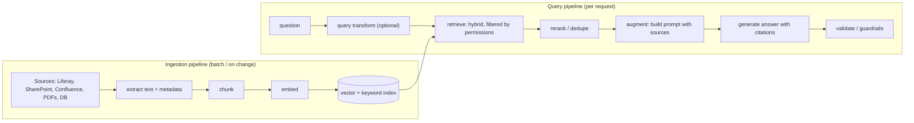

## Why it matters

Models know what was in their training data, up to a cut-off, and nothing about your intranet, tickets or contracts. RAG puts the relevant facts into the prompt at question time — with sources — and is the backbone of most enterprise AI assistants.

## Concept

### Where failures live

| Stage | Typical failure | Symptom |
|---|---|---|
| Extraction | Tables and PDFs mangled, boilerplate kept | Garbage chunks |
| Chunking | Facts split from their context | Right document, wrong answer |
| Embedding | Model weak on domain jargon | Relevant chunks not retrieved |
| Retrieval | No hybrid, bad filters, k too small | "I don't know" when the answer exists |
| Augmentation | Too much context, wrong order | Model ignores or confuses evidence |
| Generation | Model adds knowledge not in sources | Hallucinated details, wrong citations |

Evaluate each stage separately (Phase 12): **retrieval recall** and **answer faithfulness** are different problems.

### RAG vs alternatives

| Need | Best tool |
|---|---|
| Large, changing, permissioned knowledge with citations | RAG |
| One bounded document per request | Long context |
| Consistent format, tone, domain behaviour | Fine-tuning (Phase 13) |
| Live data (order status, stock) | Tool calling (Phase 6) |

## Build it

This phase builds RAG three times:

1. **From scratch** (lesson 3): plain functions for embed and generate.
2. **With Spring AI's modular RAG** (lesson 4): `RetrievalAugmentationAdvisor`.
3. **Over Liferay DXP** (lesson 6): ingestion from the Headless Delivery API with per-user permission checks.

And you have already used one: the course **Tutor** is a RAG system over these lessons (`app/.../ai/AiService.java`): hybrid retrieval → numbered context → answer with citation links → sources shown even when the model is offline.

## Production notes

- **Ingestion is a data pipeline,** with all that implies: change detection, retries, idempotency, monitoring, re-processing.
- **Permissions are part of retrieval,** not an afterthought (lessons 4 and 6).
- **Show sources.** Citations let users verify answers and give you a feedback signal when they are wrong.
- **Define "I don't know" behaviour** and measure it — refusing correctly is part of quality.

## Exercises

1. **Easy** — Ask the course Tutor three questions and check whether the cited sections actually support each answer.
2. **Medium** — For a knowledge source you know (e.g. a Liferay site), list the metadata you would store per chunk and why.
3. **Hard** — Write a one-page architecture decision record choosing between RAG and fine-tuning for a "policy assistant" over 2,000 HR documents that change monthly and differ by country.

## Common mistakes

- Debugging prompts when retrieval is the problem.
- One giant chunk per document.
- No permission model in the index.

## Further reading

- Lewis et al., "Retrieval-Augmented Generation for Knowledge-Intensive NLP Tasks", NeurIPS 2020.
- Gao et al., "Retrieval-Augmented Generation for Large Language Models: A Survey", 2023.
