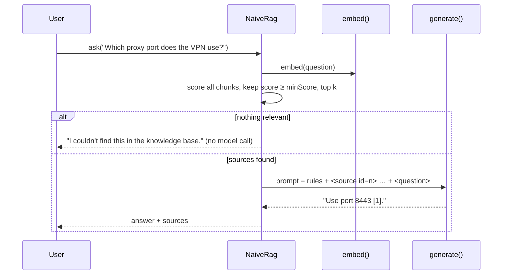

## Why it matters

Frameworks hide the essentials of RAG behind advisors and builders. Writing it once in plain Java shows that the core is small — and that the important decisions (relevance gate, prompt shape, citations, refusal) are yours, not the framework's.

## Concept



## Build it from scratch

Ingestion reuses the heading-aware chunker with contextual headers:

<!-- code: lessons/p09-rag/src/main/java/dev/aieng/p09/NaiveRag.java#ingest -->

Question answering — retrieve, gate, augment, generate:

<!-- code: lessons/p09-rag/src/main/java/dev/aieng/p09/NaiveRag.java#ask -->

The test `naiveRagGroundsAnswersAndRefusesWithoutCallingTheModel` uses a keyword fake embedder and a fake generator. It asserts that the proxy question is answered from the chunk containing `8443` (ranked first), and that an unrelated question (`canteen menu`) is refused **without** a model call — the counter stays at 1.

Note the prompt shape:

```text
Answer the question using ONLY the sources below. Cite sources as [n].
If the sources do not contain the answer, reply exactly: I couldn't find this in the knowledge base.

<source id="1">
IT Handbook > VPN > Windows > Proxy
Set the proxy port to 8443.
</source>
...
<question>
Which proxy port does the VPN use on Windows?
</question>
```

Rules first (stable, cacheable), evidence next, question last — Phase 7's layout.

## Now with the library

Swap the functions for real models in two lines:

```java
NaiveRag rag = new NaiveRag(
        text -> embeddingModel.embed(text),                       // Spring AI EmbeddingModel
        prompt -> ChatClient.create(chatModel).prompt().user(prompt).call().content(),
        5, 0.55);
```

The next lesson replaces the whole class with Spring AI's modular RAG components.

## Production notes

- **Return sources to the UI**, with links, even when the model refuses — users can still read them (the course Tutor does this when Ollama is offline).
- **Validate citations:** check that every `[n]` refers to a provided source; strip or flag answers citing nothing.
- **Log the retrieved chunk ids and scores** with each answer for debugging and evaluation.

## Exercises

1. **Easy** — Lower `minScore` to 0 in the test. What does the generator receive for the canteen question?
2. **Medium** — Add citation validation: after generation, parse `[n]` markers and mark the answer `ungrounded` if any number is out of range or no citation appears.
3. **Hard** — Replace brute-force scoring with the `Hnsw` index from Phase 8 and add BM25 + RRF hybrid retrieval. Measure the effect on a 30-question eval set built from a real document.

## Common mistakes

- Always calling the model, even with zero relevant evidence.
- No citation format, so answers cannot be checked.
- Putting the question before the sources in long prompts.

## Further reading

- OpenAI cookbook and Anthropic docs on "grounded" answering and citations.
- Phase 12 of this course for measuring faithfulness.
