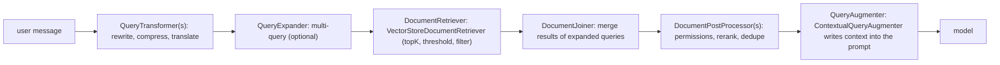

## Why it matters

Spring AI turns each RAG stage into a replaceable component. You can start with a few lines and later swap in query rewriting, multi-query expansion, rerankers or permission filters without rewriting the pipeline.

## Concept



All of these are bundled in one `RetrievalAugmentationAdvisor`, added to a `ChatClient` like any other advisor.

## Build it

<!-- code: lessons/p09-rag/src/main/java/dev/aieng/p09/SpringRag.java#advisor -->

The tests run it against `SimpleVectorStore`, a keyword fake embedding model and a capturing fake chat model:

- `springRagAdvisorInjectsOnlyPermittedSameSiteContext` indexes the VPN guide for `site-a` and a conflicting document (`port 9999`) for `site-b`. The prompt sent to the model contains `8443`, **not** `9999` (filter expression), and not the Mac chunk (removed by a post-processor).
- `springRagWithNoRelevantContextTellsTheModelNotToAnswer` asks about the canteen: no document passes the threshold, so the augmenter replaces the prompt with an instruction to decline.

## Making filters per-request

The filter above is fixed per `SpringRag` instance. In a web application, compute it from the current user on every call:

```java
VectorStoreDocumentRetriever.builder()
        .vectorStore(store)
        .filterExpression(() -> {
            var user = SecurityContextHolder.getContext().getAuthentication();
            var f = new FilterExpressionBuilder();
            return f.and(f.eq("tenant", tenantOf(user)), f.in("group", groupsOf(user).toArray())).build();
        })
        .build();
```

(The `Supplier` variant runs at query time. If retrieval runs on another thread — the advisor can use a `TaskExecutor` — make sure the security context propagates, or pass the user explicitly through the advisor context.)

## Now with more components

```java
RetrievalAugmentationAdvisor.builder()
        .queryTransformers(RewriteQueryTransformer.builder().chatClientBuilder(cheapClientBuilder).build())
        .queryExpander(MultiQueryExpander.builder().chatClientBuilder(cheapClientBuilder).numberOfQueries(3).build())
        .documentRetriever(retriever)
        .documentPostProcessors(permissionFilter, reranker)
        .queryAugmenter(ContextualQueryAugmenter.builder().allowEmptyContext(false).build())
        .build();
```

Use a **cheaper model** for query transformation and expansion; they are simple tasks.

## Production notes

- **Return the retrieved documents with the answer.** `ChatClientResponse.context()` carries the retrieved documents (key `RetrievalAugmentationAdvisor.DOCUMENT_CONTEXT`) so you can show sources and log ids.
- **Order post-processors deliberately:** permissions first (never rerank what the user cannot see), then rerank, then dedupe/trim.
- **Watch latency:** every transformer/expander adds a model call before retrieval.

## Exercises

1. **Easy** — Raise `similarityThreshold` to 0.9 in `SpringRag` and observe the effect on the first test.
2. **Medium** — Implement a `DocumentPostProcessor` that keeps at most two chunks per `sourceId` (diversity across documents) and test it.
3. **Hard** — Read the retrieved documents from `chatClientResponse().context()` and return an `AnswerWithSources` record from `SpringRag.ask`, including titles and URLs from metadata.

## Common mistakes

- Static filters in multi-user applications.
- Reranking before permission filtering.
- Using the expensive answer model for query rewriting.

## Further reading

- Spring AI Retrieval Augmented Generation: <https://docs.spring.io/spring-ai/reference/api/retrieval-augmented-generation.html>
