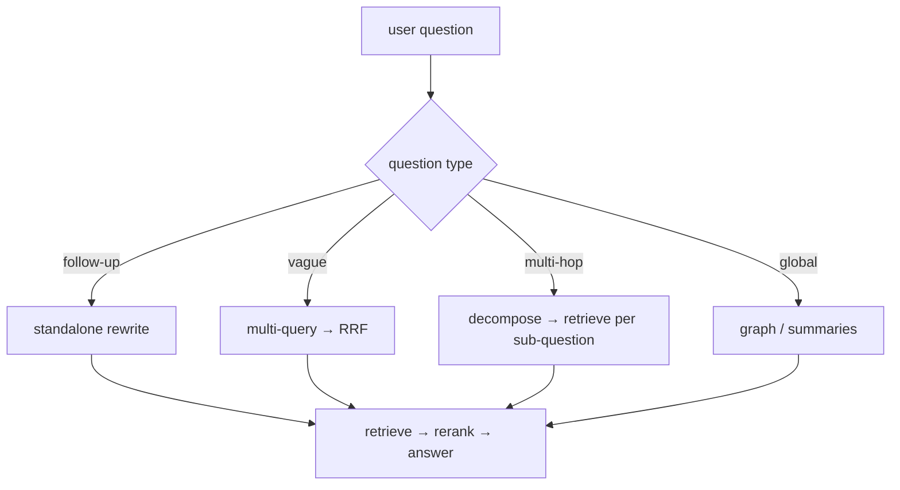

## Why it matters

Basic RAG handles "what is X?" well. Real users ask follow-ups, vague questions, comparisons and corpus-wide questions. Each advanced technique targets one failure; add them when your evaluation shows that failure, not by default.

## Concept

| Failure | Technique | Extra cost |
|---|---|---|
| Follow-up lacks context ("and on Mac?") | **Standalone rewrite** with conversation | 1 cheap LLM call |
| Vague or differently worded question | **Multi-query** expansion + RRF fusion | 1 call + N retrievals |
| Questions phrased unlike documents | **HyDE**: embed a hypothetical answer | 1 call |
| Chunks lack context | **Contextual retrieval**: headers or LLM-written chunk context at ingestion | Ingestion-time calls |
| Chunk too small to answer | **Parent-document** retrieval | Storage |
| Multi-hop / comparison | **Query decomposition** or **agentic RAG** | Several calls |
| Corpus-wide / relationship questions | **GraphRAG**, hierarchical summaries | Heavy ingestion |

**Agentic RAG** gives the model a `search(query)` tool (Phase 6) and lets it decide when and what to search, possibly several times. Most flexible, least predictable — needs step limits and good evals (Phase 10).

**GraphRAG** extracts entities and relationships into a graph at ingestion (LLM-assisted), clusters it into communities and summarises them. Queries use the graph for multi-hop paths and the summaries for global questions. Powerful, but ingestion is expensive.

## Build it from scratch

<!-- code: lessons/p09-rag/src/main/java/dev/aieng/p09/QueryTransforms.java#transforms -->

The test `multiQueryKeepsOriginalAndCleansNumbering` checks two details that matter in practice: the **original question is always kept** (expansion must never lose it), and list numbering or bullets the model adds are stripped.

## Now with the library

Spring AI ships these as modular components:

| Technique | Spring AI component |
|---|---|
| Standalone rewrite / compression | `CompressionQueryTransformer` (uses history), `RewriteQueryTransformer` |
| Translation to the corpus language | `TranslationQueryTransformer` |
| Multi-query | `MultiQueryExpander` + `ConcatenationDocumentJoiner` |
| Agentic RAG | A `@Tool` that calls your retriever, plus tool calling |

For graphs, Neo4j's `Neo4jVectorStore` (Spring AI) combines vector search with Cypher traversal; Microsoft's GraphRAG and similar projects show the ingestion pattern.

## Production notes

- **Measure per question category.** Advanced techniques often help one category and hurt another.
- **Latency budget:** each pre-retrieval call adds hundreds of milliseconds; run expansions in parallel.
- **Cache transformations** for repeated questions.
- **Agentic loops need limits** on steps, tokens and time.

## Exercises

1. **Easy** — Write five follow-up questions for a VPN conversation and the standalone rewrites you would expect.
2. **Medium** — Combine `multiQuery` with RRF from Phase 8: retrieve for each query with `NaiveRag`-style scoring, fuse, and compare recall@5 against the single query on an eval set.
3. **Hard** — Implement agentic RAG with Spring AI: a `@Tool search(String query)` backed by a `VectorStore`, a system prompt allowing up to three searches, and a fake model scripted to search twice before answering. Assert both searches happened and the final prompt contains both results.

## Common mistakes

- Turning on every technique at once.
- Losing the original question in expansion.
- GraphRAG for a corpus that only receives single-fact questions.

## Further reading

- Gao et al., "Precise Zero-Shot Dense Retrieval without Relevance Labels" (HyDE), 2022.
- Edge et al., "From Local to Global: A Graph RAG Approach to Query-Focused Summarization" (Microsoft), 2024.
- Spring AI modular RAG documentation.
