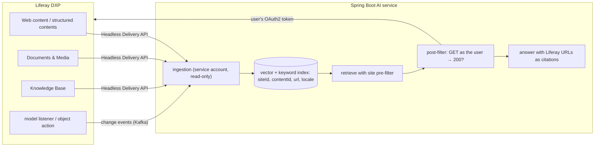

## Why it matters

Liferay DXP portals hold exactly the content enterprise assistants need — policies, procedures, product documentation, knowledge bases — under a detailed permission model. A RAG system that ignores those permissions is a data-leak machine. This lesson builds ingestion and permission-aware retrieval against Liferay's real API shapes.

## Concept



**Two-layer permission enforcement:**

1. **Pre-filter (coarse, fast):** restrict retrieval to sites/groups the user belongs to, using metadata stored at ingestion.
2. **Post-filter (exact):** for the final top candidates, ask Liferay — with the user's token — whether the user can read each source item. Liferay evaluates roles, permissions and workflow status; 403/404 means drop it.

## Build it

Ingestion pages through `/o/headless-delivery/v1.0/sites/{siteId}/structured-contents`, strips HTML from content fields, and produces chunked Spring AI `Document`s with Liferay metadata:

<!-- code: lessons/p09-rag/src/main/java/dev/aieng/p09/LiferayContent.java#ingest -->

The permission check is a `DocumentPostProcessor`, so it plugs straight into the `RetrievalAugmentationAdvisor` from lesson 4:

<!-- code: lessons/p09-rag/src/main/java/dev/aieng/p09/LiferayContent.java#permissions -->

The test uses Spring's `MockRestServiceServer` to simulate Liferay: two pages of structured contents (a VPN article and a confidential HR article), then a user who gets `200` for the first and `403` for the second. Only the VPN article survives the filter. No Liferay instance is needed to run it.

## Wiring it into a Spring Boot service

```java
// Spring Security's OAuth2 client support adds the service account's client-credentials token to each call
@Bean
RestClient liferayServiceClient(RestClient.Builder builder, OAuth2AuthorizedClientManager clients,
                                LiferayProperties props) {
    var oauth = new OAuth2ClientHttpRequestInterceptor(clients);
    oauth.setClientRegistrationIdResolver(request -> "liferay-ingestion");   // registration in application.yml
    return builder.baseUrl(props.url()).requestInterceptor(oauth).build();
}

// Per request: a RestClient carrying the end user's bearer token (from SSO / Liferay OAuth2)
DocumentPostProcessor permissions = LiferayContent.permissionFilter(
        restClientBuilder.baseUrl(props.url()).defaultHeader("Authorization", "Bearer " + userToken).build());
```

Front-end options on the Liferay side: a **React client extension** or a **fragment** that calls the AI service, or a Liferay **Object** action that triggers AI enrichment on save.

## Keeping the index fresh

| Approach | How | Notes |
|---|---|---|
| Event-driven | Model listener / object action → Kafka → ingestion consumer | Near-real-time; needs a Liferay module or client extension |
| Incremental poll | `filter=dateModified gt <last run>` on Headless Delivery | Simple; minutes of lag |
| Reconciliation | Nightly full id comparison | Catches missed events and deletions |

Unpublished, expired or deleted content must be **removed** from the index — use the deterministic chunk ids from lesson 2.

## Production notes

- **Least privilege:** the ingestion account reads only the sites in scope; it never writes.
- **Locales:** store `locale` metadata and retrieve in the user's language (Liferay content is often multilingual).
- **Cite Liferay URLs** so users land on the authoritative page, with its own permission check.
- **Red-team cross-site leakage** with users from different sites before go-live.
- **Performance:** batch the post-filter checks (e.g. one search call restricted to candidate ids) and cache per request.

## Exercises

1. **Easy** — Extend `fetchSite` to also store `taxonomyCategoryBriefs` names as metadata for filtering.
2. **Medium** — Add ingestion of Knowledge Base articles (`/o/headless-delivery/v1.0/sites/{siteId}/knowledge-base-articles`) with a mocked test.
3. **Hard** — Replace the per-document permission check with a single batched call: query Liferay's search API as the user, restricted to the candidate content ids, and keep only ids it returns. Compare latency in a test with 20 candidates.

## Common mistakes

- Indexing with an admin account and filtering nothing.
- Leaving unpublished or expired content in the index.
- Caching answers across users with different permissions.

## Further reading

- Liferay Headless Delivery API: <https://learn.liferay.com/w/dxp/headless-delivery>
- Liferay OAuth 2.0: <https://learn.liferay.com/w/dxp/security-and-administration/security/oauth-2>
- Liferay client extensions: <https://learn.liferay.com/w/dxp/liferay-development/customizing-liferays-look-and-feel/client-extensions>
