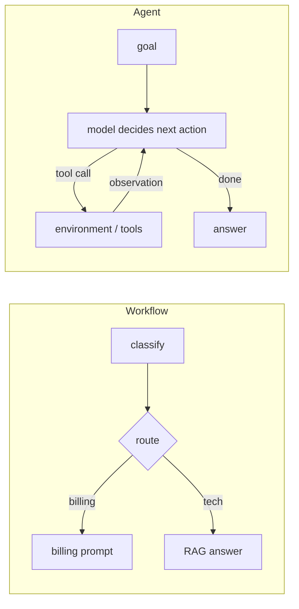

## Why it matters

"Agent" is the most over-used word in AI. Precise vocabulary leads to better architectures: most production value comes from **workflows** with a little autonomy, not from fully autonomous agents.

## Concept

**Augmented LLM:** a model with retrieval, tools and memory (everything from Phases 6–9).

**Workflow:** LLM calls orchestrated by **your code** along predefined paths.

**Agent:** the LLM **directs its own process** — it decides which tool to use next and when it is done — running in a loop with feedback from the environment.

### The decision ladder

| Rung | Use when | Example |
|---|---|---|
| 1. Single call (+ retrieval, structured output) | One well-defined transformation | Summarise a ticket |
| 2. Workflow (chain, route, parallel) | Steps are known in advance | Classify → route → draft reply |
| 3. Single agent with narrow tools | Steps depend on what is found | Investigate why an order is stuck |
| 4. Multi-agent | Clearly separable expertise or context isolation needed | Research + writing + review |

Climb only when the evaluation shows the lower rung is insufficient.

### Why caution

- **Compounding errors:** with 95% reliability per step, a 10-step run succeeds about 60% of the time.
- **Cost and latency** grow with every step (each re-sends the growing transcript).
- **Security:** an agent with tools is an attack surface for prompt injection (Phase 15).

## Build it

The rest of this phase builds every rung: a ReAct agent loop from scratch (lesson 2), a safe tool registry (lesson 3), memory (lesson 4), the five workflow patterns (lesson 5) and the controls that make agents safe (lesson 6) — then maps them onto Spring AI (lesson 7).

## Now with the library

You have already built rung 3 implicitly: Spring AI's tool-calling loop in Phase 6 *is* an agent loop — the model decided whether to call `orderStatus` and when to answer. What frameworks add is configuration of that loop: limits, memory, approval hooks and observability.

## Production notes

- **Start with workflows** for anything customer-facing or write-capable.
- **Measure task success end to end**, not per step only.
- **Make autonomy a dial,** not a switch: read-only first, then writes with approval, then limited unattended writes.

## Exercises

1. **Easy** — Classify five AI features you know as rung 1, 2, 3 or 4.
2. **Medium** — For one rung-3 idea, list each tool, whether it reads or writes, and what could go wrong if the model called it with wrong arguments.
3. **Hard** — Estimate success probability, cost and latency for a 6-step agent (per-step reliability 97%, 2,000 input tokens growing by 500 per step, 200 output tokens per step) using your Phase 6 cost model.

## Common mistakes

- Building an agent where a workflow would do.
- Measuring only the happy path.
- Giving an early prototype write access to production systems.

## Further reading

- Anthropic, "Building effective agents" (December 2024).
- Yao et al., "ReAct: Synergizing Reasoning and Acting in Language Models", ICLR 2023.
